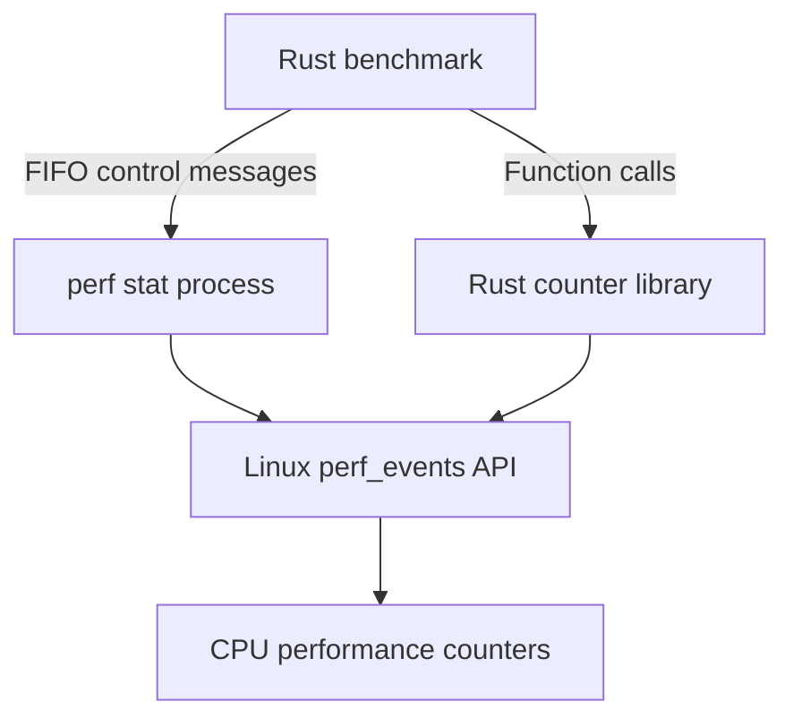

# External research report 144: the researcher on an in-process Rust counter backend (perf_event_open via perf-event2) instead of perf stat's control FIFO (verbatim)

A research input, not a finding of this repository.

- **Relayed:** by the maintainer, 2026-11-02.
- **Source:** the new independent researcher session (as in reports 138 and 140); the maintainer's question is kept in place.
- **In reply to:** the maintainer's question whether a library could replace the perf CLI.

**Evidence cutoff:** 2 November 2026. Documentation review only: no integration audited or implemented.

It is kept exactly as received (rendered text, cards flattened, tracking parameters
included).

## The message, as received

`````text
I also asked about this idea from the researcher:

> do we really have to use a CLI tool? that seems quite odd to me, usually there are libs... and in this day and age surely a linux cli tool will be dated... is it not possible (or even a done thing) to make this a rust library or something? I have to admit i know very little about how this works, so i may be well off..

Glad it helped. **Yes: we can use a Rust library for this, and libraries already exist. For a lasting benchmark harness that measures specific regions of Rust code, I would seriously consider that approach.**

The part I would correct is the assumption that a Linux CLI must be dated. `perf` is actively developed alongside the kernel. The awkwardness we encountered comes from how our benchmark communicates with it.

## What is actually doing the counting?

There are three layers:

1. **The CPU contains hardware performance counters.** These count selected events, such as retired instructions or particular cache misses.
2. **Linux manages access to those counters.** It handles permissions, associates measurements with threads or CPUs, and schedules the available counter resources.
3. **A program asks Linux to configure and read them.** That program can be the `perf` executable, or our Rust benchmark using a library.

Linux exposes this through an API called `perf_event_open`. It returns file descriptors representing events; programs can enable, disable and read them. A Rust program can use that API directly through a wrapper. [Linux manual page](https://man7.org/linux/man-pages/man2/perf_event_open.2.html?utm_source=chatgpt.com)

For our benchmark, the two possible arrangements look like this:



Those are **alternative routes to the same counters**. Choosing a Rust library would replace the external control machinery.

## Rust libraries already provide the interface you are imagining

Two relevant crates are **[`perf-event`](https://docs.rs/perf-event/latest/perf_event/)** and **[`perf-event2`](https://docs.rs/perf-event2/latest/perf_event/)**. Their documented interfaces include groups of counters that can be enabled, disabled and read together. Linux also provides a C library, **`libperf`**, for accessing its performance-event subsystem. [Rust](https://docs.rs/perf-event/latest/perf_event/?utm_source=chatgpt.com)

Once the counter group has been configured, the measurement code can have this shape:

```rust
group.enable()?;

run_the_walks();

group.disable()?;
let counts = group.read()?;
```

Those group methods exist in the Rust library; `run_the_walks()` is our workload in this illustration. The control calls would surround the entire batch of walks. Setup and output validation could remain outside that region. [Rust](https://docs.rs/perf-event2/0.7.4/perf_event/struct.Group.html?utm_source=chatgpt.com)

The library can also return the information needed to judge whether the counts are usable:

- The event counts.
- How long the group was enabled.
- How long the group actually ran on the counters.

For example, `perf-event2` exposes `time_enabled()` and `time_running()` on its group results. We could inspect those values directly and produce our own structured diagnostic record. [Rust](https://docs.rs/perf-event2/0.7.4/perf_event/struct.GroupData.html?utm_source=chatgpt.com)

**So your expectation of “surely there should be a library” is correct. There is no fundamental requirement to launch `perf stat`.**

## Why use the CLI in the first place?

`perf` packages a substantial amount of useful functionality. Its command interface accepts named events, resolves them into counter configurations, supports event groups and exposes descriptions and diagnostic information. Its documentation even provides an option to show how named events are resolved internally. [GitHub](https://github.com/torvalds/linux/blob/master/tools/perf/Documentation/perf-list.txt?utm_source=chatgpt.com)

That makes it convenient when you want to measure an existing executable. You can change the requested events without adding a counter library to the application.

And it is very much maintained: Linux merged a substantial batch of perf-tool updates on **30 October 2026**, including event handling, tests and profiling improvements. A command-line interface says little about how current the implementation is. [GitHub](https://github.com/torvalds/linux/commit/dd384658c738d15783a786d3af2851e02490f171?utm_source=chatgpt.com)

For an initial diagnostic, using it was a reasonable choice.

The complication arose when our requirements became more specific:

> Measure exactly the walker’s selected execution window, while excluding construction, warm-up, validation and output hashing.

The benchmark knows when that window begins and ends. An external counter controller needs the benchmark to communicate those boundaries. We chose perf’s FIFO interface, which brought in endpoint management, acknowledgments, process launching and output parsing.

**That particular requirement makes an in-process library attractive.** The code that knows the measurement boundary can also control the counters.

## What a library would simplify in our case

My engineering assessment is that it could remove several of the mechanisms that just failed:

| Current mechanism | With counters controlled inside Rust |
|---|---|
| Passing FIFO paths through the launcher | Counter handles are created and held in the benchmark |
| Sending `enable` and `disable` messages | Ordinary library calls |
| Waiting for ACKs and handling their framing | No FIFO acknowledgment protocol |
| Parsing perf’s CSV output | Structured counter results |
| Interpreting a printed `100.00%` beside an invalid count | Check the underlying enabled and running times directly |

That is a meaningful reduction in moving parts.

It would also make it easier to express a strict sequence: successfully open the required group, enable it, run the workload, disable it, read it, then validate it. Any failed operation can return an error through the benchmark’s normal Rust error handling.

It would **still need validity checks**. A library can return zero running time, an error, or a group that could not be scheduled. Typed values make those cases easier to handle deliberately; they do not make them disappear.

The four-worker barrier and result-vector allocation issue would also remain our responsibility. Those concern the workload and its coordination.

## The main migration cost is preserving exactly what we measure

This is the reason I would review a switch carefully.

### The specialized Intel events need explicit definitions

Basic events such as cycles and retired instructions are straightforward. Our experiment also requests events such as:

```text
uops_issued.any
l1d_pend_miss.pending
cycle_activity.stalls_l1d_miss
```

A low-level library does not necessarily accept the same strings as the perf CLI. It may expect the numeric configuration that selects the event on that processor.

`perf-event2` provides a `Raw` event type with `config`, `config1` and `config2` fields, so it can represent such events. Its documentation explicitly warns that raw configurations depend on the CPU. [Rust](https://docs.rs/perf-event2/0.7.4/perf_event/events/struct.Raw.html?utm_source=chatgpt.com)

For our fixed i9, a small, reviewed event table could be practical. We would need to establish that each entry selects exactly the same event and modifiers as the registered perf configuration.

That is manageable work, but simply replacing a string with something named “cache misses” would not preserve the experiment.

### Library defaults can change the measurement

Here is a concrete example: the `perf-event` crate defaults to excluding kernel execution. It provides an option to include it. Thread inheritance also has explicit defaults. [Rust](https://docs.rs/perf-event/0.4.9/perf_event/struct.Builder.html?utm_source=chatgpt.com)

A migration therefore needs to preserve the intended:

- Event configurations and group membership.
- Group leader.
- Thread and CPU scope.
- User-space and kernel-space counting policy.
- Measurement boundaries.

Otherwise, two implementations can produce different numbers while both are functioning correctly.

There are subtler API details too. Linux’s counter-reset operation clears the event counts but **does not reset the accumulated enabled/running times**. A harness that reuses counters for multiple windows needs to account for that correctly. [Linux manual page](https://man7.org/linux/man-pages/man2/perf_event_open.2.html?utm_source=chatgpt.com)

These are reasons to test the replacement carefully. They do not make a library approach unreasonable.

### Permissions and hardware limits remain

A Rust library goes through the same kernel access checks as perf. It does not bypass your machine’s counter-access policy. Linux documents these permissions for both direct API use and the perf tool. [The Linux Kernel documentation](https://docs.kernel.org/admin-guide/perf-security.html?utm_source=chatgpt.com)

Likewise, there are still only so many physical counters, and some events have restrictions on which counters can measure them. A library cannot make an oversized or incompatible group fit. [Rust](https://docs.rs/perf-event2/0.7.4/perf_event/struct.Group.html?utm_source=chatgpt.com)

The interpretation questions also remain: changing the reader would not change what an issued-µop event or a demand-miss event means.

## Would the library be more accurate or faster?

**It could make the measurement boundary simpler and remove communication overhead. That is a plausible engineering benefit, not a measured result yet.**

Direct control still involves kernel operations. We would retain a control-only measurement to quantify the cost of starting and stopping collection. The counter setup can happen beforehand, and results can be read after collection stops. [Linux manual page](https://man7.org/linux/man-pages/man2/perf_event_open.2.html?utm_source=chatgpt.com)

The stronger argument is clarity: fewer processes and protocols between “start measuring this region” and the counter operation.

We should judge it by whether it produces the same intended measurements with fewer failure modes. The fact that its interface is Rust is useful for integration, but correctness still depends on how we configure and use it.

## What I would do with the work already underway

**For a durable Rust benchmark harness, I would lean towards an in-process Rust counter backend, with `perf` retained as an independent reference tool.** I would start by evaluating `perf-event2` against our exact grouping, raw-event and timing requirements; I have checked those documented capabilities, but have not audited or implemented an integration.

For the immediate repair, I would let Claude finish the bounded change already in progress and review the resulting pin. Introducing a second collection implementation halfway through that repair would make it harder to establish which change fixed which problem.

Once the repaired source is available, we can make a concrete decision about the likely lifespan of this harness:

- If it is a short-lived diagnostic, a small, tested perf adapter may be sufficient.
- If it is becoming reusable infrastructure for further `mibz2` research, the case for direct Rust collection is considerably stronger.

The terminal command you run could remain just as simple in either case. **Using a CLI to launch the benchmark is separate from making the benchmark communicate with another CLI internally.** It is the latter layer that a Rust library would let us remove.
`````
