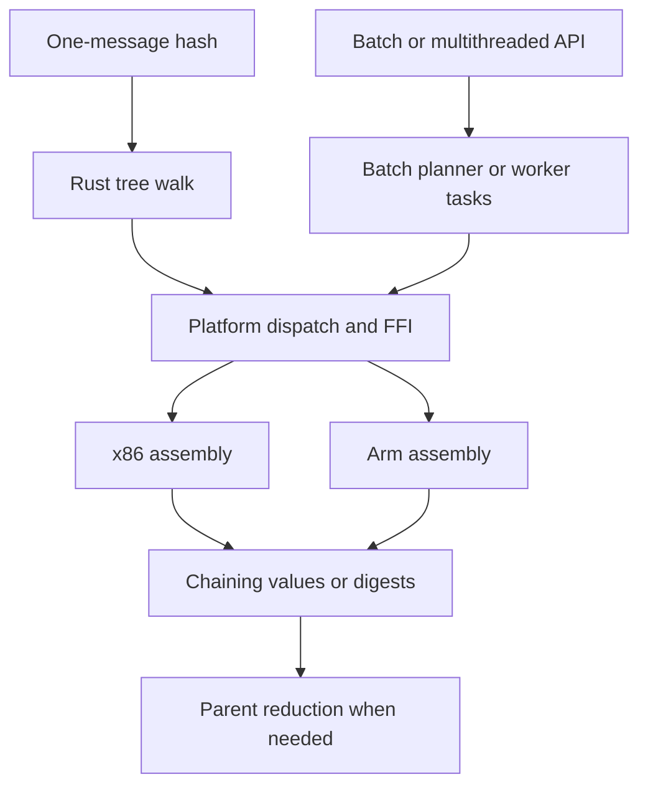

# External research report 163: the BLAKE3 session's guided walkthrough of its MLP and assembly techniques, with a brief for a coding agent (verbatim)

A research input, not a finding of this repository.

- **Relayed:** by the maintainer, 2026-11-02.
- **Source:** the same ChatGPT session as report 162.
- **In reply to:** the maintainer's follow-up, quoted below.

> aha, yes very good. can you give a guided walkthrough of the codebase’s use of MLP and how it uses assembly, I want to have my coding agent study it and look for ways to use similar techniques. please be very detailed and explain the importance of each part

**Evidence cutoff:** 2 November 2026. The reply's links are pinned to the fork at
`09d3bbc`. It also links a ChatGPT "space" page, which this repository can't open and
hasn't seen.

**Read with report 164, the guardian's framing of the study:**
- BLAKE3 knows its future addresses, and mibz2 must discover them.
- The AVX2 mechanism is upstream BLAKE3's, not the fork's.
- The i9 runs AVX2, not AVX-512 or SME2.
- The closing PMU link is for Granite Rapids. The i9 uses the Skylake-family definitions.

None of this changes the reply's text.

It is kept exactly as received (rendered text, cards flattened, tracking parameters
included).

## The reply, as received

`````text
I’ve prepared a reusable, source-linked guide: **[BLAKE3 memory parallelism and assembly study guide](https://chatgpt.com/space/page_ce6b2518220c819192f690139aacf5ba)**.

The walkthrough is below, with a **copyable investigation brief for your coding agent at the end**.

The central lesson is that this implementation coordinates several decisions: **how independent work is exposed, how its data is represented, when future inputs are fetched, and which instructions execute that work.** The assembly is one part of that design.

All repository links are pinned to commit [`09d3bbc6d07eedbf66545a35adfb6b5546445bc4`](https://github.com/johnservil/BLAKE3/tree/09d3bbc6d07eedbf66545a35adfb6b5546445bc4). This is the `johnservil` fork; the details should not be attributed to every upstream BLAKE3 release.

---

## 1. Start with the dependency distinction that makes this possible

A BLAKE3 **block** is 64 bytes. A full **chunk** is 1,024 bytes, comprising sixteen blocks. Within a chunk, each block’s compression updates the chaining value used by the next block. Different chunks can be processed independently before their chaining values are combined in the tree. See the [size definitions](https://github.com/johnservil/BLAKE3/blob/09d3bbc6d07eedbf66545a35adfb6b5546445bc4/src/lib.rs#L300-L316) and [chunk and parent routines](https://github.com/johnservil/BLAKE3/blob/09d3bbc6d07eedbf66545a35adfb6b5546445bc4/src/lib.rs#L697-L799).

The distinction your agent should learn is:

> **A dependency on the previous computation’s result does not necessarily prevent fetching the next computation’s input.**

For chunk `c`, block `b + 1` cannot finish compression before block `b` produces its chaining value. But its input address is already known:

```text
address(c, b + 1) = chunk_base[c] + 64 * (b + 1)
```

The bytes at that address can be fetched while block `b` is being computed. Across multiple chunks, many such addresses are available independently. The [SME2 block loop](https://github.com/johnservil/BLAKE3/blob/09d3bbc6d07eedbf66545a35adfb6b5546445bc4/c/blake3_sme2_aarch64.S#L623-L660) explicitly exploits this.

Keep these four mechanisms distinct:

| Mechanism | What overlaps | Example here |
|---|---|---|
| **SIMD** | The same arithmetic across multiple data elements | A vector contains one state word from sixteen chunks |
| **Instruction-level parallelism, ILP** | Independent instruction dependency chains | Several mixing functions advance through their arithmetic stages together |
| **Memory-level parallelism, MLP** | Independent memory requests remain outstanding together | Loads and prefetches target several chunks before earlier requests finish |
| **Thread parallelism** | Work executes on multiple CPU cores | Workers hash different subtrees |

They reinforce each other, but they are not interchangeable measurements.

**Why this matters when adapting the techniques:** a loop with sequential state updates may still permit early reads. Conversely, unrolling a dependent pointer chase does not make the next pointer available sooner. The agent should first identify which future addresses are independently known.

Also preserve the target algorithm’s semantics. BLAKE3’s tree is part of its design. Splitting another hash into independently hashed chunks may change its result. Batching independent messages is often possible even when parallelizing the internals of one message is not.

## 2. Follow this reading route

Start with one complete call path, then compare backends.

| Read | What to understand |
|---|---|
| [`src/convenience.rs`](https://github.com/johnservil/BLAKE3/blob/09d3bbc6d07eedbf66545a35adfb6b5546445bc4/src/convenience.rs#L36-L58) | How a public hash call enters the implementation |
| [`src/tree.rs`](https://github.com/johnservil/BLAKE3/blob/09d3bbc6d07eedbf66545a35adfb6b5546445bc4/src/tree.rs#L12-L66) | Independent chunks, tree reduction, and lookahead bounds |
| [`src/lib.rs`](https://github.com/johnservil/BLAKE3/blob/09d3bbc6d07eedbf66545a35adfb6b5546445bc4/src/lib.rs#L697-L799) | Pointer batches, chunk counters, and parent flags |
| [`src/block.rs`](https://github.com/johnservil/BLAKE3/blob/09d3bbc6d07eedbf66545a35adfb6b5546445bc4/src/block.rs#L10-L63) and [`src/many.rs`](https://github.com/johnservil/BLAKE3/blob/09d3bbc6d07eedbf66545a35adfb6b5546445bc4/src/many.rs#L51-L115) | Alignment, padding, and batches of complete messages |
| [`src/platform.rs`](https://github.com/johnservil/BLAKE3/blob/09d3bbc6d07eedbf66545a35adfb6b5546445bc4/src/platform.rs#L307-L354) | Backend selection and the internal `hash_many` contract |
| [`src/ffi_avx512.rs`](https://github.com/johnservil/BLAKE3/blob/09d3bbc6d07eedbf66545a35adfb6b5546445bc4/src/ffi_avx512.rs#L33-L90) | The additional decision that selects the 32-input kernel |
| [AVX2 assembly](https://github.com/johnservil/BLAKE3/blob/09d3bbc6d07eedbf66545a35adfb6b5546445bc4/c/blake3_avx2_x86-64_unix.S#L55-L176) | Independent loads, transposition, and prefetch distance |
| [Wide AVX-512 generator](https://github.com/johnservil/BLAKE3/blob/09d3bbc6d07eedbf66545a35adfb6b5546445bc4/tools/gen_avx512_32.py#L1-L52) | Register allocation, stack storage, and instruction scheduling |
| [SME2 assembly](https://github.com/johnservil/BLAKE3/blob/09d3bbc6d07eedbf66545a35adfb6b5546445bc4/c/blake3_sme2_aarch64.S#L123-L179) and [wrapper](https://github.com/johnservil/BLAKE3/blob/09d3bbc6d07eedbf66545a35adfb6b5546445bc4/src/ffi_sme2.rs#L419-L550) | Next-block loading and longer-distance prefetch |
| [Proof documentation](https://github.com/johnservil/BLAKE3/blob/09d3bbc6d07eedbf66545a35adfb6b5546445bc4/tools/verify/README.md#L65-L91) and [guard-page tests](https://github.com/johnservil/BLAKE3/blob/09d3bbc6d07eedbf66545a35adfb6b5546445bc4/src/ffi_avx512_32_guard_tests.rs#L63-L124) | What aggressive loads and hand scheduling must preserve |

The responsibilities fit together like this:



This summarizes the architecture. Small inputs have specialized paths, and parent reduction invokes the backend again.

## 3. Rust makes the independent work visible

The ordinary path begins at `convenience::hash`, passes through `hash_serial`, and reaches `tree::hash`. The tree walk uses a `Kernels` interface for chunks, parents, specialized subtrees, and roots.

An input within the current batching allowance goes directly to a chunk kernel. Larger inputs use a specialized subtree implementation when available, or split and recurse. See [the interface and `wide` walk](https://github.com/johnservil/BLAKE3/blob/09d3bbc6d07eedbf66545a35adfb6b5546445bc4/src/tree.rs#L12-L66) and [the platform bridge](https://github.com/johnservil/BLAKE3/blob/09d3bbc6d07eedbf66545a35adfb6b5546445bc4/src/tree.rs#L107-L157).

An important reading detail: **the ordinary tree walk visits its left and right children sequentially**. The tree structure does not mean that every recursive call creates a thread. The leaf routines already process several chunks together on one core.

In `compress_chunks_parallel`, Rust constructs an array of references to complete 1,024-byte chunks. It passes that table, the key, counter, flags, and output space to `Platform::hash_many`. Each pointer identifies a stream whose block offsets can be calculated independently. [Read the construction and call.](https://github.com/johnservil/BLAKE3/blob/09d3bbc6d07eedbf66545a35adfb6b5546445bc4/src/lib.rs#L701-L749)

There is still a dependency from loading a pointer-table entry to loading that pointer’s payload. The useful independence is **between the separate streams**, and between future payload loads and current arithmetic.

The parent path uses a different shape. Two 32-byte child chaining values form a 64-byte parent input. Parents use counter zero, fixed-counter behavior, and the `PARENT` flag. [Read the parent batch.](https://github.com/johnservil/BLAKE3/blob/09d3bbc6d07eedbf66545a35adfb6b5546445bc4/src/lib.rs#L765-L799)

One naming trap: the public `performance::hash_many` hashes complete messages; internal `Platform::hash_many` may produce intermediate chaining values.

### Why this part matters

Assembly cannot manufacture independent work that the interface hides. Calling a compression routine once per block would repeatedly cross a function boundary and limit how much work is visible together. The batch interface lets a backend schedule many accesses and retain state across the whole chunk.

### What your agent should look for elsewhere

Look for loops over independent records, messages, queries, or objects that currently call a small routine once per item. A bounded batch may expose more independent addresses while preserving results and ordering.

The experiment must include the cost of assembling that batch.

## 4. Data layout makes the parallel work practical

The input’s natural layout keeps a block’s sixteen 32-bit words together. SIMD arithmetic wants the same word from many independent chunks together.

Conceptually, transposition changes this:

```text
Input block for chunk c:    [word(c,0), word(c,1), ... word(c,15)]

Vector for message word w: [word(0,w), word(1,w), ... word(15,w)]
```

Now one vector addition performs the corresponding operation for sixteen chunks.

This arrangement serves both sides:

- Memory can supply contiguous blocks from each input.
- Arithmetic receives vectors with one independent computation per lane.

The implementation also **keeps state vectors transposed between blocks**. It avoids undoing and rebuilding the state representation at every compression boundary. New message blocks still need loading and rearranging. This is described in [the `Platform::hash_many` design note](https://github.com/johnservil/BLAKE3/blob/09d3bbc6d07eedbf66545a35adfb6b5546445bc4/src/platform.rs#L307-L315).

The public batch representation supports the kernels’ assumptions:

- `Block` contains 64 bytes with 64-byte alignment.
- `Batch` places messages in whole-block slots.
- Owned batches preserve zero padding beyond each message’s logical end.
- The mutation interface exposes actual message bytes while retaining that padding invariant.

See [layout and padding](https://github.com/johnservil/BLAKE3/blob/09d3bbc6d07eedbf66545a35adfb6b5546445bc4/src/block.rs#L10-L63) and [message mutation](https://github.com/johnservil/BLAKE3/blob/09d3bbc6d07eedbf66545a35adfb6b5546445bc4/src/block.rs#L170-L188).

This gives the backend both a regular stride and a known physical readable extent.

A 64-byte alignment promise is not a universal promise that an object occupies its own cache line. The Arm-specific code separately uses 128-byte line assumptions for its target. Nor should the aligned batch contract be confused with the convenience API, which accepts ordinary byte slices.

### Why this part matters

Early and wide loads require valid readable bytes. A logical length field does not make a full-width memory access safe.

### Transfer lesson

Consider a representation intended for repeated computation, especially when the producer can fill it directly. Measure the copying, padding, allocation, and transposition required to obtain it.

Retaining a useful representation across multiple operations may provide more benefit than widening an isolated instruction.

## 5. Assembly is a backend with explicit contracts

The hot kernels are checked-in `.S` files compiled ahead of time by `build.rs` and linked into the Rust crate. Python generators produce several of those files during development. Hashing does not generate or JIT assembly.

The build separately handles x86, NEON, and SME2, including probing assembler support for SME2. [Assembly build integration.](https://github.com/johnservil/BLAKE3/blob/09d3bbc6d07eedbf66545a35adfb6b5546445bc4/build.rs#L63-L164)

At this commit, the top-level build accepts little-endian x86-64 Linux and AArch64 Linux/macOS. Runtime CPU and OS support are separate checks. A compiler’s ability to assemble an instruction does not establish that the executing machine can use it. [Supported targets](https://github.com/johnservil/BLAKE3/blob/09d3bbc6d07eedbf66545a35adfb6b5546445bc4/build.rs#L167-L183); [x86 feature checks](https://github.com/johnservil/BLAKE3/blob/09d3bbc6d07eedbf66545a35adfb6b5546445bc4/src/platform.rs#L493-L524).

The newer wide x86 kernel receives six semantic arguments:

```text
input-pointer table
blocks per input
key
counter
packed flags
output pointer
```

The Rust wrapper checks input count, block shape, and output capacity. ISA support is a caller precondition established by earlier detection. It then makes a narrow `unsafe extern "C"` call. [Wide-kernel boundary.](https://github.com/johnservil/BLAKE3/blob/09d3bbc6d07eedbf66545a35adfb6b5546445bc4/src/ffi_avx512_32.rs#L6-L35)

The generator’s contract specifies readable extents, final-block padding, counters, and permitted input/output overlap. Its statement that the interface matches the Arm family describes argument meaning; the x86 code still follows the x86-64 System V ABI. [Raw kernel contract.](https://github.com/johnservil/BLAKE3/blob/09d3bbc6d07eedbf66545a35adfb6b5546445bc4/tools/gen_avx512_32.py#L4-L14)

On SME2, the boundary additionally manages streaming mode and ZA state, preserves required registers, and checks vector length. Its callers must not hold live SME state across these calls. [Caller assumptions](https://github.com/johnservil/BLAKE3/blob/09d3bbc6d07eedbf66545a35adfb6b5546445bc4/c/blake3_sme2_aarch64.S#L11-L20); [entry sequence](https://github.com/johnservil/BLAKE3/blob/09d3bbc6d07eedbf66545a35adfb6b5546445bc4/c/blake3_sme2_aarch64.S#L488-L512).

### Why assembly helps here

It provides direct control over:

- Register lifetimes and spills.
- Exact load widths.
- Instruction scheduling.
- Transposition.
- Architectural mode transitions.

Those controls are valuable when the schedule itself is the optimization.

For another project, establish whether ordinary code, intrinsics, or an improved interface exposes the same opportunity. Assembly should address a measured remaining limitation.

For generated kernels, edit the generator and regenerate its output. This repository checks that the emitted assembly matches the checked-in file. [Generator consistency checks.](https://github.com/johnservil/BLAKE3/blob/09d3bbc6d07eedbf66545a35adfb6b5546445bc4/tools/check-builds.sh#L40-L44)

## 6. Walk the AVX2 kernel one block at a time

The eight-input path begins by broadcasting the key into vector state and loading eight input pointers into general-purpose registers.

At a common block offset, it reads from all eight streams, rearranges their words, and stores sixteen transposed message vectors in a 512-byte stack region. [Setup, loads, and transpose.](https://github.com/johnservil/BLAKE3/blob/09d3bbc6d07eedbf66545a35adfb6b5546445bc4/c/blake3_avx2_x86-64_unix.S#L55-L167)

Its iteration is:

1. Determine the current block’s flags.
2. Load and transpose the current block from each input.
3. Issue lookahead prefetches.
4. Execute seven compression rounds.
5. Produce the next chaining value and advance the block offset.

After all blocks, it rearranges outputs into ordinary 32-byte chaining values and advances to the next input group. [Block completion and output stores.](https://github.com/johnservil/BLAKE3/blob/09d3bbc6d07eedbf66545a35adfb6b5546445bc4/c/blake3_avx2_x86-64_unix.S#L1220-L1303)

Two of the eight prefetch instructions are:

```asm
prefetcht0 [r8+rdx+0x80]
prefetcht0 [r12+rdx+0x80]
```

Read the offsets carefully. `rdx` has already advanced by 64 bytes. Current data starts at `rdx - 64`; the hint targets `rdx + 128`.

Therefore the lookahead is **192 bytes, or three blocks**, from the current block’s start. [Offset update](https://github.com/johnservil/BLAKE3/blob/09d3bbc6d07eedbf66545a35adfb6b5546445bc4/c/blake3_avx2_x86-64_unix.S#L82-L97); [prefetch instructions](https://github.com/johnservil/BLAKE3/blob/09d3bbc6d07eedbf66545a35adfb6b5546445bc4/c/blake3_avx2_x86-64_unix.S#L169-L176).

The useful lead time comes from the computation performed before those future blocks are consumed. Three blocks in a cryptographic compression loop represent much more work than three blocks in a copy loop.

Independent addresses permit overlapping demand requests. The hints try to move later data toward the CPU before demand. They may be ignored, merged, or too late; they do not guarantee a particular number of outstanding misses.

### What to learn

Treat these as separate dimensions:

- Number of independent streams.
- SIMD width.
- Prefetch distance.
- Amount of computation between request and use.

Then inspect the register budget. AVX2’s message storage and some temporaries use the stack. More parallel work can also increase shuffle and load/store pressure.

## 7. The 32-input AVX-512 kernel illustrates the tradeoffs

The new kernel handles 32 inputs using **two groups of sixteen lanes**.

| State | Inputs 0–15 | Inputs 16–31 |
|---|---|---|
| Eight chaining-value vectors | `zmm0`–`zmm7` | `zmm8`–`zmm15` |
| Eight upper-state vectors | `zmm16`–`zmm23` | `zmm24`–`zmm31` |

Those two states occupy all 32 ZMM registers during compression. The current message vectors therefore live in a stack buffer:

| Region | Size |
|---|---:|
| Current messages for both groups | 2,048 bytes |
| Counter vectors | 256 bytes |
| Temporary CV spill | 64 bytes |
| Total | 2,368 bytes |

This is a deliberate register/storage tradeoff. [Register and frame plan.](https://github.com/johnservil/BLAKE3/blob/09d3bbc6d07eedbf66545a35adfb6b5546445bc4/tools/gen_avx512_32.py#L16-L37)

### The generator avoids some runtime register moves

The transpose needs sixteen data registers plus one scratch register. At each butterfly step, the generator changes which register is considered the scratch. Some moves disappear because the Python generator changes its register bookkeeping instead of emitting a copy instruction.

One CV register is temporarily spilled to obtain the extra register. [Transpose generator.](https://github.com/johnservil/BLAKE3/blob/09d3bbc6d07eedbf66545a35adfb6b5546445bc4/tools/gen_avx512_32.py#L76-L98)

This is a useful assembly-generation technique: distinguish a change in a value’s conceptual name from an actual need to move its bits.

### MLP and ILP appear in different instructions

The load sequence requests a current block from each pointer and prefetches at `current_offset + 192`. Reusing `rax` for successive pointers does not introduce a true dependency between their separate payload reads; register renaming can distinguish the successive values. Each payload still depends on its own pointer. [Actual load sequence.](https://github.com/johnservil/BLAKE3/blob/09d3bbc6d07eedbf66545a35adfb6b5546445bc4/c/blake3_avx512_32.S#L82-L101)

A BLAKE3 **G mixing function** is a dependency chain of additions, XORs, and rotations. Four independent G functions operate in each column or diagonal phase. With two SIMD groups, this kernel advances eight independent vector chains.

- The independent input requests expose **MLP**.
- Interleaving stages of eight arithmetic chains exposes **ILP**.
- Sixteen elements processed by each vector instruction provide **SIMD**.

The [generated arithmetic](https://github.com/johnservil/BLAKE3/blob/09d3bbc6d07eedbf66545a35adfb6b5546445bc4/c/blake3_avx512_32.S#L383-L438) makes this visible.

The 2 KiB buffer holds the current block for two groups. It is **not** a current/next-block double buffer. This kernel loads current messages, computes seven rounds, advances, and repeats. Prefetch requests future input; SME2 below uses explicit next-block loads.

The wide kernel also uses a compact round loop with table-driven message offsets, trading extra offset loads for a smaller instruction footprint. Its speedup therefore cannot be attributed specifically to MLP without isolating that mechanism.

The dedicated `p16` parent kernel makes a different tradeoff: sixteen state vectors plus sixteen message vectors fit in registers, with much smaller scratch storage. It has no input prefetches; production parent inputs are one block each. [Parent-kernel design.](https://github.com/johnservil/BLAKE3/blob/09d3bbc6d07eedbf66545a35adfb6b5546445bc4/tools/gen_avx512_32.py#L39-L45)

### Dispatch is part of the optimization

The 32-input path requires the appropriate AVX-512 support and is selected for complete whole-chunk groups on Linux on AMD family `0x1A` onward, identified by the source as Zen 5. [Shape dispatch](https://github.com/johnservil/BLAKE3/blob/09d3bbc6d07eedbf66545a35adfb6b5546445bc4/src/ffi_avx512.rs#L33-L90); [CPU policy](https://github.com/johnservil/BLAKE3/blob/09d3bbc6d07eedbf66545a35adfb6b5546445bc4/src/platform.rs#L515-L558).

The source reports single-thread comparisons against the older 16-input kernel for inputs of 32 KiB and above:

| CPU | Author-reported result |
|---|---|
| EPYC 9255, Zen 5 | About 20% less time |
| EPYC 9124, Zen 4 | About 4–5% more time in tests of input fetched from memory |
| Xeon Gold 6330, Ice Lake | About 3–4.5% more time |

These are repository observations, not benchmarks I reran. They show why “wider” needs a measured dispatch policy.

Another trap: `Platform::simd_degree()` reports 32 for AVX-512 on Linux even on machines whose FFI dispatch uses the older kernel in smaller groups. **Inspect the actual executed symbol; a batching allowance does not prove which kernel ran.**

## 8. SME2 uses tile storage to build an explicit load pipeline

This backend requires a 512-bit streaming vector length, giving sixteen 32-bit lanes. SME’s ZA storage supports horizontal and vertical transfers, which are useful for transposition. [developer.arm.com](https://developer.arm.com/community/arm-community-blogs/b/architectures-and-processors-blog/posts/arm-scalable-matrix-extension-introduction-p2?utm_source=chatgpt.com)

The kernel assigns storage as follows:

| Storage | Role |
|---|---|
| `z0`–`z15` | Compression state across sixteen chunks |
| `z16`–`z31` | Current message words |
| `ZA0` | Message transpose and next-block storage |
| Other ZA tiles | Output transpose, IV, and counters |

Read [the register map](https://github.com/johnservil/BLAKE3/blob/09d3bbc6d07eedbf66545a35adfb6b5546445bc4/c/blake3_sme2_aarch64.S#L64-L92), then [`LOAD_ROW` and `READ_MESSAGES`](https://github.com/johnservil/BLAKE3/blob/09d3bbc6d07eedbf66545a35adfb6b5546445bc4/c/blake3_sme2_aarch64.S#L123-L179).

`LOAD_ROW` obtains a chunk pointer, adds the block offset, and loads a contiguous 64-byte block into a horizontal ZA row.

Sixteen row loads form a matrix conceptually indexed by:

```text
ZA0[chunk][message_word]
```

Reading its columns into Z registers puts the same word from sixteen chunks into each vector. The code uses tile storage for layout conversion; it does not turn the hash into matrix multiplication.

Once `READ_MESSAGES` has transferred the current block into `z16`–`z31`, ZA0 is available for reuse. `SEVEN_ROUNDS_PIPELINED` spreads sixteen next-block row loads through the current block’s seven rounds. [The pipeline.](https://github.com/johnservil/BLAKE3/blob/09d3bbc6d07eedbf66545a35adfb6b5546445bc4/c/blake3_sme2_aarch64.S#L351-L411)

Conceptually:

```text
Load block 0 into future-input storage.

For each nonfinal block:
    Transfer that block into current-operand registers.
    Compute the current block.
    Interleave loads of the following block into future-input storage.

Transfer the final block into current-operand registers.
Compute it without loading another block.
```

The prologue fills the pipeline. The steady-state loop overlaps necessary loads with arithmetic. The epilogue avoids loading a nonexistent next block. [Actual loop and final-block handling.](https://github.com/johnservil/BLAKE3/blob/09d3bbc6d07eedbf66545a35adfb6b5546445bc4/c/blake3_sme2_aarch64.S#L623-L678)

### Why this matters

Current state and current message already occupy the Z register file. ZA provides storage for future input without requiring another sixteen Z registers.

**Double buffering means separating current operands from future operands; it does not require two heap buffers.**

In another kernel, that separation might use registers, a small scratch region, or alternating tiles. Its value depends on whether the extra storage and scheduling cost less than the latency they hide.

## 9. Arm adds two longer prefetch horizons

### The next group of chunks

`PREFETCH_NEXT_GROUP` requests data from the next sixteen chunk pointers using `prfm pldl1strm`.

Current pointer entries occupy offsets 0–120; offsets 128–248 identify the next group. The hints use the loop’s advancing block offset. [Next-group prefetch.](https://github.com/johnservil/BLAKE3/blob/09d3bbc6d07eedbf66545a35adfb6b5546445bc4/c/blake3_sme2_aarch64.S#L428-L447)

The remaining-group check is important: **obtaining a nonexistent pointer-table entry would itself be a real invalid load**, even if the pointer’s eventual use were only a prefetch hint.

### The following subtree

The Rust `flat_walk` wrapper reaches farther ahead. Before computing a subtree, it requests following input into L2 using `prfm pldl2keep` at 128-byte intervals.

The range is capped by the smaller of:

- The current subtree’s size.
- The valid following-byte count, `ahead`.

[Bounded L2 prefetch.](https://github.com/johnservil/BLAKE3/blob/09d3bbc6d07eedbf66545a35adfb6b5546445bc4/src/ffi_sme2.rs#L419-L440)

The tree walk propagates this information. The left child receives the right sibling’s length plus any existing suffix; the right child inherits only the existing suffix. The whole-message root starts with zero bytes beyond its supplied input. [Lookahead propagation](https://github.com/johnservil/BLAKE3/blob/09d3bbc6d07eedbf66545a35adfb6b5546445bc4/src/tree.rs#L47-L66); [root call](https://github.com/johnservil/BLAKE3/blob/09d3bbc6d07eedbf66545a35adfb6b5546445bc4/src/tree.rs#L107-L122).

For example, a 2 MiB input split into two 1 MiB subtrees permits the first subtree to request the second while computing. The last subtree has no following input to request.

### Why this matters

The traversal knows what comes next and how far it remains valid. Passing that knowledge downward enables lookahead that a narrow compression routine could not infer.

**Transfer lesson:** a valid next-batch or next-tile descriptor may be more useful than guessing future addresses inside a kernel.

## 10. Hybrid execution and code prefetch address other costs

The Arm constants describe different kinds of width:

| Value | Meaning |
|---|---|
| `GROUP = 16` | SIMD lanes per ordinary SME2 group |
| `DEGREE = 128` | Tree/wrapper batching allowance of eight ordinary groups |
| `HYBRID_GROUP = 18` | Sixteen chunks on SME2 plus two chunks completed on integer units |

See [width and batching](https://github.com/johnservil/BLAKE3/blob/09d3bbc6d07eedbf66545a35adfb6b5546445bc4/src/ffi_sme2.rs#L55-L65) and [flat-walk scheduling](https://github.com/johnservil/BLAKE3/blob/09d3bbc6d07eedbf66545a35adfb6b5546445bc4/src/ffi_sme2.rs#L489-L518).

The hybrid uses one scalar state lane to complete two chunks during the vector group’s work. NEON hybrids likewise combine scalar and vector work. These are primarily execution-resource and ILP techniques; their group sizes are not counts of outstanding memory transactions. [SME2 hybrid design](https://github.com/johnservil/BLAKE3/blob/09d3bbc6d07eedbf66545a35adfb6b5546445bc4/tools/gen_sme2_hybrid.py#L1-L30); [NEON hybrid design](https://github.com/johnservil/BLAKE3/blob/09d3bbc6d07eedbf66545a35adfb6b5546445bc4/c/blake3_neon_hybrid_aarch64.S#L1-L24).

Check the implementation carefully: the plain SME2 kernel has next-group prefetch; the hybrid generator retains next-block pipelining but has only a comment and `pass` where next-group prefetch would be emitted. The surrounding flat walk can still issue its separate subtree hints. [Relevant generator code.](https://github.com/johnservil/BLAKE3/blob/09d3bbc6d07eedbf66545a35adfb6b5546445bc4/tools/gen_sme2_hybrid.py#L281-L293)

There is also `prefetch_code`. It issues L2 load-prefetch hints for executable kernel addresses. This requests **code bytes into L2**, rather than message input or direct population of L1’s instruction cache. [Implementation.](https://github.com/johnservil/BLAKE3/blob/09d3bbc6d07eedbf66545a35adfb6b5546445bc4/src/platform.rs#L636-L660)

The Arm path uses an approximately 100-microsecond inter-call-gap heuristic for selected input ranges. That predicts possibly cold code; it does not inspect cache contents. [Cold-code policy.](https://github.com/johnservil/BLAKE3/blob/09d3bbc6d07eedbf66545a35adfb6b5546445bc4/src/lib.rs#L1052-L1112)

### Transfer lesson

Large unrolled kernels can perform well in repeated warm calls yet cost more after other code has displaced them.

When searching for prefetch instructions, classify their targets: input, metadata, scratch, or executable code. Then benchmark the application’s real calling pattern.

## 11. Keep core MLP separate from threads and storage

The thread pool assigns whole subtrees or message ranges to workers. Small inputs remain on the caller; the current split threshold is 512 KiB. This adds cross-core concurrency on top of the kernels’ within-core overlap. [Threshold and pieces](https://github.com/johnservil/BLAKE3/blob/09d3bbc6d07eedbf66545a35adfb6b5546445bc4/src/lanes.rs#L110-L175); [worker execution](https://github.com/johnservil/BLAKE3/blob/09d3bbc6d07eedbf66545a35adfb6b5546445bc4/src/lanes.rs#L365-L407).

On SME2 machines, it can combine an SME2 prefix with NEON work on other cores. Shared execution resources make using the widest backend everywhere an empirical scheduling question. [Backend-sharing policy.](https://github.com/johnservil/BLAKE3/blob/09d3bbc6d07eedbf66545a35adfb6b5546445bc4/src/lanes.rs#L43-L55)

One particularly important trap: `Sme2Turn` is an advisory performance flag. Its relaxed load/store arrangement allows simultaneous callers to take the turn; correctness does not depend on exclusion. **It is not a mutex pattern for protecting shared mutable data.** [Contract and implementation.](https://github.com/johnservil/BLAKE3/blob/09d3bbc6d07eedbf66545a35adfb6b5546445bc4/src/platform.rs#L37-L110)

At another layer, `b3sum`’s Linux read-ahead code tries cached small-file reads, requests `WILLNEED` for files that miss, and returns to them later. That overlaps storage activity at an OS timescale. It is separate from CPU cache-miss concurrency. [File read-ahead design.](https://github.com/johnservil/BLAKE3/blob/09d3bbc6d07eedbf66545a35adfb6b5546445bc4/b3sum/src/readahead.rs#L1-L23)

Your agent should identify which layer limits the target workload before choosing a technique.

## 12. Memory contracts and validation are part of the optimization

**Logical length and physical readable extent are separate.**

A full-vector load touches the bytes selected by that instruction even when later arithmetic discards some lanes. A short logical block needs appropriate backing storage if the kernel physically reads a full block.

The partial-chunk wrapper makes this explicit. It copies the short chunk into a zero-padded 1,024-byte buffer, sets the true final length and flags, and captures the correct chaining value at the logical endpoint. Later physical loads remain within the padded storage. [Partial-chunk handling.](https://github.com/johnservil/BLAKE3/blob/09d3bbc6d07eedbf66545a35adfb6b5546445bc4/src/ffi_partial.rs#L44-L100)

When expressing prefetch in C, C++, or Rust, obey the language’s pointer-arithmetic and lifetime rules too. A non-faulting CPU hint does not make otherwise invalid pointer construction valid.

The wide kernel also permits some input/output overlap because input reads finish before output writes. Moving stores earlier requires reconsidering that contract. [Read-before-write guarantee.](https://github.com/johnservil/BLAKE3/blob/09d3bbc6d07eedbf66545a35adfb6b5546445bc4/tools/gen_avx512_32.py#L4-L14)

### A useful historical failure

The repository records an x86 bug where two- and four-input paths loaded full vectors while using only the first sixteen bytes. On the final block, they could read up to 48 bytes beyond the input.

The proof model identified it, and guard-page tests reproduced a crash. Correct hash outputs had not established safe memory accesses. [Documented overread.](https://github.com/johnservil/BLAKE3/blob/09d3bbc6d07eedbf66545a35adfb6b5546445bc4/docs/quality-manual.md#L471-L476)

### What to retain when adapting the code

| Validation layer | Purpose |
|---|---|
| Independent reference outputs | Detect arithmetic, flag, counter, and ordering mistakes |
| Boundary tests | Exercise tails, exact widths, width ± 1, overflow, and permitted overlap |
| Guard pages | Detect invalid accesses to inputs, pointer tables, keys, and outputs |
| ABI checks | Preserve registers, stack, return behavior, and architectural state |
| Generator checks | Ensure reviewed generation logic matches compiled assembly |
| Symbolic checking where available | Establish properties under explicit contracts |
| Startup self-test | Detect some faulty builds or execution failures |

The [wide-kernel guard tests](https://github.com/johnservil/BLAKE3/blob/09d3bbc6d07eedbf66545a35adfb6b5546445bc4/src/ffi_avx512_32_guard_tests.rs#L63-L124) protect individual inputs and metadata, use read-only regions, and exercise block lengths and counter behavior.

The proof tooling symbolically executes disassembled kernel instructions. It checks results, memory regions, relevant public/secret dependencies, and ABI behavior. Its scope excludes the surrounding Rust dispatch, tree, and threading code. Proof models and contracts remain assumptions, and functional proof does not establish speed. [Proof obligations](https://github.com/johnservil/BLAKE3/blob/09d3bbc6d07eedbf66545a35adfb6b5546445bc4/tools/verify/README.md#L65-L91); [scope](https://github.com/johnservil/BLAKE3/blob/09d3bbc6d07eedbf66545a35adfb6b5546445bc4/tools/verify/README.md#L142-L176).

For a software pipeline, make the invariant explicit:

- Current registers represent block `b`.
- Future storage represents `b + 1`.
- The prologue initializes the first block.
- Each iteration advances exactly once.
- The epilogue makes no nonexistent next-block load.

That invariant is as important as the instruction sequence.

## 13. How your agent should evaluate similar techniques

### Begin with a causal hypothesis

A useful hypothesis identifies a bottleneck, a change, and a predicted observation:

> Independent record loads arrive late. Prefetching a bounded later batch should reduce memory-stall time for cold inputs, while adding some instructions.

If the change improves only warm inputs and changes arithmetic issue pressure, that suggests a different cause.

A useful experimental order is:

1. Expose independent work through batching.
2. Retain reusable state in a computation-friendly layout.
3. Move necessary future loads earlier when their addresses and storage are valid.
4. Test explicit lookahead for a remaining memory-latency problem.
5. Evaluate specialized intrinsics or assembly where simpler code leaves a measured limitation.

Treat stream count, per-stream block lookahead, and next-group/subtree lookahead as separate variables. Change one at a time before combining successful experiments.

Inspect the emitted machine code. Source-level intent does not prove the compiler produced the expected schedule.

### Think in lead time and request capacity

A rough occupancy model is:

\[
C \approx \frac{B\,T}{S}
\]

Here:

- \(C\) is average outstanding transactions.
- \(B\) is bandwidth at the memory level being considered.
- \(T\) is average service time.
- \(S\) is bytes per transaction.

For hypothetical values of 12.8 GB/s, 80 ns, and 64-byte transactions, this gives sixteen requests in flight. This is an illustration, not a BLAKE3 measurement or a promise about a CPU’s capacity.

Use latency and traffic from the same memory level. Account for wasted or additional traffic where relevant.

Too little prefetch lead leaves data in transit when needed. Too much lead may cause eviction or displace useful data. Additional requests also consume finite tracking capacity and bandwidth. Intel discusses these distance and cache-target tradeoffs explicitly. [intel.com](https://www.intel.com/content/www/us/en/developer/articles/technical/qcd-performance-optimization-with-hbm.html?utm_source=chatgpt.com)

### Measure several operating conditions

| Condition | What it reveals |
|---|---|
| Nearby-cache-resident data | Arithmetic, shuffles, spills, and prefetch overhead |
| Large resident memory outside the relevant cache | Miss handling, bandwidth, and lookahead benefit |
| Input just written by the caller | Producer interactions and realistic load behavior |
| Calls after other work or pauses | Instruction footprint and changed CPU state |
| Full batches and awkward tails | Packing and pipeline fill/drain costs |
| One core and multiple cores | Per-core latency hiding versus shared-bandwidth limits |
| Different supported CPUs | Whether a dispatch rule is justified |

Separate page faults, I/O, allocation, and initialization when studying CPU-memory behavior, then include them in end-to-end measurements when they belong to the real workload.

Measure the public API as well as the isolated kernel. Setup or copying can erase an inner-loop improvement.

CPU counters can help explain outstanding misses, stalls, cache traffic, instructions, and cycles. For example, supporting Intel CPUs expose `L1D_PEND_MISS.PENDING` and `L1D_PEND_MISS.PENDING_CYCLES`. Their ratio estimates tracked L1-miss occupancy during cycles with misses pending. It is not a universal DRAM-MLP metric; consult the exact processor definitions. [PerfMon Events Documentation](https://perfmon-events.intel.com/platforms/graniterapids/core-events/core/?utm_source=chatgpt.com)

Two interpretation traps deserve emphasis:

- **Successful prefetching can lower demand-miss occupancy** because demand loads now hit.
- **High outstanding-miss occupancy can indicate congestion.**

Useful work completed per unit time is the objective. Counters explain the result.

Inside this repository, follow its [`AGENTS.md` measurement rules](https://github.com/johnservil/BLAKE3/blob/09d3bbc6d07eedbf66545a35adfb6b5546445bc4/AGENTS.md#L100-L110) and `clocks` tooling. For another project, use equivalent discipline with its supported tools.

## 14. Copyable brief for your coding agent

```text
Study johnservil/BLAKE3 at commit
09d3bbc6d07eedbf66545a35adfb6b5546445bc4 as a reference for
memory-level parallelism and assembly scheduling.

First trace one real call from Rust orchestration through CPU/shape
dispatch, the FFI contract, and the selected assembly loop.
Distinguish SIMD width, independent arithmetic chains, batch size,
thread count, and measured memory-miss concurrency.

Study these mechanisms:
- Independent chunk pointer tables and retained transposed state.
- AVX2/AVX-512 current-block loads and three-block lookahead hints.
- The k32 generator's two SIMD groups, register budget, and spills.
- SME2 current operands in Z registers and future operands in ZA.
- Next-group prefetch and bounded next-subtree lookahead.
- Code prefetch, tails, ABI obligations, and guard-page validation.

Then inspect our target repository and representative workloads.
Identify where future addresses are known before their data is used,
where independent jobs could be batched, and where current interfaces
or layouts hide that independence.

Produce a ranked table with:
1. Exact target function and source location.
2. Observed bottleneck and evidence, with uncertainty stated.
3. Proposed mechanism and why dependencies permit it.
4. Readable extents, aliasing, tails, ordering, and ISA obligations.
5. Smallest experiment that isolates the proposed mechanism.
6. Predicted counter changes and end-to-end performance effect.
7. Cases likely to regress and criteria for keeping the change.

Prefer bounded experiments: batching, layout retention, early necessary
loads, prefetch distance, then specialized intrinsics or assembly when
justified. Preserve algorithmic outputs and public contracts.

Use an independent correctness reference, boundary/guard tests for
aggressive loads, disassembly inspection, and repeated measurements of
warm/cold data, realistic call gaps, full batches, and tails.
Identify the actual executed backend for every comparison.

Report source facts, hypotheses, author-reported observations, and new
measurements separately. Do not treat a wider vector, more outstanding
misses, or more prefetch instructions as success by itself.
```

*The saved guide’s text and links were verified; I couldn’t preview its rendered diagram.*
`````
