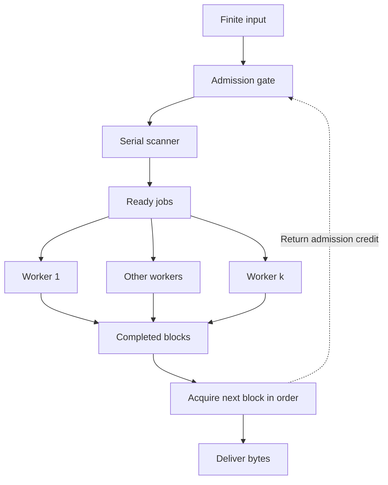
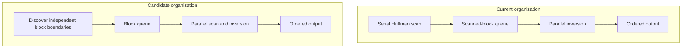

# ChatGPT Pro's reconstruction of the queueing narrative, verbatim

Relayed by Louis on 25 November 2026 and pasted into the blog writer's session. ChatGPT Pro was asked
to read the published post "The decoder as a queueing network" against the repository's notes,
course material, experiments and code, and to develop the missing story: why a local optimisation
forced the question of what sort of system the decoder is, and what sort it could become. Recorded as
pasted. The paste lost ChatGPT's hyperlinks: where it linked a file, PR or paper, the link shows as
"⁠". Its two Mermaid diagrams arrived as plain text and are kept as fenced blocks; its mathematics is
kept in the LaTeX the paste carried. It also attached an editable `queueing-narrative.docx`, which was
not relayed.

The blog post that used it (PR 901) checked each claim against the record. Its corrections to this
text: the original "course reading" inventory claim is right here and was wrong in the post; the
under-lock sequence numbers answered a hazard raised in design review before stage 1, not a problem
stage 1's data uncovered; #841 is open, not merged; the scanner's +23% is at 16 workers and above;
the 32 ms constant's cause is unidentified; the trace-driven simulator is specified, not built; the
I = SECMRD gap was found independently by the Pathfinder and resolved before any data by registration
clarification 8 (44 arms a count). The caching example's details and the Qiu, Yang and Harchol-Balter
paper are not in the repository's sources.

---

The missing story is why a local optimization forced you to ask what sort of system the decoder was—and then what sort of system it could become.

Queueing theory gives a connected way to ask those questions. It describes work, waiting, capacity, feedback and competition for resources. Those are things you were already changing through parallelization and algorithm design. The readings supplied ways to characterize them, predict the consequences of changes, and discover when an apparently unpromising improvement was merely hidden by another constraint.

I’ve developed that into the narrative below, following the questions through the academic material, your notes, the experiments and the code. The complete editable version includes the source ledger, diagrams and corrections:

queueing-narrative.docx⁠

1. Begin with the improvement whose value disappeared

The natural opening is the inversion experiment.

You had a way to supply information that emission would otherwise have to compute. Preparing that information outside the timed decode created an oracle: an experiment asking what would happen if a particular computation became cheap.

At one and six workers, supplying the emission codes helped. At ten workers, its effect on total time was unresolved.

That observation admitted two explanations:

* The computation might offer little useful opportunity.
* Another part of the decoder might be preventing its saved time from reaching the output.

Supplying the scanner’s output as a second oracle separated those explanations.

Configuration at ten workers	Wall time relative to baseline	What it tells us
Everything real	1.000	Reference configuration
Emission codes supplied	0.976 [0.936, 1.017]	Isolated benefit unresolved
Scanner output supplied	0.806 [0.782, 0.831]	Removing scanner work exposes substantial room
Both supplied	0.741 [0.717, 0.766]	Emission becomes valuable behind the relieved scanner

The decisive comparison is both supplied against scanner supplied: 0.920 [0.901, 0.939]. Emission has about an 8% effect in that changed system, although its effect was hidden in the original one. These are the reported oracle results, with preparation outside the clock and matching output across the twenty rounds. Journal §44⁠.

That gives the theory a reason to enter the story:

How can the same computation be worth improving in one configuration and apparently worthless in another?

A CPU profile tells us where work happened. To answer this question, we also need to know which work determined when the decode finished.

The approximately 26% reduction with both oracles is a measurement of an opportunity under that experimental arrangement. Finding an algorithm that obtains the supplied information cheaply remains a separate problem. That distinction is precisely what makes the experiment useful for directing mathematical work.

2. Introduce queueing theory through the decoder’s actual shapes

The first explanation can be very concrete.

A job is a piece of work whose progress we follow. A service centre is a resource that performs work for it. A queue holds jobs that cannot yet receive their next service. A service discipline decides which eligible job runs next.

The common shapes describe different relationships:

Shape	What it captures
A single queue and server	Competition for one resource
A tandem pipeline	Different stages overlapping across jobs
A shared queue and several servers	A pool processing independent jobs
A fork and join	One job divided into tasks that must reunite
A feedback loop	Completion or progress enabling further work

The decoder combines several of these. Its worker pool normally gives each block to one worker; it does not split every block across all workers.

The scanner reads the bitstream and decodes Huffman symbols. Workers perform MTF/RLE2, construction of the inversion structures, emission, and final expansion and checksum work. Completed blocks may arrive out of order, while the reader must acquire the next required block in sequence.

This produces several distinct kinds of waiting:

* The scanner can wait for permission to admit more work.
* A scanned block can wait for a worker.
* A worker can wait for a scanned block.
* A completed block can wait behind an earlier unfinished block.

They have different remedies. Increasing the ready-job population might keep workers occupied. Increasing the completed-buffer population might merely consume memory behind an early straggler.

The implementation adds details that the diagram must eventually respect. Admission uses both a block window and a ready-byte threshold. Its credit is returned when the reader acquires the next buffer, before fully consuming it. The scanner’s current work also precedes the increment of issued, so issued − taken has a more precise boundary than the informal phrase “everything in flight.” Those details became explicit requirements in the accepted model decisions⁠.

This is a finite pipeline with feedback-controlled admission. Its population changes during startup, drain and blocked refill. A window of W does not mean that exactly W block jobs continually circulate.

The return arrow is still useful: admission permits are reusable. But treating those permits as the population of a closed reference network is a modelling choice, whose relationship to real blocks must be explained.

3. The bottleneck law turns a profile into a capacity argument

Jain’s operational laws provide an accessible starting point because they begin with observable quantities.

Service time is time receiving service during one visit. A visit ratio counts how often a job visits a resource. Service demand is their product: the total service required from that resource per completed job.

For resource i,

D_i=V_iS_i,\qquad U_i=XD_i,

where X is completed-job throughput and U_i is utilization. These accounting relationships do not require an initial assumption that arrivals are Poisson or service times exponential. 

Apply that to the simplest decoder model. Suppose each block requires:

* s seconds from the serial scanner;
* w seconds from one worker;
* with k workers available.

The scanner can supply at most 1/s blocks per second. The worker pool can supply at most k/w. Every completed block needs both services, giving the capacity bound

X\leq \min\!\left(\frac1s,\frac{k}{w}\right).

The capacities balance at

k_{\mathrm{balance}}=\frac ws.

That predicts a recognizable scaling curve. With few workers, worker capacity constrains progress. Adding workers helps. Eventually the workers can process blocks as quickly as the scanner supplies them. Beyond that point, extra workers increasingly wait for the scanner.

Your measurements made this an unusually good first model:

Quantity	Result
Scanner demand estimated from counts 1–4	106.6 μs per block
Worker demand estimated from counts 1–4	798.3 μs per block
Predicted balance w/s	7.49 workers
Measured load-ratio crossing	7.67 workers
Best measured completion time	About 0.191 seconds at eight workers

Four low-count measurements located the interesting region around eight workers. That is the substantive success. The separate global c+\max(b,a/k) fit was less exact: its crossover was 7.17, its RMS residual was 13.6 ms, and its errors had a systematic pattern. The fitted 32 ms constant did not acquire a unique physical explanation merely by being included in the fit. Journal §§57 and 61⁠.

Two distinctions make this explanation trustworthy.

First, stations represent resources. Several functions executed by the same scanner share its serial capacity; their demands must be added. Drawing each function as an independently parallel station would invent capacity.

Second, a capacity bound is not an achievable completion time. For B blocks, a bound such as

T\geq \max\!\left(Bs,\frac{Bw}{k}\right)

omits lost overlap, uneven assignment, startup, drain and ordering constraints. One job requiring a one-second scan, one-second decode and one-second delivery takes three seconds, although its largest individual stage demand is one second.

The textbook’s closed-network population knee also concerns a different variable from this worker crossover. Increasing the number of circulating jobs and increasing the number of servers are separate changes, even where an implementation couples them through its window policy.

4. Modification analysis explains why improvements interact

Once we have demands and capacities, we can ask what happens when one changes.

That is the practical purpose of modification analysis: alter a service requirement, resource capacity or routing arrangement, then determine which constraint becomes binding. Harchol-Balter’s examples include faster processors, redistributed work and additional devices. The method makes bottleneck migration explicit. 

Consider an illustrative pipeline with enough overlap that the bottleneck maximum is a useful approximation:

Configuration	Scanner demand	Worker-pool demand	Approximate wall
Baseline	100	95	100
Scanner work reduced 20%	80	95	95
Worker work reduced 20%	100	76	100
Both reduced 20%	80	76	80

These are invented teaching numbers, not measurements.

The scanner improvement saves twenty units of scanner work, but only five units reach completion time before the workers take over. The worker improvement is invisible in the original configuration. Together they permit a twenty-unit reduction.

This explains the original oracle observation and changes how an optimization is valued.

Its immediate value depends on the other stages, worker count and machine. Its conditional value depends on what else improves. A worker optimization may also let the decoder reach its scanner-limited throughput with fewer cores, even if current wall time barely changes.

There is an apt example in the 2025 course’s caching material. Qiu, Yang and Harchol-Balter show how increasing a cache’s hit ratio can remove storage work while increasing pressure on serialized hit-path metadata operations. Eventually that new bottleneck can make throughput decline. A locally improved metric has changed the distribution of service demand. I checked this example during the present reconstruction; it illuminates the decoder without implying that it originally caused a particular implementation decision. 

For your project, the consequence is substantial: price improvements in combinations.

A scanner improvement should be evaluated alongside the worker capacity that becomes appropriate after it succeeds. A worker idea that appears masked today should remain visible as a conditional opportunity. The research target becomes a surface over combinations, rather than a list of functions ranked by CPU percentage.

5. Little’s law makes the model measurable

The next question is whether the program can account for the states in the diagram.

Little’s law relates average population, throughput and average residence:

L=XR.

Its finite-trace interpretation is particularly intuitive. Count how many jobs are present at each instant and integrate. Alternatively, add the time each individual job spends inside the chosen boundary. For a complete observation beginning and ending empty, those are two counts of the same job-time:

\int n(t)\,dt=\sum_j(d_j-a_j).

This does not depend on a Poisson-arrival assumption. The observation boundary and complete coverage of the jobs are what matter. 

For the decoder, that forces useful questions:

* Are we counting jobs waiting for workers?
* All issued blocks not yet taken?
* Completed buffers awaiting ordered delivery?

Each population has its own residence time. Mixing one population with another interval can produce a plausible number that describes no actual queue.

An early attempt to size the window illustrates the trap. Multiplying throughput by the sum of service demands suggested roughly eight or nine slots. But Little’s law uses residence time, including waiting, and returns a mean population, not a sufficient maximum admission limit.

The instrumentation made the distinction concrete. It independently accumulated queue occupancy areas and block residence intervals. Stage 1 ran 840 grid decodes and passed its accounting identities. It also uncovered an event-ordering problem: timestamps recorded after releasing a lock could imply that a reader acquired a block before its completion had been recorded. Sequence numbers assigned under the lock restored the real transition order. Instrumentation PR #841⁠; Stage 1 report⁠.

That is a strong academic-to-implementation connection: the law changed what had to be recorded and how the trace was checked.

Passing the identities established internal consistency. It did not establish negligible instrumentation overhead. At high counts that overhead remained insufficiently resolved, so subsequent primary timing comparisons used the detailed ledgers turned off.

6. Scheduling and variability become specific questions

With demands measured, we can ask whether a different order of work could close the remaining gap to the capacity limit.

Several ideas that sound similar actually change different things:

Idea	What changes	Relevant question
Size-aware dispatch	Order of eligible work	Does it improve the chosen completion objective?
Help the earliest unfinished block	Allocation of capacity to the output frontier	Can useful help be divided cheaply enough?
Admit by estimated work or bytes	Amount and composition of admitted work	Can memory and interference fall while servers stay busy?
Relax resequencing	When completed results become usable	Does the output contract permit it?
Duplicate speculative work	Total work and competition to finish	Does reducing a tail outweigh extra contention?

The objective matters. A policy that improves average job response need not minimize the time to finish an entire file. Ordered output adds another objective: advancing an early unfinished block may release both bytes and admission credits.

The early sweep showed elapsed time already close to the busiest resource’s measured demand. If service demands and capacities stay unchanged, removing idle gaps can therefore recover only a few percent. That is a useful restriction on pure rearrangement.

A scheduling change that improves cache locality or prevents simultaneous memory-heavy phases can change those demands. Its possible gain must be assessed against a newly measured bound. The original “no discipline can gain more than about 5%” statement needs that qualification. Journal §§57–61⁠.

Variability supplies another reason to retain more than means. Long services delay followers and occupy more of the time at which a random observer might encounter a busy server. The M/G/1 and inspection-paradox material makes that intuition precise in its own setting. Here it motivates collecting distributions; its standard open-queue formulas do not directly describe the bounded, ordered decoder. 

Your corpus also contained two rather different populations: 792 tiny blocks among 1,724 blocks, accounting for about 0.1% of the bits. Pooled variability and variability among substantial blocks answer different questions. Neither automatically gives the worker-service distribution. Order and correlations can matter as much as marginal sizes. Outside course reading⁠.

The open-versus-closed workload paper adds a related caution: an external arrival stream behaves differently from work whose completion permits a replacement arrival. That motivates preserving admission feedback. It does not establish that scheduling is generally unimportant in bounded pipelines. 

7. BCMP and MVA were attempts to explain what the simple maximum omitted

This is the right point to introduce the acronym you were remembering: BCMP—Baskett, Chandy, Muntz and Palacios.

The capacity maximum explains the broad crossover. Near that crossover, finite populations, variability and temporary starvation can matter. It is therefore natural to ask whether a tractable queueing network can calculate the missing behavior.

BCMP identifies classes of network with a product-form equilibrium distribution: individual centres contribute tractable factors, with the necessary normalization and population constraints. This makes a model solvable. It does not identify an intrinsically optimal software architecture. In a closed network, the fixed total population still couples queue occupancies. 

Mean value analysis is attractive because, for suitable closed-network models, it calculates average performance without enumerating the entire joint state space. Starting with zero jobs, it builds the solution for successively larger populations: infer the occupancy an arriving job encounters, calculate residence, obtain throughput, and update average occupancies. Multiple-server and load-dependent cases require the appropriate extensions. 

The notes did more than mention this possibility. One review reports a computed two-station, load-dependent closed surrogate with N=4k, scanner demand 107.9 μs and worker demand 815 μs.

Workers	Surrogate batch-time estimate	Observed time reported alongside it
3	About 0.4684 s	0.4693 s
8	About 0.1888 s	0.1911 s

Those surrogate numbers are reproducible from its stationary distribution. I did not locate the original solver script. This is evidence of a real numerical reference-model calculation, rather than merely a proposed use of MVA. Neon’s course-mining review⁠.

Its interpretation needs care. Converting stationary throughput into a file-completion estimate does not automatically account for startup, drain, ordering and byte-gated admission. Its residual cannot all be labelled hardware contention.

The mathematical qualification must also be fair to BCMP. The theorem permits broader service distributions under appropriate disciplines, and the original paper explicitly discusses load dependence, including multiprocessor interference. Non-exponential work, feedback or contention are not blanket disqualifications. What was not established was a compatible representation of this implementation’s particular combination of gates, ordering, correlations and shared-resource effects. 

That led to a sensible modelling hierarchy:

* Operational laws supply robust accounting and bounds.
* Tractable networks supply reference calculations.
* A detailed discrete-event model can preserve implementation-specific rules.
* Measurements determine whether the resulting predictions are useful.

At the inspected snapshot, the current trace-driven pipeline simulator remained a proposal. The trace accounting and intervention analyses were implemented. That status distinction belongs in the narrative.

8. Load dependence connects the model back to familiar hardware problems

The first approximation treats s and w as stable costs. Real cores share caches, memory paths, execution resources and frequency limits.

Adding workers can therefore change both the pool’s nominal capacity and the service demand of the scanner.

Writing s(k) and w(k) is a useful reminder:

X(k)\leq
\min\!\left(\frac{1}{s(k)},\frac{k}{w(k)}\right).

The extra worker may help the pool while slowing the resource that already limits completed output.

This is queueing theory’s load dependence expressed in the performance problems you were already studying.

The original sweep showed scanner work increasing by about 23% at high worker counts. SMT interference was initially a hypothesis. Later placement experiments demonstrated substantial sensitivity to sharing: placing workers on SMT siblings instead of distinct physical cores increased wall time by about 48% in the tested eight-worker configuration. Giving the scanner a quiet core was a separate contrast. These experiments establish effects of particular placements; they do not uniquely decompose every earlier residual. Journal §§57 and 78⁠.

There is a strong connection to work that predates the course mining. The 5 November co-run investigation considered:

* Stage-specialised thread pairs.
* A walk token limiting simultaneous walks on each core.
* Software interleaving within one thread.
* Phase-aware selection of whole blocks.

The first three were modelled; the last was held without a model in that note. A synthetic discrete-event simulator existed for the token design, while its production patch was explicitly uncompiled.

That investigation also exposed a common assumption: the walk kernel’s own resource footprint was being treated as fixed. A different kernel could tolerate co-running better, changing the demand rather than only arranging its competitors. 5 November co-run journal⁠.

This is exactly the connection you wanted to draw: scheduling, placement, stage boundaries and algorithm choice all alter the organization of work, but through different mechanisms.

Even benchmark preparation mattered. Idle intervals sometimes left short decodes at a lower clock. A 100 ms pre-spin improved control of that state, although variation remained near the knee. PR #874⁠ was consequently a repair to the measurement apparatus, rather than a decoder speedup.

9. The intervention experiments tested whether the explanation predicted change

Accounting says which resources appear busy. Deliberate perturbation asks whether changing them produces the predicted effect.

Stage 2 used calibrated busy ALU loops to slow activities, then tested combinations, placement and queue conditions. Those loops increased occupancy without reproducing the activity’s original memory traffic. The resulting elasticity describes the response to that intervention, rather than exact proportional scaling of the original code.

Below the crossover, worker activities were influential. Around and above it, scanner Huffman work became a strong controller.

The especially useful test was whether effects composed as predicted.

Workers	Observed joint slowdown	Additive prediction	Later maximum-based prediction
8	1.0693	1.1010	1.0787
10	1.0633	1.0342	1.0565

A log-additive model initially appeared acceptable with broad intervals. The finer experiment failed its registered prediction criterion. A maximum-based explanation fit the displayed points better afterward, consistent with competing constraints. Since that alternative was selected after seeing the failure, it needed a fresh validation test. Stage 2b report⁠.

Another experiment attempted to infer speedups by slowing other work and rescaling. Its homogeneity check failed.

That failure carries an important explanation for the reader:

The harm from making a part slower cannot automatically be inverted into the gain from making it faster.

At a crossover, slowing one stage can make it decisively limiting. Speeding it can immediately expose the neighboring stage.

The pulse experiments supplied a dynamic view as well. Slowing the scanner depleted waiting work; slowing worker emission accumulated it; queues recovered after the perturbation. A fluid approximation describes backlog changing at the rate of actual arrivals minus departures, subject to empty queues and admission limits. These observations motivate that description, while stopping short of establishing a fitted, validated fluid model of the whole decoder.

10. The implementation history supplies both successes and counterexamples

The account becomes more convincing when it follows the analysis into code and keeps the outcomes distinct.

Connection to the model	What happened	Status in the inspected record
Characterize the execution users actually receive	At five and seven requested threads, switching an older eager path to the existing lazy path produced wall ratios of 0.840 and 0.631, with substantially lower RSS	#868⁠ merged
Balance capacity near the knee	Moving the applicable plan from seven to eight workers produced warmed Wikidata×4 ratios of 0.929 and 0.932 at ten and twelve requested threads	#878⁠ merged
Reduce serial demand	Seam copying and symbol-buffer re-zeroing accounted for roughly 15 ms, around 8% of scanner demand; implementations were tried	#846⁠, #857⁠, #861⁠ remained open
Reduce Huffman lookup count	A third symbol per lookup reduced lookup count about 12%, but additional costs erased the target gain and hurt other corpora	#870⁠ rejected
Retain a smaller sub-improvement	Batched bit counting looked promising locally, but whole-decoder intervals did not resolve the gain	#879⁠ held

Two details are particularly instructive.

Requested threads, actual workers and selected kernel were different variables. An earlier claim that the public API launched twenty workers on this machine was wrong. Inspecting dispatch changed the relevant comparison to seven against eight.

The proposed multi-symbol improvement initially assumed an obsolete baseline. The production reader already decoded up to two symbols per lookup after #745⁠, merged on 22 November. Queueing analysis can explain why that existing serial-stage improvement mattered; it did not originate it. The third-symbol experiment then demonstrated why fewer operations of one kind do not guarantee lower total service demand.

The approximately 7% worker-count gain also needs its operating conditions attached: warmed Wikidata×4 runs on the applicable unpinned i9 plan. The later shorter, unspun release harness did not independently resolve that same gain. Journal §§82–86⁠.

11. The ideal-parts matrix gives the story its destination

The latest journal explicitly restores the intended research purpose. The overnight work found useful engineering changes, but the larger task was to characterize the system with parts made ideal and direct the search for new mathematics. Journal §87⁠.

Three questions now need to remain separate:

Method	Question answered
Profiling	Where is time spent?
Slowdown intervention	Which changes currently hurt completion?
Ideal-part experiment	How much could completion improve if this computation became cheap?

The last question is what allows a currently masked algorithmic idea to remain a research target.

The proposed factors are:

Factor	Part
S	Huffman scan
E	Emission
C	Construction
M	MTF/RLE2
R	Final RLE1, CRC and output work
D	Reader and delivery

Each part has real and ideal levels. Combinations reveal whether its opportunity depends on another part being relieved.

This is where Jain’s experimental design becomes central. An interaction means the effect of one factor depends on another factor’s setting. A four-arm experiment directly observes baseline, S, E and S+E. A factorial main effect averages across the other tested settings, so it should not be confused with a baseline-only headroom measurement. Both can be useful. 

There is now a concrete implementation of this connection. Research PR #889⁠ combines the scanner and emission oracles in one binary and implements the sign-table analysis on log wall time, including interactions and allocation of variation.

Its 144-decode development smoke run passed correctness and accounting checks. It was explicitly invalid for performance conclusions because it ran on the wrong machine. The registered workstation measurements remained pending, and the full six-part programme still required additional oracles.

“Ideal” must retain its experimental definition. Supplied intermediates introduce storage and handover costs and can change memory traffic. Upstream stages must still run when only a later stage is idealized. Delivery-discard experiments need their output boundary stated. The results measure conditional headroom within an arrangement; they do not prove universally attainable performance.

The desired output is therefore a map of opportunities:

* Immediately useful improvements.
* Improvements hidden by another part.
* Combinations that expose substantial room.
* Changes that lower required CPU or memory even when wall time is unchanged.

That map is what should direct the mathematical search.

12. From characterizing this network to finding a better organization

The phrase “ideal form” now has three distinct meanings:

1. A tractable form: a mathematical model we can solve.
2. An ideal-part configuration: a counterfactual experiment with selected computation supplied.
3. A better architecture: a realizable program satisfying the output and resource constraints.

The structural question is which obligations genuinely require the current serial path.

For example, a candidate reorganization might look like this:

The second drawing is a question to investigate. Boundary discovery, state transfer, memory and changed interference all have costs. The attraction is that it moves an obligation behind a parallel boundary; the model then asks whether the resulting demands and dependencies are actually better.

Other structural questions follow:

* Can a small summary transfer enough state to start work elsewhere?
* Can stages be fused so an intermediate disappears?
* Can expensive phases be prevented from competing on the same core?
* Can a different representation make some work unnecessary?
* Can compute admission and buffer ownership be separated?

The hybrid-systems reading gives these choices a common language. Between events, clocks and modelled remaining work evolve. At events, block identities, ownership, counters and modes change. The flow map and set describe permitted continuous evolution; the jump map and set describe permitted discrete changes. Integer queue counts remain discrete, and actual event priorities still require specification. 

The repository translates that into five practical questions: change rates, permitted progress, event eligibility, event effects, or the represented state. An algorithmic change can affect several simultaneously. The formalism organizes the search; performance predictions and optimality claims still require their own evidence or proofs. Hybrid-system levers⁠.

This gives the rest of the blog a coherent purpose. The scanner profile asks where capacity changes hands. The traces ask whether the proposed state description accounts for real execution. Interventions ask whether the explanation predicts change. Implementation attempts test whether reducing a proposed cost actually reduces demand. The ideal-parts matrix asks where a new algorithm could matter, including opportunities the current architecture hides.

Source attribution and corrections worth retaining

The academic contribution can be stated precisely:

Source	Contribution to the narrative
Jain, operational laws and MVA	Demand accounting, capacity bounds and closed-network reference calculations
Harchol-Balter, operational laws and modification analysis	Residence versus service, bottleneck migration and consequences of changing resources
BCMP and the closed-network material	Conditions under which richer network models are tractable
M/G/1 and open-versus-closed readings	Reasons to preserve variability, workload feedback and the chosen performance objective
Jain, experimental design and simulation analysis	Interactions, factorial experiments, and the separation of verification from validation
Hybrid-systems reading	A vocabulary for alternative organizations of state, progress and events

Two corrections should survive the writer’s edit.

The original reading inventory is narrower than “three courses read in full.” It documents course pages and outlines, six full Jain decks, Harchol-Balter’s book contents and course schedules. Primary material checked for this reconstruction can enrich the explanation, but it should not be retroactively described as something the original project had already read. Reading inventory⁠.

The proposed six-factor design needs an amendment to produce its promised direct headroom table. With defining relation I=SECMRD, the selected 32-arm fraction contains all-real and all-ideal, but excludes every single-ideal and single-real configuration. Those direct contrasts require twelve additional configurations, a complementary fraction, or explicitly model-dependent reconstruction. Matching scanner-only and emission-only measurements from Slice A could reduce the additional count to ten. This is a correction identified during the reconstruction, not a change I made to the repository. Ideal-parts design⁠.

The central intellectual progression is now explicit: a hidden local benefit led to a capacity model; the model made testable predictions; its failures exposed missing dependencies; and that increasingly precise characterization became a way to search for different algorithms and organizations of work.
