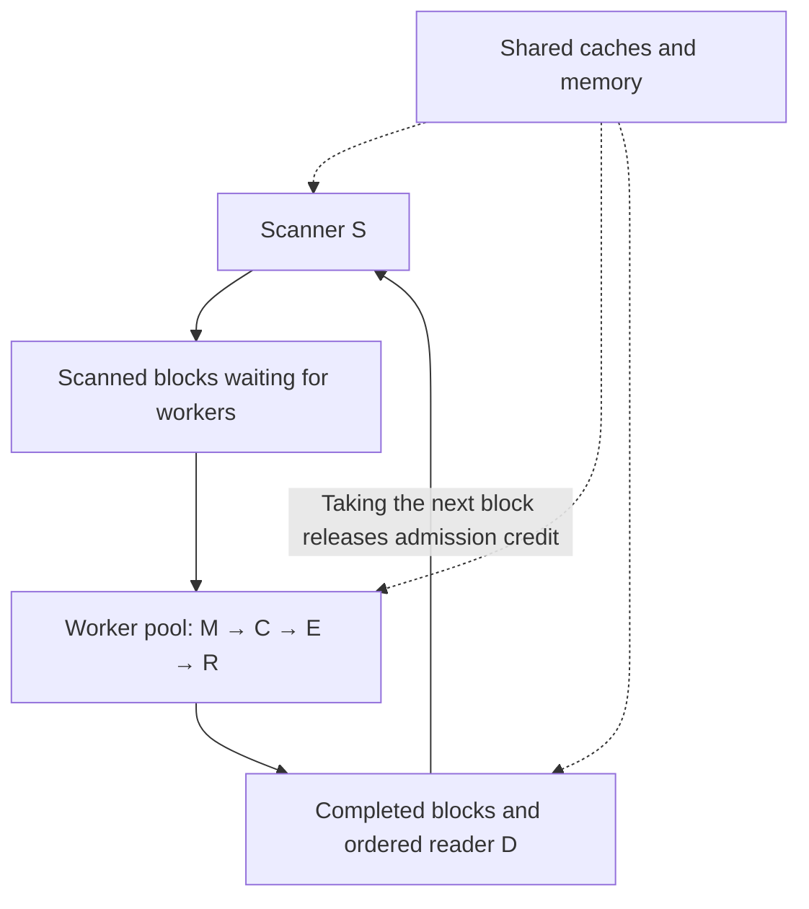

# ChatGPT's review of the ideal-parts work, 26 November 2026 (verbatim)

*Relayed by Louis on 26 November 2026 and recorded at his request, verbatim and unedited. ChatGPT checked the repository with `master` at `2135b1a`. The corrections it prompted are listed in `README.md` in this folder. They were applied to `../results/full/README.md`, `../../plan.md`, `../../rauzy-census/README.md` and journal §91. The review itself stays as written. Its one diagram, attached as an image, is the rendering of the Mermaid block in §1 and is kept here as that Mermaid source.*

---

**Yes. You have completed the main experiment needed to direct the algorithmic work.** It has established where reducing computation could make the whole decoder faster, how that changes with the number of workers, and which improvements become valuable only when another bottleneck is relieved.

Your recollection of the hybrid-system idea is also right. That was the broader framework for reasoning about the decoder’s organisation: work progressing, queues filling, threads waiting, blocks changing ownership, and shared resources affecting everything. The ideal-parts matrix supplies experimental evidence for that framework. A complete predictive model of every possible reorganisation remains unfinished, but you do **not** need that before pursuing the opportunities already identified.

The most consequential result is this: **at eight workers, supplying construction’s results saves about 6% of elapsed time, and supplying the scanner’s results saves about 3%; supplying both saves about 36%.** The measured time falls from approximately **195 ms to 125 ms**, equivalent to **1.56× throughput**. That is substantial room under the experimental intervention. Turning it into a real algorithm requires finding affordable ways to obtain those results. [Full matrix results](https://github.com/lmmx/mibz2/blob/master/docs/journal/2026-11-24-algorithm-level/ideal-parts/results/full/README.md)

There are several distinctions lost in the compressed account you pasted. Explaining those makes the whole programme much easier to understand.

## 1. What the experiment was trying to find

The question was:

> **Which computations would have to become cheaper, and in which combinations, for a mathematical improvement to reduce the time needed to decompress the file?**

That is more specific than identifying expensive functions. There are three different questions involved:

| Question | What answers it | What you learn |
|---|---|---|
| Where does the program spend time? | Profiling and activity timings | The amount and distribution of work. |
| What currently controls completion time? | Scaling measurements and interventions that slow activities | Which constraints are binding in the current configuration. |
| What could become worthwhile if we removed work? | Ideal-part interventions, individually and together | The opportunity for an improvement, including opportunities hidden behind another bottleneck. |

The distinction matters because the decoder overlaps work.

Suppose the scanner and worker pool can each process the file in about 185 ms. Making either one much faster leaves the other taking about 185 ms. Slowing either one makes the whole thing slower. Therefore, **sensitivity to a slowdown does not tell you the gain available from a speedup**.

The project encountered exactly this problem. Earlier experiments established who controlled the wall time, but the ideal-parts study was needed to measure how much improvement was available when work became cheap. The project’s own statement of purpose connects this directly to choosing mathematical targets. [Why the matrix was needed](https://github.com/lmmx/mibz2/blob/master/docs/journal/2026-11-24-algorithm-level/ideal-parts/README.md)

### The decoder being studied

The stage letters describe the following work:

| Part | What it does | Where it runs |
|---|---|---|
| **S — scan** | Parses the compressed block’s coding information and Huffman-decodes its symbols. These are not yet the original bytes. | One scanner thread. |
| **M — move-to-front / RLE2** | Converts those symbols into the BWT column or its run representation. | Workers. |
| **C — construction** | Builds Open’s structures for reconstructing the original order: retained rows, interval-exchange reductions, word descriptions and graph links. | Workers. |
| **E — emission** | Follows the reconstruction structure and expands its word codes into bytes. | Workers. |
| **R — RLE1 / CRC** | Performs the final run-length expansion and checksum work. | Workers. |
| **D — delivery** | Hands completed blocks to the caller in the correct order. | The reader. |

Each worker handles a block through its worker-side stages. Different blocks are processed concurrently. The scanner, workers and reader overlap, while admission limits prevent an unlimited accumulation of blocks and output buffers. [Factor definitions](https://github.com/lmmx/mibz2/blob/master/docs/journal/2026-11-24-algorithm-level/ideal-parts/parts.md)

This organisation explains why adding workers eventually stops helping. If the scanner needs \(s\) seconds per block and one worker needs \(w\), a simple capacity bound is

\[
\text{throughput}(k)\leq
\min\left(\frac{1}{s},\frac{k}{w}\right).
\]

The workers’ capacity rises with their number; the single scanner’s capacity does not. The crossover occurs around \(k=w/s\).

This simple model was already useful: measurements at one to four workers predicted the crossover at **7.49 workers**; the measured crossover was **7.67**, with the best elapsed time around eight workers. That was a successful prediction of a specific system property. It was not a complete explanation of cache contention, startup, draining or every later intervention. [Queueing analysis, §5](https://github.com/lmmx/mibz2/blob/master/docs/site/blog/2026-11-25-the-decoder-as-a-queueing-network.md)

### Where the hybrid-system idea fits

“Hybrid” means combining two descriptions:

- **Between events**, threads make progress on work at rates affected by contention.
- **At events**, a block is admitted, dispatched, finished, taken by the reader, or its buffer recycled.

That description gives you several ways to reorganise the computation: change the amount or rate of work; change when work may proceed; change dispatch and ownership; or change what the intermediate state represents.

A new representation that lets many reconstruction operations be shared fits naturally into this picture. So does moving scanning into the worker pool.

The repository is explicit that this is a **modelling proposal**, not a fully validated hybrid model. It also corrects an earlier claim that the decoder was an exact closed queueing network: it is a finite pipeline with feedback-controlled admission. The input starts, runs and ends; the admission window is a ceiling on outstanding work, not a fixed population of circulating blocks. [Hybrid-system formulation](https://github.com/lmmx/mibz2/blob/master/docs/journal/2026-11-24-algorithm-level/reading/hybrid-dynamical-systems/relevance/decoder-as-hybrid-system.md)

The practical purpose of the formalism is to organise possible changes and state their assumptions. It does not have to become a separate, indefinitely expanding prerequisite to algorithm development.

## 2. What the factorial experiment actually did

You are remembering the **\(2^p\) factorial-design family**. Here there were six factors, each with two settings:

- **Real:** perform the normal computation.
- **Ideal:** supply a previously recorded, correct intermediate result.

I am using \(p\) for the number of factors because the repository also uses \(k\) for the number of workers.

For example, an ideal construction stage receives the structures that construction would normally build. The preparation happens outside the timed decode. Downstream processing consumes those structures.

A crucial experimental detail is that **upstream stages still execute when a downstream stage is ideal**. Otherwise supplying final output could accidentally remove almost the whole decoder, and you could not attribute the measured change to one stage. Each intervention was intended to remove a particular activity while preserving the surrounding computation. [Oracle definitions](https://github.com/lmmx/mibz2/blob/master/docs/journal/2026-11-24-algorithm-level/ideal-parts/parts.md)

### Why combinations were essential

Testing each part alone would miss the central result.

The combination experiments ask:

> Does construction become more valuable to improve after the scanner is improved?

That dependence is an **interaction**. It is precisely what a factorial design is designed to reveal.

Six binary factors give \(2^6=64\) possible combinations. The actual run used **44 configurations per worker count**:

1. **32 configurations** forming a resolution-VI half-fraction.
2. **Six configurations with just one part ideal.**
3. **Six configurations with just one part real.**

The 32 configurations efficiently estimate main effects and pairwise interactions without confusing those effects with one another. Higher-order effects still have aliasing: this does not recover every conceivable interaction independently.

The extra twelve configurations were important. The chosen half-fraction omitted the single-ideal and all-but-one-ideal cases. Adding them meant the headline “room” measurements could be read directly from observed configurations instead of inferred from a fitted model. This amendment was made before the data. [Design](https://github.com/lmmx/mibz2/blob/master/docs/journal/2026-11-24-algorithm-level/ideal-parts/design.md), [registration, clarification 8](https://github.com/lmmx/mibz2/blob/master/docs/journal/2026-11-24-algorithm-level/ideal-parts/registration.md)

### Why those worker counts and controls?

The matrix used **1, 6, 8 and 10 workers**:

- One worker exposes most of the worker-side computation directly in elapsed time.
- Six lies below the crossover.
- Eight lies around the balance point.
- Ten lies above it.

“One worker” still includes the separate scanner and reader; it does not make the whole program single-threaded.

The experiment used twelve randomised round blocks, the same binary across interventions, a pinned scanner, and a 100 ms CPU pre-spin to control the clock-state problem found earlier. Every configuration held the same oracle stores, including the all-real baseline. Output equality and activity ledgers checked that the supplied results were correct and that the intended work disappeared.

The run comprised **2,492 decodes over 4 h 15 min**. Output checks passed; the scanner pin held in all **352** relevant traces; the removed activities’ remaining busy time was **0.00–0.19%** of their real activity time. The reported comparisons use paired geometric-mean time ratios and 95% intervals. [Full results and validity checks](https://github.com/lmmx/mibz2/blob/master/docs/journal/2026-11-24-algorithm-level/ideal-parts/results/full/README.md)

Those controls make the comparisons useful. Their scope is still specific: the i9-10900K, the repeated Wikidata workload, and this experimental arrangement. The stores occupied about **495 MiB**, so the all-real experimental baseline had the production computations but a different memory environment from an ordinary decoder invocation. [Detailed report](https://github.com/lmmx/mibz2/blob/master/docs/journal/2026-11-24-algorithm-level/ideal-parts/results/full/report.txt)

## 3. What was found, and how to read it

Here is the most useful part of the result in milliseconds. Times are rounded; “supplied” means the corresponding oracle intervention.

| Workers | All computations real | Construction supplied | Scanner supplied | Both supplied |
|---:|---:|---:|---:|---:|
| **1** | 1,306 | **756** | 1,319 | **751** |
| **6** | 243 | **183** | 237 | **143** |
| **8** | 195 | 184 | 189 | **125** |
| **10** | 196 | 186 | **180** | **149** |

These are the completed matrix’s results, already recorded on `master`. [Results](https://github.com/lmmx/mibz2/blob/master/docs/journal/2026-11-24-algorithm-level/ideal-parts/results/full/README.md), [combined-intervention table in the plan](https://github.com/lmmx/mibz2/blob/master/docs/journal/2026-11-24-algorithm-level/plan.md)

### Below the crossover, construction is a large opportunity

At one worker, supplying construction reduces elapsed time by about **42%**. At six workers, the reduction is about **25%**.

This gives a strong reason to investigate construction. It establishes that a substantial amount of useful worker-side work could be removed without immediately becoming irrelevant to completion time.

It does not mean every construction improvement can capture that whole amount. Construction contains several different operations, and a particular mathematical idea may affect only one of them.

### At eight workers, the opportunity is strongly conditional

Read the four eight-worker configurations together:

- Ordinary decode: **195 ms**.
- Scanner supplied: **189 ms**.
- Construction supplied: **184 ms**.
- Both supplied: **125 ms**.

Improving either side alone leaves the other holding completion near the old level. Improving both allows completion to move much further.

The individual savings are about 6 and 11 ms; the joint saving is about 70 ms. That is why adding independently measured speedups would have badly underestimated the combined opportunity.

Another way to read the same data:

- Construction supplied by itself saves about **5.6%**.
- Construction supplied **after the scanner is already supplied** saves about **34% of that scanner-supplied time**.

The denominator changed because the question changed.

**There is no meaningful basis for assigning half the joint 36% to each stage.** The result describes a complementary pair. The published factorial interaction coefficient averages over other stages’ settings; the four numbers above are the direct, concrete demonstration. [Conditional ratios and interactions](https://github.com/lmmx/mibz2/blob/master/docs/journal/2026-11-24-algorithm-level/ideal-parts/results/full/report.txt)

This also makes “we must fix S and C” slightly too strong. **Scanner plus construction is the strongest measured pair and an excellent research priority.** Other combinations can help: supplying the scanner and the tested emission work gives approximately **16% less time at eight workers**, with construction still real. A representation change could also improve several stages or reduce shared-resource interference at once. The experiment identifies promising dependencies; it does not prove that only two named functions can produce a worthwhile improvement.

### The other parts matter differently

The single-part results establish the following:

- **Emission’s tested intervention** saves approximately **16.5% at one worker** and **14.9% at six**. Its interpretation needs the correction in the next section.
- **MTF/RLE2** saves approximately **7.5% at one worker** and **8.4% at six**. Calling this “little room” loses a real result. It is smaller than construction, but potentially useful, especially through fusion with construction.
- **RLE1/CRC and delivery** show small standalone benefits in the current arrangement. Their importance can change once upstream constraints are relieved.
- Adding workers from eight to ten makes the **scanner-plus-construction-supplied case slower**, from about 125 to 149 ms. More parallelism is therefore not automatically beneficial even when the obvious computations have been removed. [Full ceiling table](https://github.com/lmmx/mibz2/blob/master/docs/journal/2026-11-24-algorithm-level/ideal-parts/results/full/report.txt)

Shared cache and memory contention are plausible explanations for that last result. However, the original matrix does not cleanly separate production contention from the artificial traffic generated by its replay stores. Antigravity’s report explicitly lists that as an unresolved distinction. “Memory bandwidth is conclusively the third production bottleneck above eight” goes beyond what this run isolated. [Antigravity second pass, §6.1](https://github.com/lmmx/mibz2/blob/7fab624e/research/neon-movement/IDEAL-PARTS-2.md)

### Two statistical phrases that otherwise mislead

**“Construction explains 80%.”** This means approximately 80% of the variation in log elapsed time *across the factorial configurations at one worker*. It does not mean construction consumes 80% of normal runtime. Earlier activity timings put construction at roughly **578 ms of a 1,283 ms one-worker decode**, about 45%. Those are different quantities from different measurements. [Factorial report](https://github.com/lmmx/mibz2/blob/master/docs/journal/2026-11-24-algorithm-level/ideal-parts/results/full/report.txt), [activity timings](https://github.com/lmmx/mibz2/blob/master/docs/journal/2026-11-24-algorithm-level/math-targets/data/character-stage1/report.txt)

This also explains why the scanner can account for a large fraction of experimental variation at eight workers while improving it alone changes the baseline only slightly: many experimental configurations have already made worker work cheap, exposing the scanner much more strongly.

**“UNRESOLVED.”** The registered `ROOM` label required the entire confidence interval to demonstrate at least a 5% saving. Construction at eight workers has an estimated saving of **5.6%**, with an interval corresponding to about **4.4–6.9%**. It therefore misses that particular threshold.

Likewise, the formal `MASKED` label required essentially no standalone effect, within ±2%, before a conditional effect could qualify. No cell met that complete rule. The substantive scanner–construction interaction is still clear; the formal label was narrower than the everyday description. [Decision rules](https://github.com/lmmx/mibz2/blob/master/docs/journal/2026-11-24-algorithm-level/ideal-parts/registration.md)

## 4. The important unfinished measurement: what “all ideal” left behind

This is the largest substantive correction to the compressed account.

### The emission oracle did not remove all emission

Emission does two kinds of work:

1. Determine which word code comes next by following the reconstruction graph.
2. Expand that code into actual bytes.

The original E oracle supplies the codes in output order. It removes the graph walk, but **still expands the words into bytes**.

The implementation charges both the oracle’s code delivery and this remaining expansion work to the ledger entry called `HandE`. The source code makes that visible: it times both `sup::deliver(...)` and `self.consume(...)` under that entry. [Emission-oracle implementation](https://github.com/lmmx/mibz2/blob/e9d5e778/src/open/supplied.rs)

Antigravity compared that with earlier measurements separating the two:

| Work inside the reported emission “handover,” at one worker | Approximate time |
|---|---:|
| Deliver/copy the supplied codes | **25.8 ms** |
| Expand the codes into bytes | **259.4 ms** |
| Combined | **285 ms** |

So about **90% of that entry was real remaining decoder work**, not artificial copying. The original full-results README’s treatment of it as copying is misleading. [Antigravity second pass, §3.1](https://github.com/lmmx/mibz2/blob/7fab624e/research/neon-movement/IDEAL-PARTS-2.md)

This has two consequences:

- The approximately 16.5% emission result is **not a ceiling on all possible emission improvements**.
- The “everything ideal” configuration still performed a significant piece of emission.

### The reported floor mixes several things

The all-ideal wall was approximately:

| Workers | Nominally all-ideal elapsed time |
|---:|---:|
| 1 | 391 ms |
| 6 | 94 ms |
| 8 | 112 ms |
| 10 | 142 ms |

Those times mix remaining word expansion, replay copies, oracle locking, contention, and pipeline overhead. They cannot be read as an irreducible decompression floor. Nor can subtracting average per-thread handover times from elapsed time produce a clean corrected measurement: work overlaps, and different configurations can have different critical paths.

The follow-up separates two quantities:

- **Residual A:** zero-copy stand-ins, with word expansion still performed.
- **Residual B:** zero-copy stand-ins plus `E_full`, which removes word expansion too.

Residual B asks how much the experimental pipeline costs after the substantive work has been bypassed. The quoted **14–19 ms** is an estimate to test, not an achieved measurement and not a proposed real decompression time. A real decoder must still acquire the answers and satisfy its output contract. [Zero-copy build specification](https://github.com/lmmx/mibz2/blob/master/docs/journal/2026-11-24-algorithm-level/ideal-parts/antigravity/prompt-build-zero-copy.md), [floor-run PR #917](https://github.com/lmmx/mibz2/pull/917)

**This follow-up has a bounded purpose:** prevent experimental copying and retained emission work from being mistaken for an intrinsic limit of the decoder. It does not erase the completed matrix’s useful finding about construction and scanner complementarity.

## 5. Where mathematical innovation could help

There are two different scales of mathematical work here.

### Improving a particular algorithmic component

Examples include choosing an induction order with fewer steps, reducing the work required to build dictionary entries, or finding a better way to split a dependency chain into independently executable pieces.

These can yield valuable gains, but each has a specific budget: the time spent in the component it changes.

### Changing the representation so more work can be shared or avoided

This is closer to the original breakthrough objective.

Open already exploits a mathematical observation: parts of the inverse-BWT computation move together. It retains some rows, summarises stretches between them as words, builds the resulting structure, then follows it to reconstruct the bytes.

A more powerful representation could potentially reduce:

- how many objects construction must create;
- how many links must be wired;
- how many dependent lookups emission performs;
- how many word expansions are needed;
- how much intermediate data is written and reread.

That means a mathematical improvement could affect **both construction and emission**, rather than living neatly inside one stage.

The project’s own formulation names two productive directions:

- **Contraction:** recognise that several operations are instances of the same computation and compose or share them.
- **Enrichment:** retain or cheaply compute useful information during existing work so that a later operation becomes unnecessary.

The hard requirement is **closure**: after composition, the representation must remain compact and cheap to use. If it fragments into thousands of pieces, requires an expensive acquisition pass, or hides a reconstruction walk inside its setup, the apparent saving disappears. [The project’s mathematical aim](https://github.com/lmmx/mibz2/blob/master/docs/journal/2026-11-24-algorithm-level/essence.md)

The separate \(Q,D,P,S\) cost model is useful here: it accounts for addressed reads, dependent-access depth, sequential passes, and stored state. It prevents a candidate from claiming victory in one currency while quietly spending much more in another.

The negative results do not close this broader search. The rigid-interval conservation result applies to a specified class of representations and operations; the repository explicitly corrects earlier claims that it was a universal machine lower bound. It also records that the cross-stage causality results prohibit certain *final values* before sufficient input is known, while leaving room for deferred summaries or “riders.” [Formulation report, §§2 and 4](https://github.com/lmmx/mibz2/blob/master/docs/journal/2026-11-24-algorithm-level/reports/2026-11-24-from-search-to-formulated-problem.md)

The matrix now supplies a practical test for such ideas: **does the proposed reduction affect a substantial demand, and what companion change lets that reduction reach the output?**

## 6. What concrete changes could capture the opportunity?

### A. Construction contains three sizeable pieces

The earlier one-worker activity measurements split construction as follows:

| Construction phase | Approximate time | What it does | Principal code |
|---|---:|---|---|
| **A6a** | **200 ms** | First pass over runs: classification, counts, admission and queues. | `src/open.rs`, with input from `src/runs.rs`. |
| **A6b** | **216 ms** | Setup, interval-exchange induction, and dictionary/word construction. | `src/open.rs`, `src/open/endpoint.rs`. |
| **A6c** | **161 ms** | Wiring the retained-row graph. | `src/open.rs`, `src/open/outq.rs`. |

These sum to about 578 ms. They come from stage 1, whose baseline was slightly different from the later matrix, so they are an indicative decomposition rather than an exact partition of the matrix’s 1,306 ms. [Measured activity split](https://github.com/lmmx/mibz2/blob/master/docs/journal/2026-11-24-algorithm-level/math-targets/data/character-stage1/report.txt)

This immediately explains why “construction has 42% room” does not mean “a better Rauzy schedule could save 42%.”

### B. The Rauzy schedule question has a fairly specific budget

The historical result gives these step counts:

| Schedule or bound | Steps per original run |
|---|---:|
| Right-end induction | **1.812** |
| Best recorded schedule: free steps first, otherwise largest cell | **1.279** |
| Lower bound for the stated class of cell steps | **1.220** |

The mathematical idea is understandable without the full formalism. Steps remove boundaries in the interval representation. Some choices create additional boundaries that will later need removal. Better schedules avoid creating as many of them.

The record expresses this as

\[
\text{steps}=r_2-1+U,
\]

where the first term counts the unavoidable boundary reductions in this model and \(U\) counts additional boundaries introduced by the schedule. “Free” in this discussion means avoiding that additional combinatorial charge; the step still costs CPU time. [Original result, §5.6](https://github.com/lmmx/mibz2/blob/master/docs/journal/monodromy/2026-11-10-rauzy-veech.md)

The known schedule reduces the step count by

\[
1-\frac{1.279}{1.812}\approx29.4\%.
\]

Now connect that to elapsed time.

Even if **all 216 ms of A6b** fell proportionally with the step count, the saving would be approximately

\[
216\text{ ms}\times29.4\%\approx64\text{ ms},
\]

or about **4.9% of the one-worker matrix baseline**.

A more realistic budget is

\[
\text{saving}\approx
216\text{ ms}
\times
\text{fraction spent on reducible steps}
\times29.4\%
-
\text{new scheduling overhead}.
\]

The written 3%-of-wall gate corresponds to about 39 ms. With this step reduction, roughly **62% of A6b would need to be reducible step time**, even before paying for the new schedule.

That is why the small time-split measurement matters: it decides whether this particular mathematical question has enough current-decoder value to justify more work.

There are also two transfer issues:

- The 1.812/1.279 counts were obtained for the earlier full run-letter interval exchange. Current Open eliminates thick strips while retaining thin rows. The census must compare schedules on the **actual production object**.
- The historical record already warns that a lower-step schedule can lose locality, prefetching and cheap sweep order. Its worklist may cost more than the saved steps.

The 1.220 figure is therefore neither a universal BWT-inversion lower bound nor an established attainable runtime optimum.

### C. The surface-dynamics work is an offline instrument

Its useful output would be a cheap rule, a useful structural invariant, or a better representation that you can implement in the decoder.

The research tool can explore many expensive alternatives offline. The deployed rule must make its decisions affordably using information available during reconstruction.

“Online” should be understood in that sense. Construction already has block-level information; an implementable schedule can inspect that available representation. It does not have to make every decision before the entire compressed block has arrived.

The current census prompt sensibly starts by extending the existing examples and timing the production kernel before committing to a large general-purpose port. It already includes the network-calculus and uiCA pre-port tests. [Census task and stopping criteria](https://github.com/lmmx/mibz2/blob/master/docs/journal/2026-11-24-algorithm-level/rauzy-census/prompt.md)

### D. Construction has other opportunities beyond induction scheduling

Two concrete proposals in Antigravity’s report address different parts of its budget.

**Feed construction directly from MTF/RLE2.** The current run interface caps run lengths at 127, while construction subsequently recombines records into maximal runs. A direct interface could avoid intermediate materialisation and repeated processing. This principally touches `src/runs.rs`, `src/open.rs` and their call path.

**Change graph wiring together with emission.** The proposal replaces bidirectional XOR-linked traversal with forward links and several interleaved forward walks. That could simplify A6c’s wiring while exposing more independent memory accesses during E and simplifying word expansion. It touches `src/open/outq.rs`, the emitters in `src/open.rs`, and potentially the RLE1/CRC consumer.

The second is especially interesting because it crosses the stage boundary: a different consumer allows a cheaper structure to be constructed. It illustrates why the best improvement may not resemble “optimise this function in isolation.”

Both remain proposals with predicted gains and explicit rejection tests. Their quoted savings have not been demonstrated by a production implementation. [Antigravity’s concrete designs, §5](https://github.com/lmmx/mibz2/blob/7fab624e/research/neon-movement/IDEAL-PARTS-2.md)

### E. The scanner opportunity is a change in work placement

The proposed pooled scanner would:

1. Locate and validate candidate block boundaries.
2. Give workers compressed blocks.
3. Have each worker perform scanning and reconstruction locally.
4. Retain correct ordered delivery and stream checks.

The principal files are `src/parallel.rs` and `src/huff.rs`.

This distributes the scanner’s work across cores and can remove intermediate cross-thread symbol traffic. **The scan still has to be performed.** That is why the scanner oracle’s deletion of work is not a direct prediction of pooled scanning’s gain.

Antigravity estimates **130–145 ms** for pooled scanning combined with construction improvements, against the approximately 195 ms baseline. That is an argued design forecast. The measured 125 ms oracle endpoint makes this a sensible scale of opportunity to investigate, but it does not validate the forecast. [Pooled-scan proposal and accounting](https://github.com/lmmx/mibz2/blob/7fab624e/research/neon-movement/IDEAL-PARTS-2.md)

Worker counts also need reconsideration after a substantial redesign: a faster worker stage, a distributed scan and a different memory footprint can move the best operating point.

## 7. What needs finishing before this becomes endless characterisation?

**The broad prioritisation is already good enough to guide constructive work.** I would give the remaining measurements narrowly defined jobs.

| Remaining question | Why answering it changes a decision |
|---|---|
| What remains after replay copying and word expansion are separated? | Determines whether pipeline overhead deserves attention and corrects interpretation of the apparent floor. |
| How much of A6b is induction steps versus setup and dictionary work? | Determines whether better induction scheduling can meet the existing payoff gate. |
| Does a proposed representation or pipeline change win as a complete path? | Determines whether to develop that specific implementation further. |

The zero-copy recipe is now **PR #917**. It is held pending the oracle implementation and plans nine arms at **1, 6, 7, 8, 9 and 10 workers**, including all-but-one comparisons and memory-controller counters where available. No completed result from that follow-up is recorded in the sources I checked. It is a focused follow-up, not another run of the original 44-arm matrix. [Current floor-run plan](https://github.com/lmmx/mibz2/pull/917)

The offline tools have similarly bounded purposes:

- **Network calculus:** can useful upper bounds be obtained under explicit arrival and service assumptions?
- **uiCA:** can a local instruction-cost model reliably distinguish promising kernel changes?
- **Surface dynamics:** does broader structural exploration reveal a useful, cheaply implementable rule?

None needs to become a prerequisite for investigating the already identified construction and scanner designs.

There is also a distinction between a mathematical breakthrough and a useful implementation improvement. A multi-lane walk may shorten dependency chains without reducing the total number of addressed reads. That can make the decoder substantially faster while leaving the original read-count research question open. Both outcomes should be recorded accurately.

## 8. Where the evidence and plan actually live

I checked the repository on **26 November**, with `master` at `2135b1a`.

| Material | Location and status |
|---|---|
| Main matrix results, statistical report and tables | **Already on `master`**, in [ideal-parts/results/full](https://github.com/lmmx/mibz2/tree/master/docs/journal/2026-11-24-algorithm-level/ideal-parts/results/full). |
| Durable explanation of the work and its stopping tests | **On `master`**, in [plan.md](https://github.com/lmmx/mibz2/blob/master/docs/journal/2026-11-24-algorithm-level/plan.md), merged through #915. |
| Full Antigravity second-pass analysis | On the research branch at the pinned [7fab624e report](https://github.com/lmmx/mibz2/blob/7fab624e/research/neon-movement/IDEAL-PARTS-2.md). Master records and links to it; the full report was not copied into master. |
| Faster next-run experimental harness | [#909](https://github.com/lmmx/mibz2/pull/909), `bench/ideal-matrix-next`, still open. This is the corrected base for the zero-copy implementation. |
| Zero-copy floor recipe | [#917](https://github.com/lmmx/mibz2/pull/917), still open and waiting for the implementation. |
| KaTeX correction | [#914](https://github.com/lmmx/mibz2/pull/914) **has now merged**. |

My assessment is that **the evidence supports pursuing substantial gains**, especially through a coordinated change to scanner capacity and worker-side construction, with representation changes that simplify both construction and emission particularly attractive.

The next decision can now be concrete: choose a candidate that removes an identified cost, account for the work needed to obtain its new representation, and test the complete affected path. The matrix has supplied the reason to do that work. The remaining floor and sub-phase measurements should sharpen that choice and then close.
