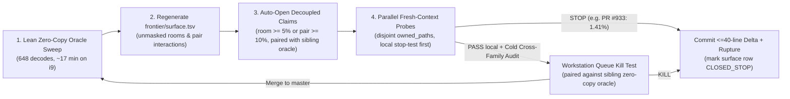

# Rhizomatic swarms, stale contexts, and the plane of consistency: a cross-reading of `mibz2`

*26 November 2026. Grounded on `origin/master` (`21971a4`), PR #145's live comment record (2,269 comments across 22 days; 2,748 comments including the seven role inboxes), and open PR #933 (the Rauzy census STOP verdict). Reading, characterisation, and analytical redesign only; no decoder or benchmark code modified.*

**Two external lenses applied literally, not as ornament:**
1. **Paradigm 3 / Leech & Zanichelli (24 November 2026), *"Swarms do not yet raise the roof"*** (`https://www.paradigm3.org/research/swarms/`): matched weighted-token comparisons (8M and 32M) of 2-, 4-, 8- (and 16/32-) agent teams against single agents across four long-horizon tasks (`git-to-zig`, `AHC014`, `AHC038`, performance take-home) and three topologies (Park et al. protocol teams, self-organized teams on Codex's undocumented message board / Claude Code DMs / mixed SwarmChat, and orchestrated Codex "Ultra" teams). Headline findings: ~6× wall-clock speedup (Bostrom's speed axis), ~7% quality penalty growing with swarm size (Toby Ord's stepping-on-toes parameter $\lambda \approx 0.6\text{–}0.9$, where $\lambda = \ln(X/b)/\ln N$), and a decisive confound at 32M tokens on `git-to-zig`: self-organized teams of 8 beat continuous solo runs (93.2% vs 83.7% on GPT-6.1 Sol; 32.0% vs 26.6% on GPT-6.1 Terra), **until the solo agent was allowed to restart with fresh contexts across sequential sessions**, whereupon the restarted solo beat every swarm (97.0% Sol; 41.9% Terra). Mixed Claude+GPT teams over SwarmChat likewise failed to clearly beat the best single agent, with a wide spread (−17 to +53 points) from letting agents talk.
2. **Deleuze & Guattari, *A Thousand Plateaus* ("Introduction: Rhizome", Principles 3 & 4 — read as a literal systems theory of multiplicities and topology):**
   - **Principle 3 (Multiplicity):** A genuine multiplicity never allows itself to be overcoded and has no supplementary dimension ($n + 1$) standing above its lines. All multiplicities are flat, filling a *plane of consistency*. "Unity" is always a power takeover by a signifier or subject operating in an empty supplementary dimension. Genuine multiplicities change in nature as their connections increase, whereas *arborescent pseudomultiplicities* merely clone the One under a single scalar unit of measure. Speed transforms points into lines (Glenn Gould).
   - **Principle 4 (Asignifying rupture):** A language closed upon itself operates only as a function of impotence. A rhizome survives by shattering at a given spot and restarting on old or new lines (as ants do), though every line of flight constantly risks restratification and overcoding.

---

## Part 1: Grounding in the Repository

### 1.1 The actual coordination machinery, message board, and live traffic

`mibz2`'s agent infrastructure has accumulated two full geological strata plus a third improvised layer running on top of them:

1. **Frozen stratum (4–5 November):** `docs/journal/compact30-channel/` (`ROLES.md`, `PROTOCOL.md`, `SPEC.md`, `MODE.md`, `MODE.ORIGIN.md`, `log.md`) established the original four-agent loop (Claude Code Coordinator + three Astra ChatGPT Work tasks: Guardian, Optimiser, Researcher).
2. **Codified team stratum (6–22 November):** `docs/team/` (`OWNERSHIP.md`, `ROLES.md`, `RULES.md`, `PROTOCOL.md`, `MODE.md`, `MODE.RATIONALE.md`, `WORK-TASKS.md`, `CODEX-PILOT.md`, `CODEX-RELAY-PILOT.md`, `COORDINATOR-FAILOVER.md`, `DELIVERED.md`, `ACQUISITION-FIRST.md`, and `docs/team/research-charter/`), enforced by `.github/coordination/coord.py` (393 lines) and `.github/workflows/channel-routing.yml`.
3. **Actual live topology (22–26 November):** A heterogeneous four-surface star centred on Claude Code (Coordinator), driving:
   - two Claude Code sibling sessions (`Pathfinder` on inbox `#314` and `MONODROMY` on inbox `#346`, woken via Claude Code Remote MCP `send_message` per `docs/team/PROTOCOL.md` §1a);
   - Google Antigravity running **Gemini Neon** (both single sessions fed Coordinator-authored prompt files committed to `docs/journal/2026-11-24-algorithm-level/ideal-parts/antigravity/prompt-*.md`, `briefs/*.md`, and `rauzy-census/prompt.md`, and bounded `/teamwork` multi-investigator runs such as `docs/journal/2026-11-22-neon-teamwork-paradigm.md`);
   - **ChatGPT Pro**, consulted manually via Louis copy-pasting questions/files and pasting verbatim responses back into `docs/journal/2026-11-24-algorithm-level/external/` and `ideal-parts/reviews/`;
   - Louis's i9-10900K workstation, pulling frozen recipes autonomously via `bench/workstation-queue.txt` and `just workstation-queue` (`PROTOCOL.md` §9) and posting automated SHA-256 evidence bundles onto `#145`.

Measuring the GitHub comment threads directly exposes the gap between the documented architecture and live practice:

| GitHub thread | Role / function | Total comments (to 26 Nov) | Comments in last 5 days (22–26 Nov, `#145` sample of 269) |
|---|---|---:|---|
| PR `#145` | Shared team channel | **2,269** | 269 (22: 22, 23: 43, 24: 98, 25: 98, 26: 8) |
| PR `#160` | Optimiser inbox (Astra Work) | 53 | **0** posts on `#145` |
| PR `#161` | Guardian inbox (Astra Work) | 92 | **0** posts on `#145` |
| PR `#162` | Researcher inbox (Astra Work) | 163 | 3 `REVIEW` posts on `#145` |
| PR `#222` | Observer inbox (Astra Work) | 90 | **0** posts on `#145` |
| PR `#314` | Pathfinder inbox (Claude sibling) | 12 | 11 posts on `#145` (10 `REVIEW`, 1 `LOG`) |
| PR `#346` | MONODROMY inbox (Claude sibling) | 54 | 49 `REVIEW` posts on `#145` |
| Issue `#363` | Codex manual inbox | 15 | **0** posts on `#145` |
| **Total** | **8 threads** | **2,748** | — |

Breaking down those last 269 comments on `#145` by parsed `FROM:` and `TYPE:` headers reveals where the board's bandwidth actually goes:

- **`coordinator`**: **124 comments (46.1%)** — 107 `LOG`, 13 `QUEUED`, 4 `CORRECTION`. Nearly half the shared board is the Coordinator logging its own state transitions or staging queue reminders.
- **`louis via workstation`**: **60 comments (22.3%)** — purely automated `just submit` start/finish `LOG` pings with evidence SHA-256 digests.
- **`monodromy`**: **49 comments (18.2%)** — `REVIEW` pointers to `docs/journal/monodromy/` records.
- **`neon` (all variants)**: **19 comments (7.1%)** — split across four inconsistent headers (`neon`: 8, `neon (movement)`: 4, `neon (council)`: 1, and **6 malformed single-line headers** `7141393178`, `7142049992`, `7143141901`, `7146233142`, `7147099561`, `7147835505` that literally read `FROM: neon (movement) / TO: coordinator / TYPE: REVIEW` on one line, causing `coord.py`'s `header()` parser to classify them as `untyped`).
- **`pathfinder`**: **11 comments (4.1%)** — 10 `REVIEW`, 1 `LOG`.
- **`researcher`**: 3; **`louis via chatgpt`**: 2; **`carbon`**: 1; **`optimizer` / `guardian` / `observer` / `codex`**: **0**.

Two repository files confirm that the governance layer stopped self-pruning weeks ago:
- `docs/team/DELIVERED.md` has only **two rows**, both dated `2026-11-10` (for v0.2.8), even though the repository has reached v0.5.14+ (`7475dafd`, `#145` comment `7159134690`) and merged dozens of changes since.
- `docs/team/OWNERSHIP.md` §5 explicitly mandates a weekly review of `DELIVERED.md`, a 30-day sunset on every process rule outside `RULES A/B`, a per-release 3-line retro that *deletes or simplifies one rule*, and tracks *"The reversion signal: comments and decisions per merged `src/` PR. If it climbs, cut process before starting anything else."* Yet in the 50 most recent commits on `master` (24–26 November), only **3 commits touch `src/`** while **38 touch `docs/`**, alongside 204 comments on `#145` over those same three days.

### 1.2 The two blog posts: from GitHub doorbell to rhizomatic desire

1. **`docs/site/blog/2026-11-04-autonomous-agent-team.md`** (*"Call on mibz2: cutting instructions from bzip2 decoding with an autonomous swarm"*):
   - Documents the shift from human copy-paste relaying to an event-driven GitHub PR message board, and records **five exact failure modes of the first shared board** (§8):
     1. every event woke every agent ("nearly all of those runs ended straight away with 'not for me'");
     2. a new event silently displaced any in-progress run with no dead-letter queue (**six Optimiser briefs lost in one evening**, leaving zero commits and looking externally like silence);
     3. brittle string-matched `TO:`/`TYPE:` routing dropped messages without trace;
     4. noise exhausted platform wake budgets;
     5. ChatGPT's GitHub connector added latency that lengthened runs and raised displacement probability.
   - Records the two classic Coordinator self-verification failures (§9): posting two Optimiser briefs (`6652503445`, `6653242752`) to `#145` instead of `#160` (sitting unseen for 53 minutes — *"Correctness of intent and correctness of record both held. Correctness of effect didn't"*), and passing a hallucinated/misnamed `sha` parameter instead of `expectedHeadSha` across eight merges (`#167`, `#170`, `#184`–`#189`).
   - Already glimpses Paradigm 3's fresh-context insight in §6 (*"Reproducible, independent review"*): *"The ongoing Researcher can't do that: it has followed the work, and it suggested some of the tests. So it started a fresh helper whose only input was a pinned brief… the point is that the reviewer never saw the discussion."*

2. **`docs/site/blog/2026-11-22-decompression-is-the-harder-problem.md`** and its full dialogue source **`docs/site/blog/conversations/2026-11-22-thomas-murphy.html`** (*"Playing the hand you're dealt: in conversation with Thomas Murphy"*):
   - Draws the operational line between Antigravity's `/teamwork` (autonomous multi-agent team) and `/swarm` (shared message board), while self-diagnosing the existing `docs/team/` stack:
     - Louis: *"before that i was sort of hand rolling their identities as 'modes' along with a 'rationale' (this torrid approach of all caps md pseudo-repo health files)"*
     - Louis on moving off Astra: *"i am moving away from astra tbh, just downgraded my sub there / all seasons come to an end / it's all about neon swarming seemingly"*
     - Louis on subagents vs sibling sessions: *"subagents are too ephemeral and if you ask them to switch gears they often just go 'oh let me stop everything and DELETE ALL WORK IJUST SPENT TOKENS ON' / Against the Beclauded Subagent"*
     - Louis on lossless transfer vs chat: *"yeah message boards are better than communication i think / basically you want to use repo filesystems for lossless transfer / if you use messaging they always summarise and give an impoverished precis"*
     - Louis on the actual current star topology: *"claude code makes a good coordinator as it can just watch the repo without being told where to watch / so it says 'send out these 4 prompts to antigravity sessions' and instructs them to use branches for their evidence and they go off into combinatoric lore and then claude gives me prompts for astra in codex to implement the algos and then claude runs the CI and merge and release runbook"*
     - Louis & Thomas explicitly invoke Deleuze (*"the trick is to paraphrase deleuze"*, *"larval subject/swarm subjectivity"*, *"insanely rhizomatic burrows"*) alongside BEAM, Bondy, Girard's session types, and Lafont's interaction nets, and frame the algorithmic pivot: real-world decompression is *"cache contention shaped"* and *"not fuckwithable"* (unlike the Hutter Prize's encoder-cheating "spherical cow"), demanding a *systems-biology* multi-parameter model rather than a single linear proof.
   - Note also `docs/team/MODE.md` (lines 77–80, 103–106) and `docs/team/MODE.RATIONALE.md` (lines 182–228): Deleuze's *"He Stuttered"* (*differential recurrence*) and *"differential proliferation"* (*"agent count is not intellectual multiplicity… No fixed initial partition imprisoning later thought"*) were already written directly into `MODE.md` on 5 November — making the contrast between the repo's *aspirational* rhizome and its *actual* star topology starkly verifiable.

### 1.3 The algorithmic pivot: from "kitchen sink" to hybrid systems and ideal-parts characterisation

The repository records a clean, dated four-stage turn between 20 November and 26 November:

1. **Mathematical maximalism ("kitchen sink", 20–22 November):**
   - `docs/journal/2026-11-20-kitchen-sink.md` and `docs/team/research-charter/METHOD.md` §1 (*"Mathematical maximalism"*) listed ~25 mathematical toolkits (Rauzy fractals, Veech groups, Krohn–Rhodes, $K_0$ of AF algebras, cluster algebras, braids, tropical geometry, learned indexes, operads) inspired by Levent Alpöge's claimed RH/GRH Lean proof.
   - On 22 November, Antigravity `/teamwork` executed a massive 7-investigator + Adversarial Referee sweep (`docs/journal/2026-11-22-neon-teamwork-paradigm.md`: `Alpha`–`Eta` + `Referee` with `CaDiCaL`, `Z3`, `OR-Tools CP-SAT`). It produced three genuine non-walk primitives (`Lazard-BWT`, `1Cut-BWT`, `BDMR`, `MF-BSE`), universal obstructions (`G1` `L`-completeness under uniform `TC⁰`, `G2` unconditional read-only streaming lower bound $\Omega(r/(L p^4))$, `G3` Krylov obstruction, `E1` 3-row global sensitivity), and DRAT certificates — **yet every single full non-walk replacement lost natively by 3.1×–15.0× at $n \le 900\text{k}$** because `OpenCells`'s `edges` (`351–798 KiB`) already fit in L2/L3 while non-walk primitives blew up irregular accesses ($2.2\text{–}5.7\times m_{16}$), RW-stream traffic (17–299 MB), or SLP expansion time alone (1.5–3.6 ms vs 1.3–2.9 ms for all of `OpenCells`). The only three positive native mechanisms (`BSAC`, uncapped maximal runs `-19.1%` Pass 1, `XB-SLP` `0.954×` 1W / flat at 4W) were narrow structural adjustments, not global non-walk replacements.
   - Across 24 November (`docs/journal/2026-11-24-algorithm-level/reports/2026-11-24-from-search-to-formulated-problem.md`, `reviews/carbon-cycle1-critique.md`, `reviews/neon-movement-critique.md`, `reviews/neon-movement-cycle4-critique.md`), 12+ mathematical candidates were built and audited; every composed route landed at `1.32–2.83 h₁` all-in (none near `h₁/2`), several duplicated prior work (`C-3` and `C-4` repeated 20 November `research/carbon-kitchen-sink` cycle 7; `S1A`/`S3`/`S4`/`S5` repeated MONODROMY or classical list ranking), and Neon's overclaims cost a full independent audit every single round.

2. **Formulation & external critique (24 November):**
   - `council/comparison.md` (comparing independent answers from MONODROMY, Neon, and ChatGPT Pro) surfaced **28 internal contradictions** across the repo's documents (with 0 substantive errors in ChatGPT's sampled claims) and replaced the degenerate scalar $c_1$ with the vector currency `(Q, D, P, S)` plus a required Bridge theorem.
   - `external/outside-review.md`, `external/chatgpt-closure.md`, and `external/against-mathematics-chatgpt.md` dismantled two premature closures (`G1` is a rigid-calculus provenance bound, not a machine lower bound; the 16% supplied-codes gain at 1W / 0% at 10W was one intervention, not a ceiling), warned against *"Pythagorean numerology"* turning $h_1$ into metaphysics, and highlighted Hilbert's 24th problem (*investigate the space of transformations between algorithms*) and Archimedes' Method (*preserve generative methods and transferable insights, not just Hearer-style obstruction decrees*).

3. **Hybrid dynamical systems & Jain experimental design (24–25 November):**
   - Triggered by the four-arm oracle surprise (`journal §44`: at 10W, emission oracle alone gave `0.976` — apparently dead — while scanner oracle gave `0.806`, and *both* gave `0.741`, exposing `D/C = 0.920` of masked emission room behind the serial scanner), the team shifted to systems-biology / Raj Jain characterisation (`programme.md`, `briefs/character.md`, `process/protocol.md`).
   - `reading/hybrid-dynamical-systems/relevance/decoder-as-hybrid-system.md` and `levers.md` formulated the decoder as $\mathcal{H} = (C, F, D, G)$ plus ownership and state space (Lever 5). Critically, `external/chatgpt-hybrid-systems-review.md` (journal §70) caught major mathematical errors in the Coordinator's first draft: the bottleneck maximum $L = \max(S, W/k, R)$ is a **lower bound**, not an upper completion-time certificate (3-second serial counterexample); `q_issued`/`q_ready`/`q_taken` are shared-order sequence numbers, not cumulative counts; admission is checked *before* scanning; discrete guard $a < W$ is already a closed discrete set, not a noisy continuous threshold; and token-bucket rate optimisation was inverted. This separated three distinct formal objects: **lower bound $L$** (prune), **held-out predictor $\hat{T}$** (rank), and **proved upper certificate $U$** (guarantee).

4. **Ideal-parts matrix, zero-copy floor, and immediate frontier kills (25–26 November):**
   - **`ideal-parts/results/full/README.md`** (2,492 decodes in 4 h 15 min, resolution-VI $2^{6-1}$ half-fraction + 12 axial arms over parts `S, M, C, E, R, D`):
     - At 1W, construction `C` has **−42% room** (`1,306 → 756 ms`); at 6W, **−25%** (`243 → 183 ms`).
     - At **8W (what ships)**, `S` alone saves **−3%** (`195 → 189 ms`) and `C` alone saves **−6%** (`195 → 184 ms`), **but `S + C` together save −36% (`195 → 125 ms`, 1.56× throughput; $q_{SC} = -0.071$, $4q = -0.28$)**.
     - `ideal-parts/reviews/2026-11-26-chatgpt.md` caught that `E`'s "handover" (`285 ms` at 1W) was actually ~90% real word-spelling work (`self.consume`, `259 ms`) rather than oracle copying (`26 ms`), and that the all-ideal rise from 8→10W (`112 → 142 ms`) confounded memory contention with oracle copy traffic.
   - **`ideal-parts/results/floor/report.txt` (journal §92, zero-copy floor built by Neon in PR `#921`, 648 decodes, ~17 min on i9):**
     - Pure pipeline plumbing (`Residual B`, `SFCMRD`) is **5.2–5.7 ms** across 1–10W (2.7% of shipped 8W wall) — refuting Antigravity's 14–19 ms prediction and closing plumbing as a target.
     - With all worker parts free, the serial scan alone (`FCMRD`) takes **179.1 ms at 8W** (leaving at most 8% for worker-only speedups until `S` leaves its serial thread).
     - Two previously hidden costs jumped into plain view: emission's word spelling (`E_consume = A - B`) takes **298.2 ms at 1W** (22% of wall) and **37.2 ms at 8W**; delivery's serial copy-out (`SFCMR - SFCMRD`) takes **47.3–49.3 ms** at every worker count (the next serial wall once `S+C` drops).
     - With oracle copies gone, `Residual A` stayed flat from 8→10W (`42.4 → 40.5 ms`), **refuting** Antigravity's §90 third-station memory-bandwidth hypothesis at 8–10W.
   - **Immediate downstream kills and decouplings:**
     - **PR `#933` (`research/rauzy-census`, Neon, 26 Nov):** Applied the frozen 3% stop test in `rauzy-census/README.md` to Thread 2 (Rauzy induction order on `A6b`). Measured `A6b` steps = 51.13% of `A6b`, best step cut on Open's actual auxiliary IET = −16.69% (not −29.4%), zero-overhead wall ceiling = **1.41%** (< 3% gate), and every alternative order slower on the clock (`1.014×–17.4×`). **STOP verdict** — killing a 4–6k-line `surface_dynamics` port in hours.
     - **`pooled-scan/registration.md` (Pathfinder, 26 Nov):** Because `S` alone has only 3.2% room at 8W, Antigravity's proposed standalone kill test (`P/none ≤ 0.93`) would have killed any pooled scan by construction. The Pathfinder therefore coupled the kill test directly to `C`'s zero-copy oracle: `PC/C` must beat $\sqrt{\text{SC}/C}$ (capturing at least half of `S`'s 32% log-room behind `C`), allowing `S` to be built and falsified *before* `C` is rewritten.

---

## Part 2: Deep Cross-Reading & Diagnosis

### 2.1 Where `mibz2` is currently overcoded ($n + 1$ supplementary dimensions)

Read through Deleuze & Guattari's Principle 3 (*no supplementary dimension $n + 1$ over and above the multiplicity's lines*) and Principle 4 (*a language closed upon itself operates only as a function of impotence*), `mibz2` exhibits **four concrete forms of overcoding** right now:

#### 1. The Coordinator as an $n + 1$ Master Signifier and Human-Relay Bottleneck
Every structural rule in `CLAUDE.md`, `PROTOCOL.md`, and `.github/coordination/coord.py` inscribes an asymmetric $n + 1$ centre:
- `coord.py` line 155 hardcodes `if sender != "coordinator": return "Only the coordinator writes in an inbox"`.
- Every single Antigravity/Neon task in the algorithm-level campaign is authored by Claude Code as a bespoke 30–105 line prompt committed to `master` (`prompt-1.md`, `prompt-2.md`, `prompt-build-oracles.md`, `prompt-build-zero-copy.md`, `rauzy-census/prompt.md`, `antigravity-software-survey-prompt.md`) and stamped **`Given to Louis to paste`**.
- The resulting **translation tax** is documented verbatim in the repo:
  - **Human reduced back to a message bus:** After celebrating eliminating manual relaying on 4 November, Louis is back to pasting prompts from Claude into Antigravity and pasting responses from ChatGPT back into Claude (`notes/coordinator.md` line 154: *"You are making me micromanage when i asked for autonomy."* — triggered because the Coordinator withheld two pre-port tests as a question after Louis had already pasted the prompt).
  - **Coordinator-injected defects:** `prompt-build-zero-copy.md` initially told Neon to branch from `master`, where `src/scan_oracle.rs` and `src/supplied_codes.rs` did not exist (requiring correction commit `#916` and re-pasting); `prompt-1.md` and `prompt-2.md` compressed the 3-line header into `` `FROM: neon (movement) / TO: coordinator / TYPE: REVIEW` ``, causing Neon to emit six unparseable single-line headers on `#145` (`7141393178`–`7147835505`); Coordinator briefed `#920` against `write-blog-post` ("credit ChatGPT's review … and name it"), causing rejection and two full rewrites (`#923`, `#927`); Coordinator accidentally closed `#861` via `"fix #861"` in queue PR `#864`; Coordinator drifted overnight on 24–25 November (`journal §87`), feeding the workstation ready engineering PRs instead of the ideal-parts matrix Louis had actually asked for.
  - **Lossy compression at the $n + 1$ hub:** Exactly as Louis warned in the Thomas Murphy chat (*"if you use messaging they always summarise and give an impoverished precis"*), every time technical reality passed through the Coordinator's summary layer, load-bearing caveats evaporated until ChatGPT Pro re-read the primary sources: `G1` became a machine floor (`journal §42`), 16% became a ceiling (`§42`), the bottleneck maximum became a completion-time certificate (`§70`), `q_*` sequence numbers became counts (`§70`), `20` requested threads became 20 active workers instead of 7 lazy workers (`§61`), and `HandE`'s 259 ms real spelling work became "oracle copying" (`§91`).

#### 2. Fossilised Arborescent Governance (`docs/team/` as a Closed Language)
`docs/team/` has become a textbook Deleuzian closed language operating as a function of impotence:
- **Dead roles still wired into active tooling:** Three Astra Work roles (`#160` Optimiser, `#161` Guardian, `#222` Observer) and `#363` Codex produced **zero** comments on `#145` over 22–26 November (Louis downgraded his Astra subscription), yet `CLAUDE.md`, `ROLES.md`, `PROTOCOL.md`, `RULES.md`, `WORK-TASKS.md`, and `coord.py` still require every Coordinator wake to audit all 8 threads and maintain their routing invariants.
- **Self-pruning rules that never pruned:** `OWNERSHIP.md` §5 explicitly prescribed a 30-day rule sunset, a weekly `DELIVERED.md` check, and a per-release retro that deletes one rule. Instead, `DELIVERED.md` froze at 10 November (2 rows), while `CLAUDE.md` grew to 225 lines of accumulated incident patches ("no redirects ever", "never put PR after fix", "macOS runners never hold merge", "when not to wait for CI", "no AI attribution").
- **Overcoding the rhizome itself:** The most revealing irony in the repo is `docs/team/MODE.md` and `docs/team/MODE.RATIONALE.md` (702 lines!). On 5 November, Louis imported Deleuze's *"He Stuttered"* and *"differential proliferation"* precisely to break linguistic and organizational ossification — and the team promptly codified it into a 702-line linguistic specification, a glossary of 16 terms, a surface linter (`tools/mode_doctest.py`), and an 8-question conformance rubric. That is literal **restratification** (Principle 4): a line of flight recaptured by an arborescent bureaucracy.

#### 3. Premature Stratification of the Mathematical Search ("Pythagorean Numerology")
As `external/against-mathematics-chatgpt.md` §II.4 and `council/comparison.md` diagnosed, between 18 and 24 November the scalar $c_1 \ge h_1$ (rigid-interval calculus) functioned as an overcoding signifier over the entire mathematical space:
- `Record 98` placed sort-based list ranking outside $\mathcal{R}$, then `Record 99` pulled it back inside by unfolding bulk operations into singleton derivations — protecting the theorem's sovereignty at the expense of blinding the search.
- `FRONTIER.md` risked converting live discoveries into *Hearer* commandments ("local coordinates blocked; copy replay blocked; contraction blocked") stripped of their escape conditions, making subsequent agents *less* capable of discovery as the register grew longer.

#### 4. Arborescent Pseudomultiplicity Inside Parallel Fan-Outs
In Deleuze & Guattari's Principle 3, an *arborescent pseudomultiplicity* clones the same unit under a fixed parent objective rather than letting connections transform the multiplicity's nature. `mibz2` hit this twice:
- **20–24 November kitchen-sink & movement cycles:** `carbon-cycle1` (`C-1`–`C-4`) and `neon-movement` (`S1`–`S6`) fanned out sub-lines under a single unverified parent scalar (`Q < h₁/2` on `Open`'s walk). Because they did not alter the problem's coordinate system, multiple branches re-derived identical classical mechanisms (Gauss–Seidel row sweeps `M-17`, external-memory list ranking, `carbon-kitchen-sink` cycle 7 unitigs and hex slabs), paying multiple full review cycles to rediscover prior rejections.
- **22 November `/teamwork` paradigm run (`Alpha`–`Eta`):** Despite extraordinary technical quality and DRAT rigor, six of the seven investigators attacked a single parent assumption (replace `OpenCells`'s walk at $n \le 900\text{k}$) *before* the ideal-parts matrix established that at 8 workers `S` and `C` co-limit and `E`'s walk is masked behind `S`. Every full non-walk replacement lost 3.1×–15.0× natively. That is **branching under an unexamined root**, not a flat multiplicity moving along measured gradients.

---

### 2.2 Where Paradigm 3's "Stale Context / $\lambda < 1$" Critique Hits `mibz2` — and Where It Misses

#### Where Paradigm 3 hits `mibz2` squarely

| Paradigm 3 mechanism | Concrete manifestation in `mibz2` |
|---|---|
| **Coordination & review tax ($\lambda \approx 0.6\text{–}0.9$)** | 124 of the last 269 `#145` comments (46%) are Coordinator `LOG`/`QUEUED`/`CORRECTION` overhead. Every single `neon-movement` cycle (1–4) and `carbon-cycle1` required a full independent audit (`reviews/neon-movement-critique.md` through `cycle4`, `reviews/carbon-cycle1-critique.md`) just to add back omitted IET/payload/pass charges and deflate overclaimed headlines. |
| **Apparent swarm gain = stale-context confound** | Paradigm 3's headline result (8-agent swarm beats continuous solo at 32M tokens only because continuous solo goes stale; fresh-context restarted solo beats every swarm) explains **why fresh isolated reviewers repeatedly outperformed `mibz2`'s long-running sessions**. MONODROMY's first session (`session_0187sPR6VfS2exgM79Mtua39`) accumulated so much context it had to be archived on 24 Nov (`HANDOFF-2026-11-24.md`). The long-running Coordinator session carried stale priors across days (20 workers vs 7 lazy; bottleneck max = certificate; `HandE` = copying; overnight PR drift §87). The "fresh independent reviewer" (4 Nov blog §6) and cold ChatGPT Pro reviews won primarily because they entered with **zero stale session history**, reading raw code and TSVs directly. |
| **Wall-clock speedup ≠ token-efficiency gain** | `2026-11-22-neon-teamwork-paradigm` (7 parallel investigators + Referee) and concurrent Pathfinder/Neon/MONODROMY workstreams clearly delivered Paradigm 3's ~6× wall-clock compression (Bostrom's speed axis: a week of exploration in one day), but on closed-scalar sub-tasks (e.g., six incremental attempts on `Open`, `METHOD.md` §1) parallel fan-out spent more total tokens for equal or worse quality than a single fresh-context researcher. |
| **Unbounded chat / messaging degrades performance** | Paradigm 3 found mixed Claude+GPT SwarmChat had a −17 to +53 point spread and Codex's mid-session messaging even triggered premature context compaction (230k–350k vs 450k). In `mibz2`, PR `#145`'s 2,269 prose comments and 4 Nov's shared-board wake storms exhibit the exact same pathology. |

#### Where Paradigm 3 misses `mibz2` (four structural divergences)

1. **Asymmetric cross-family cognitive heterogeneity vs homogeneous clones (and symmetric chat):**
   Paradigm 3's core sweeps ran $N$ identical clones of one model (GPT-6.1 Sol, GPT-6.1 Terra, Claude Opus 5.5). Even its small mixed Claude+GPT test forced symmetric free-chat through SwarmChat and paused faster models whenever they got 250k weighted tokens ahead. In `mibz2`, the real gains came from **asymmetric epistemic complementarity across three genuinely different model families + tool harnesses**:
   - **Gemini Neon (Antigravity):** highest throughput on broad mathematical exploration, exhaustive multi-variant Rust/Python prototypes, SAT/CP-SAT sweeps, and rapid instrumentation (building PR `#895`, PR `#921`, and PR `#933` cleanly in hours), paired with a systematic failure mode of **optimistic headline compression and omitted accounting terms**.
   - **ChatGPT Pro:** highest precision as a cold adversarial mathematical referee ("slow head"), catching 28 contradictions in `council/comparison.md` (0 substantive errors), disproving the bottleneck certificate (`chatgpt-hybrid-systems-review.md`), catching `q_*` sequence numbers, `HandE` spelling (`2026-11-26-chatgpt.md`), and the token-bucket inversion — paired with **no local build/benchmark shell**.
   - **Claude Code:** strongest on Rust systems integration (`src/`, `bench/`, `.just/`), workstation queue discipline, and Miri/CI stewardship — paired with a failure mode of **clerical over-coordination and premature prose summarisation** when cast as an $n + 1$ Coordinator.
   In `process/protocol.md` §5, independent parallel reading across these three families caught errors that *no single model family caught alone* (default worker count, scanner plumbing, certificate bound direction). That is **decorrelated error detection across heterogeneous priors**, not homogeneous duration scaling.

2. **Open-ended problem reformulation vs static scalar benchmarks:**
   Every Paradigm 3 task (`git-to-zig` = 743 fixed git tests; `AHC014`/`AHC038` = fixed AtCoder score; performance take-home = fixed metric) holds the problem formulation constant from token 0. In `mibz2`, the **definition of the problem itself mutated three times in 22 days**: instruction count (4 Nov) → Rauzy–Veech / `Open` MLP (10–18 Nov) → rigid-calculus $h_1$ floor (20–24 Nov) → hybrid dynamical system + complementary-bottleneck matrix (24–26 Nov). Moving along Lever 5 (changing the state space itself) is a qualitative change of the multiplicity's nature — outside the closed scalar hill-climb that Ord's $\lambda$ models.

3. **Scarce physical hardware oracle (the i9-10900K workstation) breaks token-only accounting:**
   Paradigm 3 prices only tokens and wall-clock time inside virtual sandboxes. In `mibz2`, the binding scarce resource is **physical i9-10900K workstation time** (`bench-ideal-matrix` took 4 h 15 min; `bench-scan-profile` took ~40 min) and **engineering build complexity** (a 4–6k-line `surface_dynamics` port). Spending extra parallel tokens on independent pre-run design reviews (`process/protocol.md` §8 added 12 irreplaceable measurements before Stage 1 ran) or Neon's 1-day Rauzy census (`PR #933` killing Thread 2 at 1.41%) yields a massive return in *saved physical measurement cycles and avoided dead code* — even if $\lambda_{\text{tokens}} < 1$.

4. **Lossless git/TSV stigmergy vs lossy conversational boards:**
   Paradigm 3's self-organized teams coordinated over Slack-like chat (`post`, `read_thread`, `subscribe`, DMs, SwarmChat). Whenever `mibz2` bypassed prose and communicated through **pinned commits, raw TSV tables, `check_manifest.py`, and SHA-256 `evidence` bundles**, coordination overhead dropped sharply. `mibz2`'s problem is not that it lacks stigmergic primitives — it already built them — but that PR `#145` and Coordinator-authored prompts keep wrapping those lossless artifacts in an $n + 1$ layer of lossy prose.

---

### 2.3 Why the pivot to hybrid systems and ideal-parts characterisation mattered structurally

Read through both lenses simultaneously, the 24–26 November pivot is the single most important structural event in the repository's history:

1. **Constructing a Deleuzian *plane of consistency* (escaping computational weight):**
   Before 24 November, every mathematical exploration collided immediately with **stratified computational weight**: serial scanner masking at 8–10W, 127-cap record splitting, cache-line footprint, acquisition passes, and oracle handover copies. Two opposite failure modes resulted:
   - *False kills:* Emission speedups looked dead at 10W (`0.988`, §30) because the serial scanner masked them; a naive standalone kill test on pooled scanning (`P/none ≤ 0.93` at 8W) would have killed pooled scanning because `S` alone has only 3.2% room behind `C` (`pooled-scan/registration.md` §1).
   - *Expensive dead builds:* `Lazard-BWT`, `BDMR`, `MF-BSE`, `LazyTunnel`, and `ZeroRV-Tunnel` (`2026-11-22-neon-teamwork-paradigm.md`) were implemented in full safe Rust before measuring which stages actually had room at 8W, only to lose 3.1×–15.0× natively.

   Supplying pre-computed ideal answers (`ideal-parts/` + zero-copy floor) **flattens the stratified decoder onto a plane of consistency**. Every stage's intrinsic potential (`C = −42%` at 1W; `E_consume = 298 ms` at 1W; `D = 48 ms` serial copy-out; `plumbing = 5.3 ms`) and every cross-stage coupling (`S × C = −36%` at 8W) becomes measurable *before* paying the weight of inventing or implementing the algorithm. Paired with the hybrid dynamical system representation $\mathcal{H} = (C, F, D, G)$ plus ownership and Lever 5 (`decoder-as-hybrid-system.md`, `levers.md`), the decoder ceases to be a tree of source files (`src/huff.rs`, `src/open.rs`) and becomes a flat field of flows, guards, ownership transitions, and separated bounds ($L$, $\hat{T}$, $U$).

   In Deleuze & Guattari's phrase (Glenn Gould), *speed transforms points into lines*: within 48 hours of building the zero-copy oracle surface, static point-debates ("should we port `surface_dynamics`?", "is memory bandwidth a third station?", "does plumbing cost 14–19 ms?") dissolved into decisive structural lines:
   - plumbing collapsed to 5.3 ms (closed);
   - third-station memory bandwidth at 8–10W was refuted by flat `Residual A` (`42.4 → 40.5 ms`, closed);
   - Rauzy induction order on `A6b` hit a 1.41% ceiling (`PR #933`, closed before porting 4–6k lines);
   - `S + C` became the exact coupled frontier (`195 → 125 ms`), with `E_consume` (`298 ms` at 1W) and `D` (`48 ms` serial floor) visibly queued behind it.

2. **Raising $\lambda \to 1$ by turning coupled bottlenecks into oracle-decoupled workstreams:**
   Paradigm 3's stepping-on-toes penalty ($\lambda < 1$) occurs when parallel agents share coupled state or spend tokens negotiating what matters. The zero-copy oracle suite (`src/ideal/`, PR `#921`) solves both mechanically:
   - **Shared quantitative priority without a Coordinator:** Once `ideal-parts/results/` publishes the unmasked room of every part and pair, agents do not need an $n + 1$ Coordinator to argue over what to work on. Any target below the 3–5% stop gate prunes itself.
   - **Oracle-coupled modularity:** Normally, a complementary bottleneck like `S × C` forces sequential work (low $\lambda$): you cannot test a pooled scanner cleanly until construction is faster, and you cannot see construction's full 8W gain until the scanner is faster. **Zero-copy oracles break that coupling.** Worker A develops `pooled-scan` tested against `C`'s zero-copy oracle (`PC/C`, exactly as `pooled-scan/registration.md` §4 specifies); Worker B develops `C` (`A5+A6a` uncapped maximal-run fold + `A6c`/`E` forward lanes) tested against `S`'s zero-copy oracle (`SC_cand/S`). Both work concurrently on disjoint files (`src/parallel.rs`+`src/huff.rs` vs `src/runs.rs`+`src/open.rs`) against exact counterfactual ground truth, with zero merge collisions and zero Coordinator chatter. That is how a swarm structurally approaches $\lambda \to 1$.

---

## Part 3: Concrete Rhizomatic Redesign for `mibz2`

### 3.1 Topology: Claude Code + Gemini Neon + ChatGPT Pro + Antigravity `/teamwork`

#### Verdict on Claude Code writing Antigravity/Neon prompts
**Retire the prompt-writing Coordinator role; narrow Claude Code into an equal lateral peer ("Systems & Integration Peer") backed by deterministic repo scripts.**

Keeping Claude Code as an $n + 1$ prompt-writer preserves every failure documented in Part 2: Louis acting as copy-paste relay, base-branch errors (`#916`), inline-header corruption (`7141393178`–`7147835505`), overnight objective drift (`§87`), blog-brief violations (`#920`), and 107 Coordinator `LOG` comments per five days.

#### Comparison of concrete alternatives

| Topology | Mechanism | Verdict & concrete reason |
|---|---|---|
| **A. Patched Coordinator star (status quo)** | Claude Code keeps writing `ideal-parts/antigravity/prompt-*.md` and routing `#145` with stricter templates. | **Reject.** Keeps the $n + 1$ hub, preserves human paste latency, and pays Paradigm 3's orchestrator coordination tax without fixing context staleness. |
| **B. Symmetric free-chat swarm (SwarmChat / open `/swarm`)** | Claude, Neon, and ChatGPT converse freely in a shared chat channel and self-organize. | **Reject.** Paradigm 3's mixed Claude+GPT SwarmChat test showed huge variance (−17 to +53 pts) with no consistent win over the best solo agent; `mibz2`'s own 4 Nov shared board failed in five ways; chat compresses artifacts into lossy summaries. |
| **C. Flat Stigmergic Frontier with Asymmetric Model Peers + Fresh-Context Rupture (Recommended)** | Repo state (`frontier/`) IS the plane. Zero Coordinator prompt-writer. Heterogeneous peers pull atomic, path-disjoint tickets cold via a 1-line launcher, commit lossless artifacts + ≤40-line deltas, and terminate. | **Adopt.** Eliminates $n + 1$ overcoding, leverages genuine cross-family cognitive asymmetry, enforces Paradigm 3's fresh-context restart advantage, and decouples `S`, `C`, `E`, `D` via zero-copy oracles. |

#### Exact peer allocation in Topology C (by comparative advantage, not bureaucratic titles)

| Peer / Harness | Concrete responsibility in `mibz2` | Session lifecycle (rupture rule) | What it stops doing |
|---|---|---|---|
| **Gemini Neon (Antigravity single session)** | Mathematical probes, census binaries (`examples/`), off-by-default oracle builds (`src/ideal/`), alternative kernel prototypes. | 1 atomic `frontier/claims/<id>.toml` per fresh session; hard rupture at claim completion or 4M weighted tokens. | Never relies on 100-line Coordinator prose prompts; launches via a single invariant command: *"Run `just frontier-brief`, claim the highest-priority open ticket tagged `peer=neon`, execute, commit delta, stop."* |
| **Antigravity `/teamwork` (strictly scoped niche)** | **Valid niche ONLY:** embarrassingly parallel, read-only mathematical censuses or multi-hypothesis falsification sweeps over fixed authenticated blocks with an independent local verifier/referee (the `Alpha`–`Eta` + SAT/CP-SAT pattern of `2026-11-22-neon-teamwork-paradigm.md`), *after* the ideal-parts surface confirms the target has $\ge 10\%$ room. | Single bounded run emitting one TSV/JSON result table + stop verdicts; immediate dissolution. | **Never** used for iterative prose coordination, shared `src/` engineering, or open-ended brainstorming without an active oracle room gate. |
| **Claude Code (Systems & Integration Peer — narrowed)** | Production `src/` integration, `bench/` & `.just/` workstation recipes, `run-signal.yml` ready tags, Miri/B5 safety verification, merges and releases (`docs/RELEASING.md`). | Disposable fresh sessions per PR or workstation batch (replaces both the permanent Coordinator and permanent Pathfinder/MONODROMY multi-day sessions). | **Stops** authoring bespoke Neon prompt files, **stops** summarizing external reviews in prose, **stops** posting manual `LOG`/`QUEUED` comments on `#145`. If it needs a census or oracle, it commits a 12-line `frontier/claims/<id>.toml` ticket with exact `base_sha` and `stop_test`. |
| **ChatGPT Pro (Cold Adversarial Referee — "Slow Head")** | Blinded adversarial falsification at **three gates only**: (1) before freezing a multi-hour workstation design, (2) before adopting any formal bound/certificate as a planning axiom, (3) after an oracle matrix run. | Strictly **fresh conversation** per audit, reading pinned commit SHA + raw code/TSV directly (never Coordinator summaries). Commits/pastes straight into `frontier/audits/<claim>-<sha8>.md`. | Never used as a conversational brainstormer or routine status reviewer. |
| **Louis (Owner & Physical Oracle)** | `RULES D` (mandate, spending, releases-while-absent) + unattended `just workstation-queue`. | Async only. | No longer copies prompts from Claude to Antigravity or mediates between sessions. |

#### Immediate pruning of fossilised strata (`docs/team/`)
Honor `OWNERSHIP.md` §5's 30-day sunset rule immediately:
- Archive dormant roles and specs (`#160`, `#161`, `#162`, `#222`, `#363`, `SPEC.*.md`, `WORK-TASKS.md`, `CODEX-PILOT.md`, `CODEX-RELAY-PILOT.md`, `COORDINATOR-FAILOVER.md`, `MODE.RATIONALE.md`) under `docs/team/archive/`.
- Collapse live team governance into **three compact files**:
  1. `docs/team/RULES.md` — stripped to immutable invariants only: `B1/B4/B5/B6/B7` (correctness, immutable verdicts, `unsafe` B5, stops, Miri), `C2` (no post-hoc gate relaxation), `D` (owner reserve), `E4` (no AI attribution).
  2. `docs/team/PERFORMANCE-POLICY.md` — unchanged.
  3. `docs/team/FRONTIER-PROTOCOL.md` (<120 lines) — the stigmergic schema below.
- Retire `MODE.md`'s 702-line linguistic apparatus (`mode_doctest.py`, 8-question rubric) to archive; keep a 5-line epistemic discipline block inside `just frontier-brief` (`[PROVED]` / `[VERIFIED]` / `[MEASURED]` / `[CONJECTURED]`; charge acquisition; never edit `src/` on a characterisation claim).

---

### 3.2 Message board redesign: from chat/overcoding to stigmergy + asignifying rupture

Replace PR `#145`'s prose chat and `.github/coordination/coord.py`'s Coordinator-only hub with a **git-native stigmergic layer under `frontier/`**, validated symmetrically for all peers by `frontier/check.py` (CI-enforced, zero privileged `FROM: coordinator` branch):

#### 1. `frontier/surface.tsv` — The living plane of consistency
Auto-generated directly from the latest `evidence` bundle by the benchmark analysis script (never hand-edited in prose):

```tsv
target	workers	real_ms	ideal_ms	room_pct	paired_with	pair_room_pct	oracle_feature	evidence_sha	status
C	1	1306.0	756.0	42.1	none	-	ideal-construction	7dd7b070	OPEN
E_consume	1	1342.7	1044.5	22.2	SFCMRD	-	ideal-e-full	cc8ba137	OPEN
S+C	8	195.0	125.0	35.9	S,C	35.9	scan-oracle,ideal-construction	7dd7b070	OPEN_PAIR
S	8	194.6	179.1	8.0	FCMRD	32.1_behind_C	scan-oracle	cc8ba137	OPEN_COUPLED
D	8	194.6	147.3	24.3_floor	SFCMRD	47.3ms_serial	ideal-delivery	cc8ba137	DORMANT_UNTIL_WALL_LT_120MS
A6b_order	1	1306.0	1287.6	1.41	none	-	examples/rauzy_census.rs	pr933	CLOSED_STOP
plumbing	8	194.6	189.4	2.7	SFCMRD	5.2ms	zero-copy-floor	cc8ba137	CLOSED_FLOOR
```

#### 2. `frontier/claims/<id>.toml` — Atomic, path-disjoint, TTL-bounded work leases
Every unit of work — whether opened by Claude Code, Neon, ChatGPT, or Louis — is a single TOML file. Because `base_sha` and `owned_paths` are checked mechanically by `frontier/check.py`, base-branch mismatches (`#916`), duplicate builds (`#145` comment `7188035640`), and stepping-on-toes edits fail fast at `git push` / CI:

```toml
id = "2026-11-26-pooled-scan-kill"
status = "claimed"                  # open | claimed | verdict_pass | verdict_stop | expired
peer_hint = "claude"                # advisory comparative-advantage tag: claude | neon | chatgpt | any
lever = "work_placement+ownership"  # F | C | D | G | ownership | state_space
target_surface = ["S", "S+C"]
decoupling_oracle = "ideal-construction (zero-copy, PR #921)"

base_sha = "1e27e46f972f37cf25678c1ba43c936453d772ba"   # exact 40-hex; check.py verifies ancestor
branch = "research/pooled-scan-proto"
owned_paths = ["src/ideal/pooled.rs", "src/parallel.rs", "bench/pooled-scan*"]

claimed_at = "2026-11-26T13:00:00Z"
ttl_hours = 6                       # auto-expires if no delta committed; no Coordinator polling
token_budget_weighted = 3_000_000   # rupture ceiling: stop & commit delta before context goes stale

[stop_test]
frozen_before_data = true
pass_rule = "8W PC/C 95% UB <= sqrt(SC/C) AND P/none 95% LB <= 1.03 AND peak_rss <= 1.10 AND finder_1T <= 10ms"
kill_rule = "any condition violated at 8W on i9 wikidata x4"
verifier = "cargo test --features pooled-scan && just submit bench-pooled-scan"
```

#### 3. `frontier/deltas/<id>.md` — Mandatory rupture artifact (≤40 lines, lossless pointers)
When a session finishes its claim (or hits `token_budget_weighted`), it commits its raw code/TSV/JSON artifacts, writes a **strictly ≤40-line** delta file, updates `claims/<id>.toml` status, pushes, and **terminates (asignifying rupture)** — never carrying stale context into the next claim:

```markdown
# Delta: <id>
- **Commit / Evidence:** `<40-char sha>` | bundle `<evidence sha256>` | raw data `<path/to/results.tsv>`
- **Verdict:** `PASS` | `STOP` | `VOID` (frozen stop test applied verbatim)
- **Displaced obligation:** <exact stage/cost attacked>
- **Measured or proved delta:** <exact numbers with 95% CIs or proof scope; tags [PROVED]/[VERIFIED]/[MEASURED]>
- **Transferable insight & escape condition (Learner memory):** <what mathematical/systems fact survived even if STOP; exact assumption whose removal reopens the line>
- **Next surface row unlocked:** <target row in frontier/surface.tsv, or NONE>
```

#### 4. `frontier/audits/<id>-<sha8>.toml` — Cold cross-family verification
A different model family on a fresh context reads ONLY `base_sha`, `result_sha`, code, and raw TSVs (never the author's chat history) and emits:

```toml
claim_id = "2026-11-26-pooled-scan-kill"
audited_sha = "<40-char sha>"
auditor_family = "chatgpt-pro"      # must differ from claim author_family on adoption/formulation gates
verdict = "VERIFIED"                # VERIFIED | DISPUTED | COUNTEREXAMPLE
checked_claims = ["PC/C arithmetic", "error-order contract", "zero uncharged scan duplication"]
defects = []                        # each defect names file:line + minimal counterexample or recomputed figure
```

#### 5. What remains on PR `#145` (zero manual prose)
A lightweight GitHub Actions workflow (`frontier-ping.yml`) watches pushes to `frontier/{claims,deltas,audits}/*` and `evidence`, posting a deterministic 3-line machine event on `#145` (or a clean successor board PR):

```text
EVENT: DELTA | ID: 2026-11-26-rauzy-census | VERDICT: STOP
SHA: 47b4613... | DELTA: frontier/deltas/2026-11-26-rauzy-census.md
SURFACE: A6b_order -> CLOSED_STOP (1.41% < 3.0% gate)
```

No agent manually writes `FROM:/TO:/TYPE:` headers, `LOG`s, or `QUEUED` comments ever again. The entire `coord.py` hub-and-spoke router (`route`, `verify`, `misrouted`, `RESOLVED`) and the 7 inbox PRs become unnecessary.

#### 6. Mechanical anti-restratification checks (`frontier/check.py`, enforced in CI)
To prevent the rhizome from restratifying back into a Coordinator hierarchy (Principle 4):
1. **Path disjointness ($\lambda \to 1$):** Fail CI if two `status = "claimed"` files have overlapping `owned_paths` globs.
2. **Symmetric permissions (no $n + 1$):** `check.py` contains zero role-privileged branches; any peer can open a claim, claim an open ticket, commit a delta, or submit a cold audit.
3. **Anti-bureaucracy reversion check (`OWNERSHIP.md` §5, actually enforced):** Compute rolling 7-day ratio of `(docs/team/ + frontier/claims/ prose-only commits)` to `(measured delta / src/ / examples/ commits)`. If governance commits exceed 20%, CI emits a warning requiring rule deletion before adding new process.
4. **No self-certification:** For `adoption` or `formulation` claims, `frontier/audits/` requires `auditor_family != author_family`.
5. **Auto-expiry without a human or Coordinator:** Any `claimed` lease older than `ttl_hours` without a linked delta automatically reverts to `open` when `just frontier-brief` renders.

---

### 3.3 The iterative oracle-characterisation loop

Coupling `frontier/surface.tsv` with the zero-copy oracles (`src/ideal/`, PR `#921`) turns research into a self-steering four-step loop that automatically concentrates effort on outsized levers and prunes marginal tweaks:



Concrete walk-through of the **exact next two iterations** on `mibz2` today (post-§92 and post-PR `#933`):

- **Iteration 1 (current frontier after §92, wall = 195 ms at 8W):**
  - `frontier/surface.tsv` holds four live targets and two closed floors:
    - *Closed (zero tokens spent):* `plumbing` (5.2 ms, 2.7%), `A6b_order` (`PR #933` STOP, 1.41% ceiling).
    - *Active parallel Claim 1 (`S` behind `C`):* `pooled-scan` (`src/ideal/pooled.rs`, `src/parallel.rs`) — tested against zero-copy `C` oracle (`PC/C` vs $\sqrt{\text{SC}/C}$).
    - *Active parallel Claim 2 (`C` behind `S`):* `A5+A6a` uncapped maximal-run fold (`src/runs.rs`, `src/open.rs`) — tested against zero-copy `S` oracle (`SC_fold/S`).
    - *Active parallel Claim 3 (`A6c+E` + `E_consume` behind `S`):* forward emission lanes + word-spelling reduction (`src/open/outq.rs`, `src/open.rs` emit path — attacking the newly exposed **298 ms 1W / 37 ms 8W `E_consume`** cost) — tested against zero-copy `S+C` oracles.
    - *Dormant (auto-gated):* `D` serial delivery copy-out (`48 ms` flat) stays `DORMANT` until `master` wall drops below `120 ms` (where 48 ms exceeds 40% of total wall and becomes the primary lever).
- **Iteration 2 (immediately after `pooled-scan` + `A5+A6a` merge):**
  - Run the 17-minute 9-arm zero-copy sweep (`bench-zero-copy-floor`, updated so the new `master` is `none`).
  - `frontier/surface.tsv` redraws automatically: `S` drops out of the bottleneck column; `E_consume` (now ~30% of remaining 8W wall) and `D` (now ~35–40% of remaining 8W wall, zero-copy whole-block transfer to downstream `wikidata-pq`!) jump automatically to the top two `OPEN` rows.
  - Every session working on stale pre-shift assumptions has already ruptured; the next fresh sessions pull the newly dominant levers on token 1.

---

### 3.4 Falsifiable experiment inside `mibz2` (matched token spend)

To avoid adopting a flat swarm on philosophical faith — honoring both Paradigm 3's matched-compute discipline and `mibz2`'s `RULES C2` — run one low-budget, pre-registered three-arm experiment directly on real open `mibz2` work.

#### Target problem (frozen before launch)
**Worker-side throughput behind the zero-copy `S` oracle on `bench/ideal-matrix-next` (pinned commit `1e27e46f`):**
Combine and implement candidate improvements from `plan.md` threads 4 & 5 (`A5+A6a` uncapped maximal-run direct feed from `src/runs.rs` into `src/open.rs`, `A6c+E` forward-lane wiring/emission, and `E_consume` word-spelling acceleration) as an off-by-default research feature `worker-frontier-exp`, targeting minimum byte-exact wall-clock time on `wikidata ×4` at **8 workers with zero-copy `S` ideal (`arm_S / baseline_S`)**, subject to:
- byte-exact SHA-256 parity on `wikidata`, `wikidata ×4`, `prose`, `hex`;
- zero new `unsafe` without B5 safety argument + Miri pass;
- `cargo test --features worker-frontier-exp`, `clippy -D warnings`, `fmt --check` green;
- peak RSS $\le 1.10\times$ baseline.

This problem is ideal because it has **three genuinely decomposable sub-levers** (`A5+A6a`, `A6c+E`, `E_consume`), a **hard exactness verifier**, an **objective physical wall-clock score** on the i9 (eliminating subjective grading), and real production value for `mibz2` regardless of which arm wins.

#### Three matched arms at **6M weighted tokens total** (plus a 2M solo calibration anchor)
Weighted tokens are tracked identically across arms using Paradigm 3's API-cost-weighted accounting (cached input discounted at provider ratio, output weighted at provider ratio; exact raw input/cached/output counts logged per session).

| Arm | Topology & model allocation | Budget split (6M weighted total) | Context lifecycle |
|---|---|---|---|
| **Anchor (calibration)** | Solo fresh-context (best single model: Neon or Claude) | 1 × 2M | Single fresh session (establishes $f(2\text{M})$ for computing $\lambda$) |
| **Arm 1 — Current Orchestrated Workflow** | Claude Code Coordinator writes prompts into `ideal-parts/antigravity/` → Louis pastes to Antigravity Neon → Claude integrates & reviews via `#145` | 1.5M Claude Coord + 3.5M Neon + 1.0M Claude integration | Continuous Coordinator session + pasted Neon sessions (exact current `mibz2` process) |
| **Arm 2 — Paradigm 3 Restarted Solo Baseline** | Single model (run 2a: Claude Code solo; run 2b: Gemini Neon solo; score the stronger solo) | 3 sequential sessions × 2M each | **Hard fresh-context restart** at 2M and 4M; only git repo + ≤40-line committed delta carried forward; zero board/chat |
| **Arm 3 — Redesigned Flat Stigmergic Swarm** | 2× Gemini Neon claiming disjoint `frontier/claims/*.toml` (`A5+A6a` fold on `src/runs.rs`+Pass 1; `E_consume`/`A6c+E` on `src/open/outq.rs`+emit) + 1× Claude Code Systems Peer (integration + bench recipe) + 1× Cold ChatGPT Pro Audit (blinded review of surviving commits before workstation queue) | 2.0M Neon-1 + 2.0M Neon-2 + 1.2M Claude + 0.8M ChatGPT Pro | **Zero Coordinator prompts, zero `#145` prose, strict path disjointness, hard rupture after each claim** |

#### Pre-registered metrics
1. **Primary quality score $Q_{\text{wall}}$:** Paired geometric-mean speedup `(1 - arm_S / baseline_S)` on i9 `wikidata ×4` at 8 workers (12 randomised blocks, 100 ms pre-spin, zero-copy `S` ideal), gated on byte-exactness + Miri/clippy green. (Also record 1W speedup `arm_1W / baseline_1W`.)
2. **Effective scaling exponent $\lambda$:** Fitted against the restarted solo curve using Paradigm 3 / Toby Ord's formula $\lambda = \ln(X/b)/\ln N$, where $b = 2\text{M}$ per worker slot, $N = 3$ active builder/integrator slots, and $X$ is the solo token budget needed to match Arm 3's $Q_{\text{wall}}$ on the log-budget interpolation between 2M and 6M.
3. **Soundness / defect-catch rate $D_{\text{caught}}$:** Count of real bugs, uncharged cost relocations, or flawed kill-test premises caught *before* touching the workstation queue (independently verified post-hoc).
4. **Wall-clock latency $T_{\text{wall}}$** (launch to verified PR head) and **Human relay count $H_{\text{relay}}$** (manual copy-pastes or disambiguation prompts required from Louis).
5. **Coordination tax $\tau_{\text{coord}}$:** Fraction of weighted tokens spent on prompt-writing, `#145` comments, routing, and re-summarisation vs code, proofs, and measurements.

#### Frozen decision rules (C2 — never relaxed after data)
- **ADOPT Arm 3 (Flat Stigmergic Swarm)** iff:
  1. Arm 3 meets or beats Arm 1 on $Q_{\text{wall}}$ (within 95% CI or strictly faster) **while** cutting $\tau_{\text{coord}}$ by $\ge 50\%$ and keeping $H_{\text{relay}} \le 1$; **AND**
  2. Either **(a)** Arm 3 strictly exceeds the stronger Arm 2 (restarted solo) on $Q_{\text{wall}}$ by $\ge 2\text{pp}$ (empirically demonstrating $\lambda > 1$ via heterogeneous flat stigmergy!), **or (b)** Arm 3 stays within $2\text{pp}$ of Arm 2 while delivering $\ge 2.0\times$ wall-clock speedup AND catching $\ge 1$ verified accounting/correctness defect via the cold ChatGPT audit that Arm 2 missed.
- **FALL BACK TO RESTARTED SOLO + COLD AUDIT (Paradigm 3 vindicated)** iff Arm 2 (restarted solo) beats Arm 3 by $> 3\text{pp}$ on $Q_{\text{wall}}$ at matched 6M tokens with zero uncaught soundness defects (confirming $\lambda < 1$ even after eliminating $n + 1$ overcoding). In that outcome, adopt `frontier/surface.tsv` + `frontier/deltas/` + `just frontier-brief` purely as a **fresh-context solo restart harness** plus a single cold cross-family audit before workstation runs, reserving Antigravity `/teamwork` strictly for embarrassingly parallel read-only censuses when wall-clock speed justifies the token penalty.
- **VOID:** Any arm failing byte-exact SHA-256, exceeding 6.3M weighted tokens (+5% tolerance), or mutating `bench/` controls.

---

## Summary of Claims & Provenance

| Claim | Tag | Primary source in repository / external |
|---|---|---|
| PR `#145` has 2,269 comments; 46% of recent traffic (124/269) is Coordinator `LOG`/`QUEUED`/`CORRECTION`; Astra Optimiser/Guardian/Observer had 0 posts in 22–26 Nov | `[MEASURED]` | Live GitHub API query on `lmmx/mibz2` `#145`, `#160`, `#161`, `#162`, `#222`, `#314`, `#346`, `#363` (26 Nov 2026) |
| 6 Neon comments (`7141393178`–`7147835505`) failed `coord.py` header parsing by echoing Coordinator's inline slash prompt | `[MEASURED]` | PR `#145` comments + `ideal-parts/antigravity/prompt-1.md` L7 + `.github/coordination/coord.py` L112–119 |
| `DELIVERED.md` stopped at 10 Nov (2 entries) despite `OWNERSHIP.md` §5 weekly/per-release pruning rule | `[VERIFIED]` | `docs/team/DELIVERED.md`, `docs/team/OWNERSHIP.md` §5 |
| Full non-walk replacements in `/teamwork` run lost 3.1×–15.0× natively at $n \le 900\text{k}$ | `[MEASURED]` | `docs/journal/2026-11-22-neon-teamwork-paradigm.md` §1 |
| At 8W, `S` alone saves 3%, `C` alone saves 6%, `S+C` together save 36% (`195 → 125 ms`); zero-copy plumbing is 5.2–5.7 ms; `E_consume` is 298 ms (1W); `D` is 47–49 ms serial; `Residual A` flat 8→10W refutes third-station memory bottleneck | `[MEASURED]` | `ideal-parts/results/full/README.md`, `ideal-parts/results/floor/report.txt`, `journal §92` |
| Rauzy induction order on `A6b` hit 1.41% zero-overhead ceiling (< 3% stop gate), killing `surface_dynamics` port | `[MEASURED]` | Open PR `#933` (`research/rauzy-census`, head `47b4613`) |
| Paradigm 3 matched-token swarms suffer $\lambda \approx 0.6\text{–}0.9$ and lose to fresh-context restarted solo (97.0% vs 93.2% Sol; 41.9% vs 32.0% Terra) | `[CITED]` | Leech & Zanichelli, Paradigm 3 (24 Nov 2026) |
| Eliminating Coordinator prompt-writing + enforcing path-disjoint oracle-decoupled `frontier/` claims + hard rupture raises $\lambda$ toward $\ge 1$ for heterogeneous `mibz2` peers | `[CONJECTURED]` | Tested by §3.4's pre-registered 6M-token 3-arm experiment |
