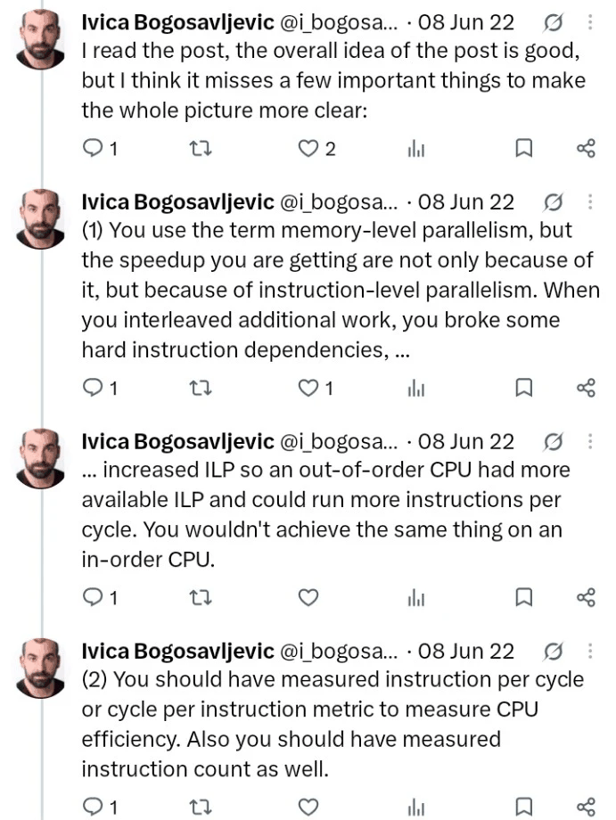
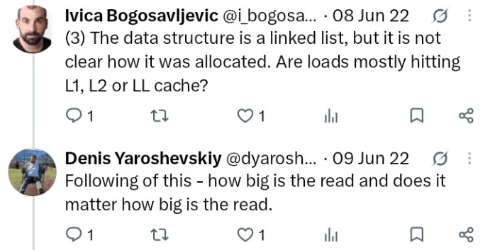
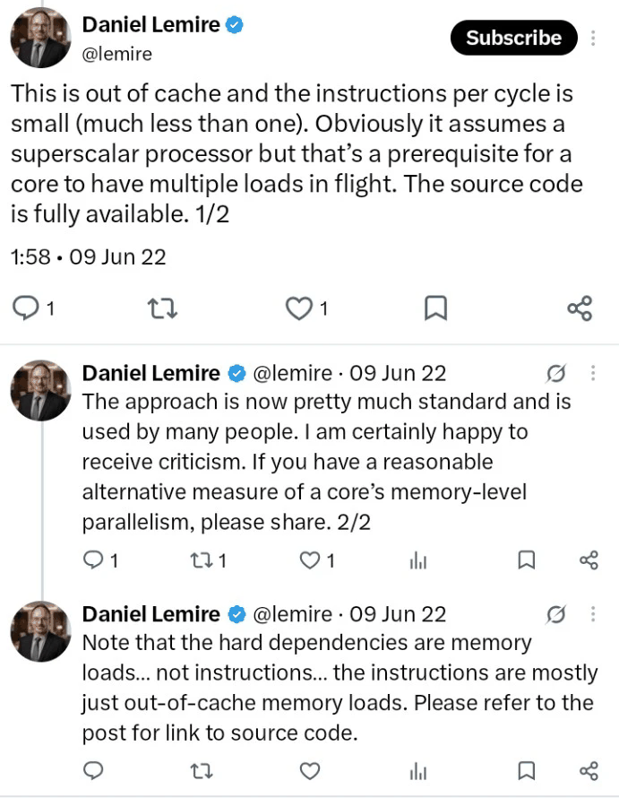

<div class="post-hero" markdown>

<div class="post-hero-text" markdown>

[mibz2 · Research blog](index.md)
{: .post-kicker }

# Memory-level parallelism in mibz2: instructions, overlap and evidence

What does interleaving independent pointer chases really demonstrate? A 2022 exchange about
Daniel Lemire's benchmark, read against mibz2's inverse-BWT walk.
{: .post-dek }

2 November 2026 · 33 min read · [Research synthesis](#12-where-this-leaves-the-instruction-work)
{: .post-meta }

</div>

<div class="post-hero-art"></div>

</div>

In June 2022 Daniel Lemire published [Memory-level parallelism: Intel Ice Lake versus Amazon
Graviton 3](https://lemire.me/blog/2022/06/07/memory-level-parallelism-intel-ice-lake-versus-amazon-graviton-3/).
His benchmark walks a large random array as a chain of dependent loads, then walks it as
several independent chains at once, and reads the speedup as a measure of how many memory
accesses a core can keep in flight.

Ivica Bogosavljevic replied that the speedup isn't only memory-level parallelism (MLP): by
interleaving work, the benchmark also raises instruction-level parallelism (ILP), and a
fuller account would report instructions per cycle, instruction counts and where the loads
are served from. Denis Yaroshevskiy asked how large each read is. Lemire answered that the
data is out of cache, that IPC is far below one, that the source is available, and that he
welcomes criticism and better measures.

The question matters to mibz2 because its inverse-BWT decoder works the same way: it
advances 32 independent traversals of one table so that their lookups overlap. Our recent
work has looked closely at the instructions in that loop. So we want to know what such a
speedup does and doesn't establish, and which measurements would tell the explanations apart.

One point first. Lemire isn't saying the benchmark can't be reviewed. In the replies below he
says the source is fully available, that he is happy to receive criticism, and asks for an
alternative measure. That is a defence of the benchmark's usefulness, not a claim that
scrutiny is impossible. A reviewer can ask for supporting measurements without having to
invent a replacement benchmark.

<figure class="bf-fig bf-shots">
<p class="bf-title">The exchange, June 2022</p>



<figcaption>Screenshots of the replies to Lemire's post, cropped to remove the phone's interface. Top: Ivica Bogosavljevic, 8 June 2022, agreeing with the overall idea, arguing that interleaving raises ILP, and asking for IPC or CPI and instruction counts. Middle: his question about allocation and cache level, and Denis Yaroshevskiy's about read size, 8–9 June 2022. Bottom: Lemire's two-part reply and his clarification, 9 June 2022. Fuller context: <a href="../assets/images/mlp-ilp/mlp-2022-thread-1.png">first excerpt</a>, <a href="../assets/images/mlp-ilp/mlp-2022-thread-2.png">second excerpt</a>.</figcaption>
</figure>

<details markdown>
<summary>Transcript of the screenshots</summary>

**Ivica Bogosavljevic**, 8 June 2022: I read the post, the overall idea of the post is good,
but I think it misses a few important things to make the whole picture more clear:

**Ivica Bogosavljevic**, 8 June 2022: (1) You use the term memory-level parallelism, but the
speedup you are getting are not only because of it, but because of instruction-level
parallelism. When you interleaved additional work, you broke some hard instruction
dependencies, …

**Ivica Bogosavljevic**, 8 June 2022: … increased ILP so an out-of-order CPU had more
available ILP and could run more instructions per cycle. You wouldn't achieve the same thing
on an in-order CPU.

**Ivica Bogosavljevic**, 8 June 2022: (2) You should have measured instruction per cycle or
cycle per instruction metric to measure CPU efficiency. Also you should have measured
instruction count as well.

**Ivica Bogosavljevic**, 8 June 2022: (3) The data structure is a linked list, but it is not
clear how it was allocated. Are loads mostly hitting L1, L2 or LL cache?

**Denis Yaroshevskiy**, 9 June 2022: Following of this - how big is the read and does it
matter how big is the read.

**Daniel Lemire**, 9 June 2022, 1:58: This is out of cache and the instructions per cycle is
small (much less than one). Obviously it assumes a superscalar processor but that's a
prerequisite for a core to have multiple loads in flight. The source code is fully
available. 1/2

**Daniel Lemire**, 9 June 2022: The approach is now pretty much standard and is used by many
people. I am certainly happy to receive criticism. If you have a reasonable alternative
measure of a core's memory-level parallelism, please share. 2/2

**Daniel Lemire**, 9 June 2022: Note that the hard dependencies are memory loads… not
instructions… the instructions are mostly just out-of-cache memory loads. Please refer to
the post for link to source code.

</details>

Here is what the rest of this post finds:

- ILP and MLP are connected mechanisms here. Treating them as rival explanations creates much
  of the apparent disagreement.
- The benchmark is useful, but its saturation point isn't a direct measurement of a hardware
  queue's capacity.
- Instruction count and IPC are valuable diagnostics, and neither is enough as an
  optimisation target.
- Our repository already holds the experiment a superficial answer would recommend: a large
  cut in instructions helped an isolated inverse-BWT walk, but gave essentially no measured
  throughput gain in the registered four-worker decoder test.
- Several similar-looking "MLP" numbers in our investigations measure different things.
  Their denominators matter.

The performance results below come from the cited experiments. This review adds no new
native benchmark of mibz2; what it adds is source inspection, reconstruction and
interpretation. A longer [companion page](2026-11-02-memory-level-parallelism-notes.md) holds
the detailed methodology, counter definitions and the full source register.

## 1. What the two sides are saying

Lemire's position, approximately:

> This loop spends most of its time waiting for dependent, long-latency memory loads. Giving
> it independent chains lets several requests overlap. Measuring the resulting throughput is
> a useful way to characterise memory-level parallelism.

Ivica's, approximately:

> Interleaving changes the instruction dependency structure too. To understand the
> improvement, show instruction counts, IPC and where the loads are served from.

Both contain something important. The questionable step is treating "more ILP" and "more
MLP" as separate contributions to the speedup. In this workload the causal sequence can be:

1. The program exposes independent load instructions.
2. The processor issues those loads before earlier ones finish.
3. Several memory requests overlap.
4. More useful traversals complete per second.

The instruction-level independence enables the memory-level overlap. Calling the first part
ILP and the second MLP doesn't mean two separately measurable speedups have happened. Work on
MLP studies exactly how the instruction window, scheduling, branches and other
instruction-side limits determine how much memory concurrency a core can achieve
([Chou, Fahs and Abraham, ISCA 2004](https://pages.cs.wisc.edu/~markhill/restricted/isca04_mlp.pdf)).

Here is how we'd assess the specific claims in the screenshots:

| Claim | Assessment |
| --- | --- |
| Interleaving increases available ILP. | Yes. Independent loads are independent instructions. |
| It "breaks" the hard dependencies. | Imprecise: the dependencies within each chain remain. The program supplies independent chains alongside them. |
| IPC and instruction count should be measured. | Sensible. They help characterise the change, but don't by themselves prove its cause. |
| Allocation and cache residency matter. | Yes. A random workload hitting L2 and one going to DRAM can give very different curves. |
| The dependencies are "memory loads, not instructions". | Loose: loads are instructions. The useful distinction is whether the critical delay is a memory access or ordinary computation. |
| Superscalar execution is a prerequisite for several outstanding loads. | Too strong as a general statement about processors. |
| An in-order processor can't benefit this way. | Also too strong. It depends on the design and on the order of the instructions. |

There is useful context on Ivica's side too. In a later article he shows interleaved
memory-access code that executes more instructions and still runs faster
([Johnny's Software Lab](https://johnnysswlab.com/instruction-level-parallelism-in-practice-speeding-up-memory-bound-programs-with-low-ilp/)).
His broader argument isn't "minimise instruction count at all costs"; it's that exposing
parallelism can justify extra instructions.

### Reviewing, reproducing and explaining are different questions

**Review:** can we inspect the algorithm, source, measurement method and interpretation? Yes.

**Historical reproduction:** can we recreate the exact 2022 executable, machine state, page
mappings, compiler output and run conditions? That needs more provenance than source code.

**Causal attribution:** does the observed speedup establish the mechanism claimed, and rule
out plausible alternatives? That needs suitable measurements or interventions.

Open source helps a great deal, but it doesn't settle all three. A fair assessment: the
benchmark is a legitimate way to characterise overlapping dependent traversals, and some of
the stronger readings of its output need more evidence.

## 2. Why one chain is slow and several help

Consider:

```c
for (size_t i = 0; i < count; ++i)
    p = next[p];
```

The next address depends on the value the current load returns:

```text
current index → load next index → compute next address → load next index
```

An out-of-order CPU can't issue the next ordinary demand load until it knows that address.
Register renaming can't remove a true producer–consumer dependency.

Now unroll the loop:

```c
p = next[p];
p = next[p];
p = next[p];
p = next[p];
```

That may cut loop-control overhead. It doesn't make the four loads independent. Compare four
states:

```c
p0 = next[p0];
p1 = next[p1];
p2 = next[p2];
p3 = next[p3];
```

Each lane still has a serial dependency from round to round. Within a round, though, the
four addresses can be available independently. That is the central transformation.

<figure class="bf-fig">
<p class="bf-title">Unrolling one chain, and interleaving four</p>
<svg viewBox="0 0 720 356" role="img" aria-label="Top: one chain unrolled into four loads, each joined by an arrow to the next. Bottom: four lanes over three rounds; each lane's loads are joined across rounds, but the lanes are not joined to each other, and the first round's four loads are highlighted."><text x="0" y="14" class="bf-ts">One chain, unrolled four times</text><rect x="0" y="28" width="150" height="34" rx="7" class="bf-cell"/><text x="75" y="50" class="bf-t" text-anchor="middle" style="font-family: var(--md-code-font-family); font-size: 12.5px">p = next[p]</text><path d="M154 45H172m-5-5 5 5-5 5" class="bf-arrow"/><rect x="176" y="28" width="150" height="34" rx="7" class="bf-cell"/><text x="251" y="50" class="bf-t" text-anchor="middle" style="font-family: var(--md-code-font-family); font-size: 12.5px">p = next[p]</text><path d="M330 45H348m-5-5 5 5-5 5" class="bf-arrow"/><rect x="352" y="28" width="150" height="34" rx="7" class="bf-cell"/><text x="427" y="50" class="bf-t" text-anchor="middle" style="font-family: var(--md-code-font-family); font-size: 12.5px">p = next[p]</text><path d="M506 45H524m-5-5 5 5-5 5" class="bf-arrow"/><rect x="528" y="28" width="150" height="34" rx="7" class="bf-cell"/><text x="603" y="50" class="bf-t" text-anchor="middle" style="font-family: var(--md-code-font-family); font-size: 12.5px">p = next[p]</text><text x="0" y="84" class="bf-tm">Each load’s address is the value the load before it returned.</text><text x="0" y="124" class="bf-ts">Four chains, interleaved</text><text x="149" y="146" class="bf-tm" text-anchor="middle">round 1</text><text x="361" y="146" class="bf-tm" text-anchor="middle">round 2</text><text x="573" y="146" class="bf-tm" text-anchor="middle">round 3</text><text x="0" y="177" class="bf-ts">lane 0</text><rect x="64" y="156" width="170" height="32" rx="7" class="bf-cell-hi"/><text x="149" y="177" class="bf-t" text-anchor="middle" style="font-family: var(--md-code-font-family); font-size: 12.5px">p0 = next[p0]</text><path d="M238 172H270m-5-5 5 5-5 5" class="bf-arrow"/><rect x="276" y="156" width="170" height="32" rx="7" class="bf-cell"/><text x="361" y="177" class="bf-t" text-anchor="middle" style="font-family: var(--md-code-font-family); font-size: 12.5px">p0 = next[p0]</text><path d="M450 172H482m-5-5 5 5-5 5" class="bf-arrow"/><rect x="488" y="156" width="170" height="32" rx="7" class="bf-cell"/><text x="573" y="177" class="bf-t" text-anchor="middle" style="font-family: var(--md-code-font-family); font-size: 12.5px">p0 = next[p0]</text><path d="M662 172H688m-5-5 5 5-5 5" class="bf-arrow"/><text x="712" y="177" class="bf-tm" text-anchor="end">…</text><text x="0" y="219" class="bf-ts">lane 1</text><rect x="64" y="198" width="170" height="32" rx="7" class="bf-cell-hi"/><text x="149" y="219" class="bf-t" text-anchor="middle" style="font-family: var(--md-code-font-family); font-size: 12.5px">p1 = next[p1]</text><path d="M238 214H270m-5-5 5 5-5 5" class="bf-arrow"/><rect x="276" y="198" width="170" height="32" rx="7" class="bf-cell"/><text x="361" y="219" class="bf-t" text-anchor="middle" style="font-family: var(--md-code-font-family); font-size: 12.5px">p1 = next[p1]</text><path d="M450 214H482m-5-5 5 5-5 5" class="bf-arrow"/><rect x="488" y="198" width="170" height="32" rx="7" class="bf-cell"/><text x="573" y="219" class="bf-t" text-anchor="middle" style="font-family: var(--md-code-font-family); font-size: 12.5px">p1 = next[p1]</text><path d="M662 214H688m-5-5 5 5-5 5" class="bf-arrow"/><text x="712" y="219" class="bf-tm" text-anchor="end">…</text><text x="0" y="261" class="bf-ts">lane 2</text><rect x="64" y="240" width="170" height="32" rx="7" class="bf-cell-hi"/><text x="149" y="261" class="bf-t" text-anchor="middle" style="font-family: var(--md-code-font-family); font-size: 12.5px">p2 = next[p2]</text><path d="M238 256H270m-5-5 5 5-5 5" class="bf-arrow"/><rect x="276" y="240" width="170" height="32" rx="7" class="bf-cell"/><text x="361" y="261" class="bf-t" text-anchor="middle" style="font-family: var(--md-code-font-family); font-size: 12.5px">p2 = next[p2]</text><path d="M450 256H482m-5-5 5 5-5 5" class="bf-arrow"/><rect x="488" y="240" width="170" height="32" rx="7" class="bf-cell"/><text x="573" y="261" class="bf-t" text-anchor="middle" style="font-family: var(--md-code-font-family); font-size: 12.5px">p2 = next[p2]</text><path d="M662 256H688m-5-5 5 5-5 5" class="bf-arrow"/><text x="712" y="261" class="bf-tm" text-anchor="end">…</text><text x="0" y="303" class="bf-ts">lane 3</text><rect x="64" y="282" width="170" height="32" rx="7" class="bf-cell-hi"/><text x="149" y="303" class="bf-t" text-anchor="middle" style="font-family: var(--md-code-font-family); font-size: 12.5px">p3 = next[p3]</text><path d="M238 298H270m-5-5 5 5-5 5" class="bf-arrow"/><rect x="276" y="282" width="170" height="32" rx="7" class="bf-cell"/><text x="361" y="303" class="bf-t" text-anchor="middle" style="font-family: var(--md-code-font-family); font-size: 12.5px">p3 = next[p3]</text><path d="M450 298H482m-5-5 5 5-5 5" class="bf-arrow"/><rect x="488" y="282" width="170" height="32" rx="7" class="bf-cell"/><text x="573" y="303" class="bf-t" text-anchor="middle" style="font-family: var(--md-code-font-family); font-size: 12.5px">p3 = next[p3]</text><path d="M662 298H688m-5-5 5 5-5 5" class="bf-arrow"/><text x="712" y="303" class="bf-tm" text-anchor="end">…</text><text x="0" y="346" class="bf-tm">Arrows join each lane’s rounds. No arrow joins one lane to another, so a round’s four addresses are known together.</text></svg>
<figcaption>A dependency diagram, not a timing trace: an arrow means "needs the result of". Unrolling lays one chain's loads out in the source, but each still waits for the last. Interleaving gives each round four loads whose addresses are known together. Whether they actually overlap depends on the processor and the memory system, and four lanes don't mean four cache misses.</figcaption>
</figure>

Two details matter for mibz2:

- A chain of integer indices is a pointer chase for performance purposes. It doesn't need
  language-level pointers.
- Independent traversal states can share one allocation. They don't need separately
  allocated lists.

So our inverse-BWT table belongs to this family of workloads.

### Latency and throughput are different quantities

Suppose, purely as an illustration, that a dependent access takes 80 ns, that each access
needs a 64-byte line not yet in cache, and that nothing else limits it yet:

| Configuration | Aggregate completion rate | Time per completed step |
| --- | ---: | ---: |
| One chain | 12.5 million steps/s | 80 ns |
| Eight perfectly overlapping chains | 100 million steps/s | 10 ns |

In the second case an individual request can still take 80 ns. Eight requests overlap, so one
completes every 10 ns on average.

At 3 GHz, 80 ns is 240 cycles. If each useful step retires three instructions:

$$
\mathrm{IPC}_{\text{1 chain}} \approx \frac{3}{240} = 0.0125
$$

With ideal eight-way overlap:

$$
\mathrm{IPC}_{\text{8 chains}} \approx 0.1
$$

That's an eightfold speedup with IPC still far below one. So Lemire's "IPC is much less than
one" is consistent with his reading. It doesn't establish that instruction execution
contributes nothing, or that another bottleneck can't appear as concurrency grows.

### Superscalar, out-of-order and nonblocking are distinct

| Property | Meaning |
| --- | --- |
| Superscalar issue | More than one instruction can start in a cycle. |
| Out-of-order issue | A later ready instruction can start before an earlier one that isn't ready. |
| Nonblocking memory machinery | Another memory operation can progress while an earlier miss is unresolved. |

A processor can issue one instruction per cycle and still keep several long-lived requests
outstanding across many cycles. There are concrete counterexamples to the universal claims in
the replies:

- Berkeley's original Rocket paper describes a single-issue, in-order pipeline with a
  nonblocking data cache that supports MLP
  ([Lee et al., ESSCIRC 2014](https://people.eecs.berkeley.edu/~krste/papers/eos18-esscirc2014.pdf)).
- Arm documents three outstanding data-cache misses on the in-order Cortex-A55, under
  particular pipeline-spacing conditions
  ([Cortex-A55 Software Optimization Guide](https://documentation-service.arm.com/static/5f1fe66bbb903e39c84d7d75)).

That doesn't mean an arbitrary in-order processor gets the same result as an aggressive
out-of-order core. Software ordering matters more there: if a dependent use blocks progress
before the next independent load is reached, the independence can't help. Out-of-order
execution usually makes available independence much easier to exploit; it isn't what defines
MLP.

## 3. What the 2022 benchmark measures

The original article reports approximately:

| Reported quantity | Ice Lake system | Graviton 3 system |
| --- | ---: | ---: |
| Single-lane access time | 90 ns | 120 ns |
| Peak implied bandwidth | 12 GB/s | 9 GB/s |
| Described simultaneous loads | about 25 | about 19 |

The stated environment is Ubuntu 22.04, GCC 11 and 4 KiB pages. These are measurements of
those configurations, not permanent limits attached to the processor names.

The public benchmark revision available before the article is
[`lemire/testingmlp` at `2356903`](https://github.com/lemire/testingmlp/tree/23569032cd784366247c0381e4d532c9a82f3263).
That establishes the historical public implementation. It doesn't prove the exact local
checkout or command line used for the post.

### The data structure is more specific than "a linked list"

The historical default uses:

- 33,554,432 `uint64_t` entries: 256 MiB;
- a random permutation forming one long cycle, built with Sattolo's algorithm;
- several traversal states starting at positions along that cycle;
- a second array used during setup, outside the timed traversal.

So it is an array-index pointer chase with several states, not a list of separately
allocated nodes. That matters for allocation, translation and cache-line sharing
([benchmark source](https://github.com/lemire/testingmlp/blob/23569032cd784366247c0381e4d532c9a82f3263/testingmlp.cpp)).

The [generator](https://github.com/lemire/testingmlp/blob/23569032cd784366247c0381e4d532c9a82f3263/gen.py)
emits a separate function for each lane count, with a local state variable for each lane. It
keeps the total useful access count approximately fixed:

$$
H(K) = K\left\lfloor \frac{H}{K} \right\rfloor
$$

Going from one lane to $K$ lanes changes the schedule of roughly the same work; it doesn't do
$K$ times as much.

The historical timing takes the fastest of five wall-clock trials. The code doesn't collect
instruction counts, actual CPU cycles, cache-source information, page walks or
memory-controller traffic.

### Its bandwidth is inferred, not measured DRAM traffic

The program multiplies logical accesses by 64 bytes per access and divides by elapsed time.
But the architectural load reads eight bytes. The 64-byte figure models a cache-line transfer
per access, and actual traffic can differ:

- a line may already be cached;
- several logical accesses can touch the same line;
- requests can merge;
- prefetching can generate or anticipate traffic;
- translation can add memory accesses of its own.

So the benchmark's bandwidth is an implied cache-line bandwidth under its model, not a
measurement at the memory controller. Likewise, its multi-lane ns/hit is

$$
\frac{\text{elapsed time}}{\text{aggregate completed accesses}}
$$

which is reciprocal aggregate throughput, not the service latency of one request.

### Its saturation point needs interpretation

The historical code looks for the point where another lane improves performance by less than
about 1%. A flattening curve could come from:

- a memory-request resource saturating;
- too little instruction-window space;
- load or address-generation throughput;
- translation limits;
- register spills as lanes are added;
- longer service latency under load;
- a bandwidth limit;
- noise around the chosen threshold.

The benchmark is useful because it gives a reproducible workload and a revealing curve. The
curve alone doesn't say which of these caused the plateau.

## 4. Four different things called MLP

This is probably the most important conceptual point for our own investigations.

| Quantity | What it asks |
| --- | --- |
| Available software independence | How many chains or tasks can advance independently? |
| Hardware capacity | How many entries does a particular queue or tracking structure have? |
| Achieved occupancy | How many qualifying requests are outstanding on average? |
| Effective speedup or saturation knee | How much faster does the workload run, or when does another lane stop helping? |

A program can have 32 active lanes without keeping 32 requests outstanding. A ten-entry
structure doesn't mean every measurement called "MLP" must peak at ten. An eightfold speedup
doesn't prove that eight DRAM requests were outstanding on average. And two processors with
the same measured occupancy can differ in throughput if their requests take different times
to service.

### Little's law connects them, under strict conditions

For a consistently measured population of requests over a suitable interval:

$$
\overline{N} = \lambda \overline{W}
$$

where $\overline{N}$ is the average number of outstanding requests, $\lambda$ the request
completion rate and $\overline{W}$ the average time a request is resident. If each matching
request transfers a line of $S$ bytes:

$$
\text{line bandwidth} \approx \frac{\overline{N} S}{\overline{W}}
$$

The hard part isn't the algebra but choosing matching quantities. A retired load, a
fill-buffer allocation, an L2-miss transaction and a DRAM read aren't necessarily the same
population. Nor is the latency of a serial, lightly loaded chain necessarily the latency in a
heavily loaded multi-chain test: queueing, where the line is found and prefetching can all
change it.

Higher occupancy can mean more useful requests are overlapping. It can also mean the requests
are taking longer.

### Why the smallest queue size isn't the answer

Suppose a request holds resource $j$ for $W_j$ seconds, the resource has $Q_j$ entries, and
each useful step needs $m_j$ such requests. Then:

$$
R \le \frac{Q_j}{m_j W_j}
$$

The time an entry is held matters as much as the number of entries. A small queue passed
through quickly can sustain more throughput than a large one whose entries stay occupied.

Travis Downs makes this point in the
[earlier discussion of the same benchmark](https://lemire.me/blog/2019/01/01/memory-level-parallelism-intel-skylake-versus-intel-cannonlake/):
the core, the uncore, the memory controller and the memory itself all affect the observed
limit, and the page configuration changes it too.

### Translation is part of the experiment

A 256 MiB array occupies 65,536 pages at 4 KiB, or 128 pages at 2 MiB: radically different
translation working sets. A TLB miss can need page-table accesses before the intended data
access can go ahead. The historical
[README](https://github.com/lemire/testingmlp/blob/23569032cd784366247c0381e4d532c9a82f3263/README.md)
already warns about this.

The code's `MADV_HUGEPAGE` request and the article's statement that the test used small pages
don't contradict each other. A huge-page request doesn't establish what backing the program
got: Linux can fall back to ordinary pages, and the actual mapping has to be checked
([Transparent Hugepage Support](https://docs.kernel.org/admin-guide/mm/transhuge.html)).

If the question is "how does this workload behave under the machine's normal configuration?",
translation is part of the answer. If it's "what is the core's data-request capacity apart
from translation?", translation needs to be controlled or measured separately.

### The question about read size is legitimate too

There are several granularities:

1. the operand an instruction loads;
2. the cache line transferred;
3. the useful payload consumed;
4. the page translated.

A four-byte lookup can need a 64-byte fill. A second nearby four-byte lookup may reuse that
line. A wider load may cost no extra fill, or may cross a line boundary. So "bytes the
instruction reads" and "bytes moved through memory" are different accounts. That distinction
matters for our packed `u32` navigation table.

## 5. Why instructions matter, and when counting them misleads

A simplified model:

$$
c_{\text{step}} \gtrsim \max\left( \frac{L_{\text{dep}}}{K},\ \frac{u}{P},\ \frac{b}{B} \right)
$$

where $L_{\text{dep}}$ is the recurrence latency in cycles, $K$ the number of effective
independent chains, $u$ the execution work per useful step, $P$ the sustainable execution
rate, $b$ the bytes transferred per useful step and $B$ the sustainable bandwidth in bytes
per cycle.

It's an optimistic aid to reasoning, not a calibrated model of a processor; real resource
limits need more detail than a single $P$. It does capture the transition that matters here.
With one chain, $L_{\text{dep}}/K$ may dominate, and removing bookkeeping that overlaps the
wait may do little. Adding independence lowers that latency-limited floor, until instruction
execution, address generation, traffic, translation or something else becomes the limit. At
that point, cutting instructions can become very valuable.

### Fewer instructions can help in several distinct ways

An instruction change may:

- shorten the dependency that produces the next address;
- reduce load/store or address-generation pressure;
- reduce front-end work;
- reduce register pressure and spills;
- fit more useful independent loads into the finite instruction window;
- reduce branch or bookkeeping overhead;
- change prefetch timing.

These are different mechanisms. The finite window is particularly relevant: even with many
independent chains in the source, the processor has to reach their loads before its tracking
resources fill. Removing intervening work can raise the MLP achieved without changing the
memory hierarchy's physical capacity. This interaction is central to the ISCA MLP work and
to [Cimple](https://people.csail.mit.edu/rinard/paper/pact18.pdf), whose subject is
exploiting instruction- and memory-level parallelism together.

### IPC is a ratio, not a score

Over the same interval:

$$
\mathrm{IPC} = \frac{I}{C}
\qquad\text{and}\qquad
\frac{C}{B} = \frac{I/B}{\mathrm{IPC}}
$$

where $B$ is useful output. A hypothetical change:

| Version | Instructions/byte | IPC | Cycles/byte |
| --- | ---: | ---: | ---: |
| A | 12 | 3.0 | 4.0 |
| B | 8 | 2.5 | 3.2 |

Version B uses 20% fewer cycles per byte despite lower IPC. Conversely, extra easy work can
raise IPC without raising useful throughput. The practical objective is closer to: minimise
elapsed time or CPU cycles per useful row or output byte, under the conditions that matter.
Instruction count and IPC explain parts of the result; neither substitutes for it.

A rule like "IPC below one means memory-bound, above one means instruction-bound" is too
crude. Intel's and Arm's methodologies use several categories and follow-up measurements
because one ratio can't establish the cause
([Intel's top-down method](https://www.intel.com/content/www/us/en/docs/vtune-profiler/cookbook/2024-0/top-down-microarchitecture-analysis-method.html)).

### Instructions aren't execution-resource demand

One instruction can expand into several back-end operations, and fusion can change some of
the accounting without removing all of the work. Two sequences with similar instruction
counts can put very different demands on load ports, store machinery, address generation or
the front end. So for our loop the useful questions are:

- Which instructions delay the next table address?
- Which consume the resource that currently limits us?
- Which make memory accesses just to maintain lane state?
- Which occupy the window while more useful loads wait to become visible?

Those discriminate better than "can I remove three instructions?"

### Normalise memory events to useful work too

Misses per thousand instructions can mislead during an instruction optimisation. Halve the
instructions while misses per output byte stay the same, and MPKI doubles: the memory work per
useful byte hasn't changed. We track misses and requests per BWT row or per final output byte
alongside instruction-normalised figures.

## 6. What mibz2's walk does

The source examined for this review is master at
[`13e9854`](https://github.com/lmmx/mibz2/tree/13e9854805eed8944ecdd7c9330e30971b6bf52d).
The README still describes an earlier 12-lane, 256-start configuration; the current
`Segmented` path dispatches to the room walk, with 32 lanes, 512 candidate starts and `PF_L1`
prefetching. Starts are deduplicated, and blocks below 65,536 rows take the serial path
([`src/bwt.rs`](https://github.com/lmmx/mibz2/blob/13e9854805eed8944ecdd7c9330e30971b6bf52d/src/bwt.rs)).

The ordinary step is approximately:

```rust
let q = t[lane.row];
lane.row = q >> 8;
prefetch(t, lane.row);
output_for_lane[offset] = q as u8;
```

This leaves out segment boundaries and the start flag, but captures the recurrence:

1. Load the packed table entry.
2. Extract the next row.
3. Start fetching it.
4. Emit the current byte.
5. Work on other lanes before coming back.

The room arrangement batches output writes using known spare capacity and a shared offset,
which avoids some per-byte pointer and capacity bookkeeping. The segments' outputs are then
assembled in final traversal order.

<figure class="bf-fig">
<p class="bf-title">The prefetch's lead time in the room walk</p>
<svg viewBox="0 0 720 230" role="img" aria-label="Lane 0 loads its entry, computes the next row, prefetches it and writes its byte; lanes 1, 2 and 3 then take their own steps before lane 0 loads the prefetched row. A bracket from the prefetch to lane 0's next load marks the lead time."><text x="100" y="16" class="bf-tm" text-anchor="middle">lane 0</text><rect x="0" y="26" width="200" height="104" rx="8" class="bf-slot"/><text x="14" y="50" class="bf-t" style="font-family: var(--md-code-font-family); font-size: 12.5px">q = t[row]</text><text x="14" y="72" class="bf-t" style="font-family: var(--md-code-font-family); font-size: 12.5px">row = q &gt;&gt; 8</text><text x="14" y="94" class="bf-t-green" style="font-family: var(--md-code-font-family); font-size: 12.5px">prefetch(t, row)</text><text x="14" y="116" class="bf-t" style="font-family: var(--md-code-font-family); font-size: 12.5px">out[i] = q as u8</text><text x="265" y="16" class="bf-tm" text-anchor="middle">lane 1</text><rect x="220" y="26" width="90" height="104" rx="8" class="bf-cell"/><text x="265" y="74" class="bf-t" text-anchor="middle">its own</text><text x="265" y="92" class="bf-t" text-anchor="middle">step</text><text x="375" y="16" class="bf-tm" text-anchor="middle">lane 2</text><rect x="330" y="26" width="90" height="104" rx="8" class="bf-cell"/><text x="375" y="74" class="bf-t" text-anchor="middle">its own</text><text x="375" y="92" class="bf-t" text-anchor="middle">step</text><text x="485" y="16" class="bf-tm" text-anchor="middle">lane 3</text><rect x="440" y="26" width="90" height="104" rx="8" class="bf-cell"/><text x="485" y="74" class="bf-t" text-anchor="middle">its own</text><text x="485" y="92" class="bf-t" text-anchor="middle">step</text><text x="630" y="16" class="bf-tm" text-anchor="middle">lane 0 again</text><rect x="550" y="26" width="160" height="104" rx="8" class="bf-slot"/><text x="564" y="72" class="bf-t" style="font-family: var(--md-code-font-family); font-size: 12.5px">q = t[row]</text><text x="564" y="96" class="bf-tm">the prefetched row</text><path d="M204 78H216m-5-5 5 5-5 5" class="bf-arrow"/><path d="M314 78H326m-5-5 5 5-5 5" class="bf-arrow"/><path d="M424 78H436m-5-5 5 5-5 5" class="bf-arrow"/><path d="M534 78H546m-5-5 5 5-5 5" class="bf-arrow"/><path d="M150 146V156H630V146" class="bf-icon-green"/><text x="390" y="178" class="bf-t-green" text-anchor="middle">the prefetch’s lead time: the work on lanes 1 to 3</text><path d="M0 204H706m-5-5 5 5-5 5" class="bf-arrow"/><text x="0" y="222" class="bf-tm">order of execution, not to scale</text></svg>
<figcaption>Execution order for four of the 32 lanes, with no durations. Once lane 0's entry arrives, its next row is known and the prefetch can start; the walk then serves the other lanes before coming back. That intervening work is the prefetch's lead time. If it's shorter than the memory latency, lane 0's next load still waits. The prefetch can't reach a second hop: that address isn't known until the next entry arrives.</figcaption>
</figure>

### Our table is very different from Lemire's array

A full 900,000-row table of `u32` entries is

$$
900{,}000 \times 4 = 3{,}600{,}000 \text{ bytes}
$$

That's 3.6 MB, against the historical benchmark's 256 MiB. On the i9 host in our records, it
is much larger than the private L2 but can fit in the shared L3, depending on other live data
and concurrent activity. A very large compressed input doesn't mean each table access goes to
DRAM: the stage's active working set is what matters. MLP can still help for accesses served
by the last-level cache or elsewhere beyond L1; we just need to say which boundary we mean.

### The prefetch changes how to read the counters

After `q` returns, the next row is known, and the prefetch can start that request while the
program serves other lanes. It can't discover arbitrary future links: the one after that is
still unknown until the next entry is read.

A prefetch can also leave the ordinary retirement path before its data arrives, which lets
the program keep memory work ahead of demand while still being limited by address discovery,
issue resources, translation and request queues. That has a consequence for measurement: a
demand load that hits in cache may be consuming a line whose expensive retrieval a prefetch
started earlier. Counting only demand loads that miss in L3 can leave out much of the
expensive traffic the walk causes.

### The BWT literature is directly relevant

Kärkkäinen, Kempa and Puglisi's
[Slashing the Time for BWT Inversion](https://www.cs.helsinki.fi/u/tpkarkka/publications/dcc2012.pdf)
studies both reducing costly accesses and overlapping the work of several starting
positions. It's a direct algorithmic antecedent of our problem, not an analogy with hash
tables or trees. It also points to two separate axes: make the existing accesses overlap
better, or change how much costly access work there is. It's worth keeping them apart when
deciding what an instruction optimisation is meant to achieve.

## 7. Our unrolling experiment

A generic answer might advise exposing more lanes or unrolling the loop. Our records already
go well beyond that.

### The 8.6 figure is a throughput factor

[The October 31 post](2026-10-31-room-walk-overlap.md) compares 38.55 cycles per byte for one
chain with 4.49 for the room walk:

$$
38.55 / 4.49 \approx 8.59
$$

That is a throughput ratio under that experiment's timing conventions, not a count of
outstanding requests, as the post itself says. A model assuming unchanged latency can turn
such a ratio into "effective chains", but prefetching, different instruction costs and
changed service conditions make that an approximation. All 32 lanes can do useful work even
if only some of them have a request outstanding at a given boundary at any instant.

### Then we cut the instruction stream substantially

The archived assembly comparison reports approximately:

| Static hot path, per ordinary lane step | Original | Unrolled |
| --- | ---: | ---: |
| Instructions | 16.4 | 10.44 |
| Loads | 3.0 | 3.06 |
| Stores | 2.03 | 2.16 |
| Prefetches | 1 | 1 |

The function grew to about 30 KB. These are static hot-path counts, not dynamic whole-decoder
instructions per output byte. They show that much bookkeeping disappeared while the demand
for memory operations didn't fall
([assembly-fidelity analysis](https://github.com/lmmx/mibz2/blob/270333c2d32fe16dc24ae7ab64f3697d87939418/docs/journal/2026-11-01-walk-unroll-astra-fidelity/README.md)).

On the recorded EPYC 7763 stage test, the time ratio of the unrolled walk to the original was

$$
0.877 \quad [0.863,\ 0.891]
$$

about a 12.3% time reduction, or roughly 14% more throughput at the point estimate. So an
instruction-stream transformation did materially help the isolated stage in that experiment.

### The target-machine decoder result was much smaller

The registered full-decoder test on the i9-10900K reported:

| Configuration | Throughput, unrolled ÷ original | Interval |
| --- | ---: | ---: |
| One worker | 1.017 | 1.006–1.028 |
| Four workers | 1.000 | 0.987–1.012 |

A control workload's CPU cost regressed. The registered verdict was negative, and the
decoder-level experiment was archived
([full-decoder results](https://github.com/lmmx/mibz2/blob/270333c2d32fe16dc24ae7ab64f3697d87939418/docs/journal/2026-11-01-walk-unroll-decoder-i9-10900K/results.md)).

This bears directly on the 2022 exchange: cutting instructions can improve a local
implementation and give little or nothing under the conditions that matter for the product.
The stage and full-decoder tests also ran on different processors, so together they aren't a
controlled measurement of one architectural variable.

### What is established, and what is still a hypothesis

Established:

- the transformation substantially cut the static instruction stream;
- it improved the recorded isolated stage;
- the registered four-worker decoder test showed no throughput improvement at the point
  estimate.

Not established:

- that total instruction count alone caused the isolated gain;
- that address-generation pressure caused the target-machine result;
- that memory bandwidth alone erased the gain;
- that the larger code caused a regression.

The archive proposes load and address-port pressure on Comet Lake as a plausible
explanation, and labels it a static model, which is the right status. The stronger next
question is: which resource reduction would help under the target conditions, beyond cutting
bookkeeping that may already overlap other work?

## 8. One worker against four

The corrected
[decoder-attribution analysis](https://github.com/lmmx/mibz2/blob/33e0e4ebac554bae03795bfb76e86440b33bae6b/docs/journal/2026-11-01-decoder-attribution-i9-10900K/analysis.md)
gives approximately these arithmetic means:

| Quantity | One worker | Four workers |
| --- | ---: | ---: |
| Retired instructions per final output byte | 32.63 | 33.06 |
| CPU cycles per final output byte | 13.46 | 17.51 |
| IPC, derived | 2.42 | 1.89 |
| CPU-seconds per GB | 2.707 | 3.579 |
| Effective frequency | about 4.97 GHz | about 4.89 GHz |

Retired work rises about 1.3%, cycle cost about 30% and CPU time about 32%. That makes a large
rise in retired instruction work a poor explanation of the efficiency loss: almost the same
retired work is taking substantially more cycles. It doesn't identify the cause, since cache
behaviour, request service time, speculation, synchronisation and the mix of phases can all
matter, but it narrows the search.

Both IPC values are above one, which shows again why an IPC threshold can't declare a
workload instruction-bound. And four workers can raise aggregate wall-clock throughput while
worsening CPU-seconds per GB: those are different objectives.

### The stage boundary matters

The [corrected proposal](https://github.com/lmmx/mibz2/blob/0156e1dad5ce4ebca78b4cb3d00276d3b6d64611/docs/journal/2026-11-01-bwt-memory-proposal.md)
separates two results:

- on 197 matched full-sized blocks, traversal plus assembly rises from 1.234 to 1.806 CPU ns
  per BWT row;
- across all 434 blocks, that interval adds about 0.61 CPU-seconds per GB of final decoded
  output.

These are different populations and denominators. The old trace also combines traversal and
assembly, so blaming the whole increase on pointer chasing would overstate it.

### Cache-capacity explanations need arithmetic and controls

Four maximum-sized tables occupy 14.4 MB before any other buffer. The host has a 20 MiB L3,
and the trace estimates fewer than four live tables on average. So "four workers necessarily
overflow L3 with their tables" isn't established; other live data, write traffic,
replacement behaviour and queueing can still make shared-memory interference important. And
the trace's association between longer walks and more overlapping walks is suggestive, not
conclusive, because a longer interval has more opportunity to overlap another. That's one
reason controlled interference experiments are useful, as
[the previous post](2026-11-01-inverse-bwt-memory-interference.md) describes.

## 9. Counters and their denominators

This is where we'd spend the most care in future analysis. Let:

- $O$ be an occupancy counter that adds the number of qualifying outstanding requests each
  cycle;
- $A$ the number of matching requests;
- $P$ the cycles with at least one matching request outstanding;
- $C$ all relevant cycles.

| Ratio | Units | Meaning |
| --- | --- | --- |
| $O/A$ | cycles per request | Average residence time |
| $O/P$ | requests | Average occupancy, given that a request is pending |
| $O/C$ | requests | Average occupancy over all measured cycles |

<figure class="bf-fig">
<p class="bf-title">One occupancy trace, three ratios</p>
<svg viewBox="0 0 720 270" role="img" aria-label="Two requests on a six-cycle timeline: A outstanding in cycles 1 to 3, B in cycles 2 to 4. Outstanding per cycle: 0, 1, 2, 2, 1, 0. O is 6, A is 2, P is 4, C is 6; O over A is 3 cycles per request, O over P is 1.5 requests, O over C is 1.0 request."><text x="185" y="14" class="bf-tm" text-anchor="middle">cycle 0</text><text x="275" y="14" class="bf-tm" text-anchor="middle">cycle 1</text><text x="365" y="14" class="bf-tm" text-anchor="middle">cycle 2</text><text x="455" y="14" class="bf-tm" text-anchor="middle">cycle 3</text><text x="545" y="14" class="bf-tm" text-anchor="middle">cycle 4</text><text x="635" y="14" class="bf-tm" text-anchor="middle">cycle 5</text><path d="M140 22V132" class="bf-grid"/><path d="M230 22V132" class="bf-grid"/><path d="M320 22V132" class="bf-grid"/><path d="M410 22V132" class="bf-grid"/><path d="M500 22V132" class="bf-grid"/><path d="M590 22V132" class="bf-grid"/><path d="M680 22V132" class="bf-grid"/><text x="0" y="46" class="bf-ts">request A</text><rect x="234" y="28" width="262" height="26" rx="6" class="bf-slot"/><text x="365" y="46" class="bf-t" text-anchor="middle">outstanding 3 cycles</text><text x="0" y="80" class="bf-ts">request B</text><rect x="324" y="62" width="262" height="26" rx="6" class="bf-cell-hi"/><text x="455" y="80" class="bf-t" text-anchor="middle">outstanding 3 cycles</text><text x="0" y="120" class="bf-ts">outstanding</text><rect x="144" y="100" width="82" height="28" rx="6" class="bf-cell"/><text x="185" y="119" class="bf-t-strong" text-anchor="middle">0</text><rect x="234" y="100" width="82" height="28" rx="6" class="bf-cell"/><text x="275" y="119" class="bf-t-strong" text-anchor="middle">1</text><rect x="324" y="100" width="82" height="28" rx="6" class="bf-cell"/><text x="365" y="119" class="bf-t-strong" text-anchor="middle">2</text><rect x="414" y="100" width="82" height="28" rx="6" class="bf-cell"/><text x="455" y="119" class="bf-t-strong" text-anchor="middle">2</text><rect x="504" y="100" width="82" height="28" rx="6" class="bf-cell"/><text x="545" y="119" class="bf-t-strong" text-anchor="middle">1</text><rect x="594" y="100" width="82" height="28" rx="6" class="bf-cell"/><text x="635" y="119" class="bf-t-strong" text-anchor="middle">0</text><path d="M0 148H720" class="bf-rule"/><text x="0" y="172" class="bf-t-strong">O = 6 request-cycles</text><text x="180" y="172" class="bf-t-strong">A = 2 requests</text><text x="360" y="172" class="bf-t-strong">P = 4 pending cycles</text><text x="540" y="172" class="bf-t-strong">C = 6 cycles</text><text x="0" y="206" class="bf-ts">O ÷ A = 3 cycles per request</text><text x="300" y="206" class="bf-t">how long a request stays outstanding</text><text x="0" y="234" class="bf-ts">O ÷ P = 1.5 requests</text><text x="300" y="234" class="bf-t">occupancy while anything is pending</text><text x="0" y="262" class="bf-ts">O ÷ C = 1.0 request</text><text x="300" y="262" class="bf-t">occupancy over the whole window</text></svg>
<figcaption>A made-up trace, not mibz2 data. Two requests, each outstanding for three cycles, fall inside a six-cycle window, so no boundary correction is needed. The two idle cycles count in C but not in P, which is why O/P and O/C differ.</figcaption>
</figure>

All three are useful, and they answer different questions. They are only valid if the
numerator and denominator cover the same requests, interval, privilege filters and hardware
scope, and short phase windows need care with requests already outstanding at the start or
still outstanding at the end.

### Why "MLP stayed at 2.18" settles nothing

Intel's derived MLP metric is

```text
L1D_PEND_MISS.PENDING / L1D_PEND_MISS.PENDING_CYCLES
```

which is conditional on cycles with a qualifying miss pending
([event definitions](https://github.com/intel/perfmon/blob/main/SKL/events/skylake_core.json),
[derived metrics](https://github.com/intel/perfmon/blob/main/SKL/metrics/skylake_metrics.json)).
In our archive the conditional value stays around 2.18 while the fraction of cycles with a
pending demand miss rises from about 12% to 30%. As an illustration:

$$
2.18 \times 0.12 \approx 0.26
\qquad
2.18 \times 0.30 \approx 0.65
$$

So an unchanged conditional average can sit beside a large rise in occupancy over all cycles.
The products are only illustrative; exact aggregation should use the matching raw totals.
The point is the denominator. There's a further limit: these are process-wide measurements,
so a change in how long the process spends in each phase also moves them. They aren't
automatically measurements of the inverse-BWT walk alone.

### The L1 event isn't "the number of independent BWT chains"

Intel's definition concerns demand-associated fill-buffer occupancy. A fill a prefetch
started can begin to count once a demand access joins it, and page-walk reads and split
accesses complicate the mapping to source-level loads. So this metric isn't the software lane
count, total prefetch concurrency, the number of DRAM reads or the number of chains making
progress. A lane count, a throughput ratio and this counter ratio should never be equated,
and some of the values we have quoted come from different experiments and processors.

### The offcore ratio is latency-like

For the relevant Intel event family,

```text
OFFCORE_REQUESTS_OUTSTANDING.ALL_DATA_RD / OFFCORE_REQUESTS.ALL_DATA_RD
```

has units of cycles per request. Its occupancy runs from an L2 miss until the transaction
completes at the superqueue boundary, and its population includes demand and prefetch
traffic and can include requests served by the LLC. It isn't automatically DRAM latency.

Our archived median rises from roughly 39 to 58 cycles per request (an arithmetic mean gives
about 41 to 58). That's consistent with a longer average residence for the counted
population. It doesn't prove that an unchanged set of useful BWT requests each became slower
by that amount: the source mix, the phase mix and the request mix can all change.

### Demand-only counts can't classify all the traffic

Suppose a prefetch starts fetching a line. Later, a demand access either finds the line in L1
or joins the fill still in flight. The demand event describes the eventual demand access, not
necessarily the whole history of the line. Likewise, `MEM_LOAD_RETIRED.FB_HIT` records a load
joining an existing fill; the request that started it could have been a demand or a
prefetch. It isn't a "prefetch supplied this fraction" counter.

That's why the corrected proposal withdraws two earlier readings:

1. the estimate that about 98% of walk traffic was prefetch, which came from comparing unlike
   event populations;
2. treating an inferred value of around six outstanding requests as directly measured,
   constant walk MLP. That figure combined an assumed number of requests per row, mixed
   process-wide residence data and stage timing, and their agreement was partly built in by
   the assumptions.

### Aggregating workers adds another distinction

Summing occupancy counts and cycle counts across threads, then dividing, gives a
cycle-weighted average per logical processor. It doesn't give the total number of requests
outstanding at once across the machine. An unweighted average of per-thread ratios, on the
other hand, can give short-lived or lightly loaded threads too much weight. Counter
arithmetic is part of the definition of the measurement, not a last step in a spreadsheet.

## 10. What the next experiment needs to distinguish

Our work is already past "try more lanes and see whether it gets faster". The next
experiments should tell specific explanations apart.

### Choose the objective explicitly

For the production decoder: wall-clock decoded throughput, CPU-seconds per GB, behaviour
across blocks, and memory footprint. For understanding the walk: actual cycles per BWT row,
nanoseconds per row, and requests, instructions and traffic per row. A stage improvement and
a decoder improvement are separate results, and both are worth recording.

### Isolate the phases without losing production behaviour

Measure table construction, traversal, segment assembly and the later output processing
separately, and keep the whole-decoder test. Use the production sequence of blocks and buffer
lifetimes: a prebuilt table traversed over and over can be much warmer than one met during
real decoding, and the surrounding phases may be what creates the shared-memory conditions
that slow the production walk.

### Keep the axes separate

These are distinct changes:

- more lanes within one core;
- more segment starts;
- a different prefetch policy;
- more worker threads;
- a different layout for lane state;
- different output-buffer lifetimes.

More lanes try to improve overlap within a core. More workers add cores, and also add
pressure on shared resources. Calling both "more parallelism" hides an important difference.

### Collect a small set of phase-matched measurements

| Measurement | What it helps answer |
| --- | --- |
| Actual cycles and ns per BWT row | Did useful service improve, and did the frequency change? |
| Retired instructions per row | Did dynamic instruction work fall? |
| Branch misses per row | Did recovery costs change? |
| Load/store and resource-pressure evidence | Did the change reduce the resource that matters? |
| Requests and supplier information per row | How much counted traffic is there, and where is it served? |
| Conditional occupancy | How many requests overlap when any is pending? |
| Pending-cycle fraction and unconditional occupancy | How much of the time is that activity going on? |
| Matching residence-time estimate | Are requests taking longer to finish? |
| Whole-decoder throughput and CPU cost | Does the change improve the actual program? |

No single row is a verdict. The combination should support or contradict a prediction.

### Write the predictions before reading the results

| Hypothesis | Result that would support it |
| --- | --- |
| Too few independent loads become visible | Better scheduling raises the useful request rate and cuts stage time, without extra traffic. |
| Lane bookkeeping consumes a limiting resource | A controlled layout or instruction change reduces that resource and the native stage cycles, with similar request behaviour. |
| Translation is significant | Verified mapping changes move page-walk activity and stage time together. |
| LLC residency deteriorates | Supplier and replacement evidence changes with a controlled live footprint. |
| Shared request service is congested | Residence time and slowdown respond to request pressure even with the footprint controlled. |
| Output traffic interferes with traversal | A targeted change to output lifetime or write traffic improves the affected stage and the production decoder. |

None of these interventions is pure. Changing instructions changes request timing; changing
page size can change placement; changing traffic changes queueing. The experiment should
record those consequences rather than assume them away.

### Respect what the existing harnesses measure

[`examples/sweep.rs`](https://github.com/lmmx/mibz2/blob/13e9854805eed8944ecdd7c9330e30971b6bf52d/examples/sweep.rs)
already explores lane counts, prefetch hints and walker variants, keeps decode order, and has
an optional separate PMU pass. Two normalisations need keeping in view:

- the sweep's byte denominator is BWT rows, while
  [`examples/phases.rs`](https://github.com/lmmx/mibz2/blob/13e9854805eed8944ecdd7c9330e30971b6bf52d/examples/phases.rs)
  uses final decoded output;
- both report c/B by converting elapsed seconds with a supplied nominal clock, which isn't an
  actual CPU-cycle count.

A fixed nominal multiplier cancels in a time ratio, so comparisons remain useful. Those values
just shouldn't be mixed with PMU cycles, or across different byte definitions.

### Use counters in small, meaningful groups

For phase measurements, use matching intervals and filters, keep the enabled and running
times, and quantify the instrumentation's own cost. Avoid collecting so many events at once
that multiplexing makes short, changing phases hard to read. If you take interval deltas with
`perf_event_open`, handle the time-accounting baselines as well as the counter baselines:
resetting the counts doesn't reset all the timing metadata
([perf-stat](https://man7.org/linux/man-pages/man1/perf-stat.1.html),
[perf_event_open](https://man7.org/linux/man-pages/man2/perf_event_open.2.html)).

The next experiment should fill a specific gap, such as phase-specific request populations or
actual traversal cycles, rather than reopen the already-negative unrolling experiment without
a new hypothesis.

## 11. What the tools can and can't establish

**Disassembly** is essential for instruction questions. It shows whether independent loads
stay visible, whether lane state is reloaded, whether bounds checks or spills remain, whether
the intended simplification happened, and where code grew. It can't show the cache residency
or service time a run experiences. Keep the binary that produced the measured result: a small
source change can alter register allocation well beyond the lines you meant to change.

**LLVM-MCA** helps investigate dependencies and execution-resource pressure. Its
documentation limits its memory model explicitly: it doesn't predict a workload's actual cache
behaviour, and its default load latencies are optimistic
([llvm-mca](https://llvm.org/docs/CommandGuide/llvm-mca.html)). "This sequence creates
address-port pressure under this model" can be useful. "This proves the production walk has
reached its real MLP limit" isn't justified, and neither is "this proves the prefetch arrives
in time". Treat it as a source of candidate explanations and lower bounds.

**Cachegrind**'s reproducible instruction counts make instruction regressions easier to catch,
but its manual cautions that the cache and branch simulations are basic
([Cachegrind](https://valgrind.org/docs/manual/cg-manual.html)). A deterministic
instruction-count improvement is real evidence of less work executed under that tool. It isn't
a measurement of native out-of-order overlap, prefetch timeliness or contention.

**Hardware counters** observe defined events; they don't label causes. The CPU model, the
event definition, filtering and errata all matter, and Intel and Arm events with similar names
needn't count equivalent things. For Neoverse V1, Arm's own
[performance-analysis methodology](https://armkeil.blob.core.windows.net/developer/Files/pdf/white-paper/neoverse-v1-core-performance-analysis.pdf)
is the right reference, not Intel's formulas. And stall events can overlap, so several of them
can't simply be added into an exclusive account of elapsed time.

## 12. Where this leaves the instruction work

Keep inspecting instructions: our evidence supports it. The isolated unrolling result shows
that changing the instruction stream can materially improve the walk. But the evidence also
supports a more specific objective than cutting instruction count:

> Find the dependency or resource that limits useful rows per cycle under the production
> workload, then change the instructions, state layout or memory traffic that consume it.

For the four-worker decoder, the strongest current observation is that roughly the same
retired work takes substantially more cycles. The open task is to attribute that increase
across traversal, assembly, request service and the interaction with the other workers.

Lemire's benchmark explains why independently advancing chains are valuable. It doesn't give
us a universal concurrency number to aim for, prove that our 32-lane walker is saturated for
the same reason, or settle whether the next profitable change is in bookkeeping, address
generation, cache behaviour or traffic. Our own controlled results and their corrections are
now the more specific evidence. The next step is to make those measurements phase-specific
and consistent in their populations, with the complete decoder still the test of whether an
optimisation earns its place.

## Further reading

**[Slashing the Time for BWT Inversion](https://www.cs.helsinki.fi/u/tpkarkka/publications/dcc2012.pdf)**,
Kärkkäinen, Kempa and Puglisi, DCC 2012. Start here for the algorithm itself: it covers
reducing costly accesses and overlapping inversions from several starting positions, which
helps separate how much expensive work there is from how it's scheduled.

**[Microarchitecture Optimizations for Exploiting Memory-Level Parallelism](https://pages.cs.wisc.edu/~markhill/restricted/isca04_mlp.pdf)**,
Chou, Fahs and Abraham, ISCA 2004. Why finite instruction windows, execution structure,
branches and other microarchitectural limits bound the memory overlap a core can expose: a
firmer basis than treating MLP as a cache parameter.

**[Asynchronous Memory Access Chaining](https://www.vldb.org/pvldb/vol9/p252-kocberber.pdf)**,
Kocberber, Falsafi and Grot, PVLDB 2015. Suspended memory-bound tasks, uneven progress and the
cost of scheduling them: the trade-off between keeping useful requests in flight and paying
to manage their state. Its speedups aren't predictions for BWT.

**[Cimple: Instruction and Memory Level Parallelism](https://people.csail.mit.edu/rinard/paper/pact18.pdf)**,
Kiriansky et al., PACT 2018. The clearest treatment of ILP and MLP as working together rather
than as competing explanations, including the limits from intervening instructions and
execution windows.

**[Travis Downs on the earlier benchmark](https://lemire.me/blog/2019/01/01/memory-level-parallelism-intel-skylake-versus-intel-cannonlake/)**.
The measurement complications for this same benchmark family: several resources along the
path, different occupancy times, and translation.

**Intel's [event](https://github.com/intel/perfmon/blob/main/SKL/events/skylake_core.json)
and [metric](https://github.com/intel/perfmon/blob/main/SKL/metrics/skylake_metrics.json)
definitions.** For the i9 investigations, the authority on what each ratio counts. Reading the
exact numerator and denominator is worth more than any secondary article's name for a metric.

---

**Research records:** [Measurement notes and source register](2026-11-02-memory-level-parallelism-notes.md) · [Unrolled walk: assembly comparison](https://github.com/lmmx/mibz2/blob/270333c2d32fe16dc24ae7ab64f3697d87939418/docs/journal/2026-11-01-walk-unroll-astra-fidelity/README.md) · [Unrolled walk: i9 full-decoder results](https://github.com/lmmx/mibz2/blob/270333c2d32fe16dc24ae7ab64f3697d87939418/docs/journal/2026-11-01-walk-unroll-decoder-i9-10900K/results.md) · [Decoder attribution on the i9](https://github.com/lmmx/mibz2/blob/33e0e4ebac554bae03795bfb76e86440b33bae6b/docs/journal/2026-11-01-decoder-attribution-i9-10900K/analysis.md) · [Inverse-BWT memory proposal, with corrections](https://github.com/lmmx/mibz2/blob/0156e1dad5ce4ebca78b4cb3d00276d3b6d64611/docs/journal/2026-11-01-bwt-memory-proposal.md).
