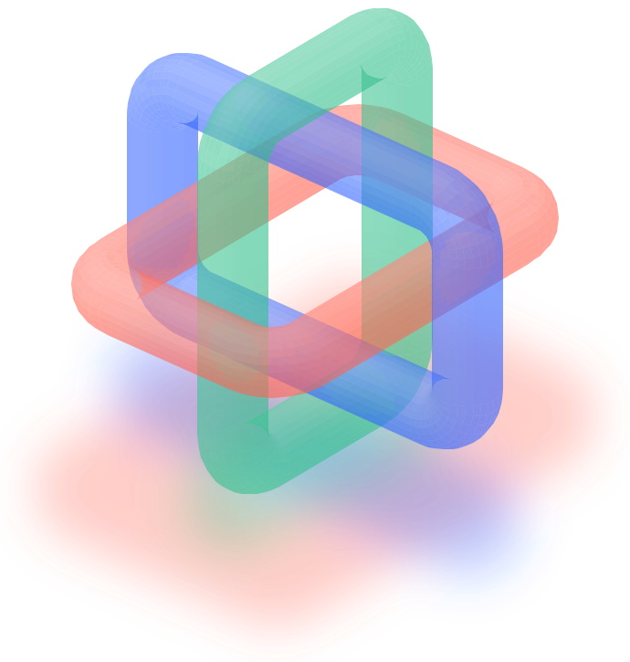

[mibz2 · Research blog](index.md)
{: .post-kicker }

# Playing the hand you're dealt: in conversation with Thomas Murphy

A discussion of the mibz2 swarm, and why the Hutter Prize has it backwards: it rewards whoever stacks the deck best, when real data deals you the hand.
{: .post-dek }

22 November 2026 · 15 min read · [Meta](#compendium)
{: .post-meta }

--8<-- "docs/conversations/2026-11-22-thomas-murphy.inline.html"
