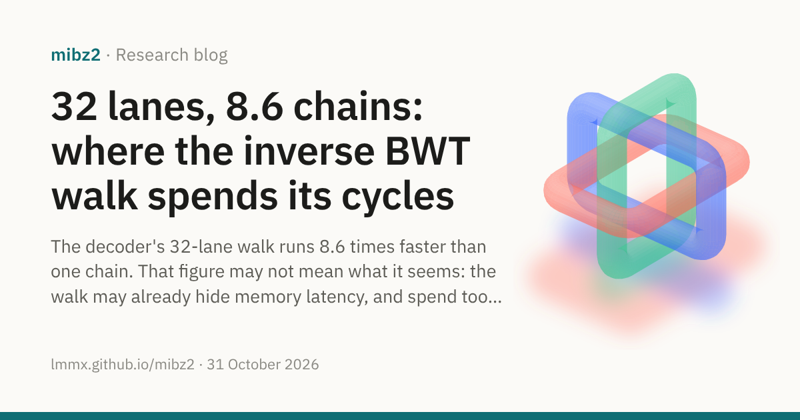
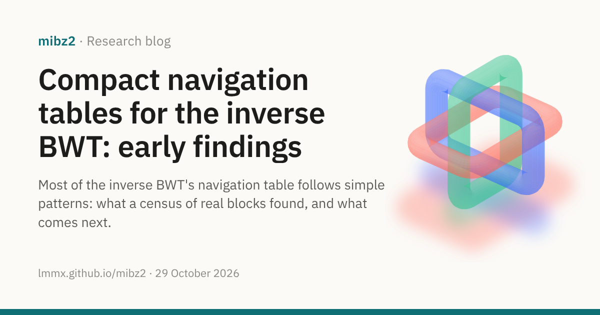

# Blog

What mibz2's experiments are finding, and where they go next. The evidence behind each
post is in the [journals](../background/journals.md) and the pull requests they link.

<a class="post-card" href="2026-10-31-room-walk-overlap.md">31 October 2026 · Open question32 lanes, 8.6 chains: where the inverse BWT walk spends its cyclesThe decoder's 32-lane walk runs 8.6 times faster than one chain. That figure may not mean what it seems: the walk may already hide memory latency, and spend too many instructions on each byte.</a>
<a class="post-card" href="2026-10-29-compact-navigation-tables.md">29 October 2026 · Work in progressCompact navigation tables for the inverse BWT: early findingsMost of the inverse BWT's navigation table follows simple patterns: what a census of real blocks found, and what comes next.</a>

