# Blog

What mibz2's experiments are finding, and where they go next. The evidence behind each
post is in the [journals](../background/journals.md) and the pull requests they link.

<a class="post-card" href="2026-11-12-rauzy-technical-companion.md">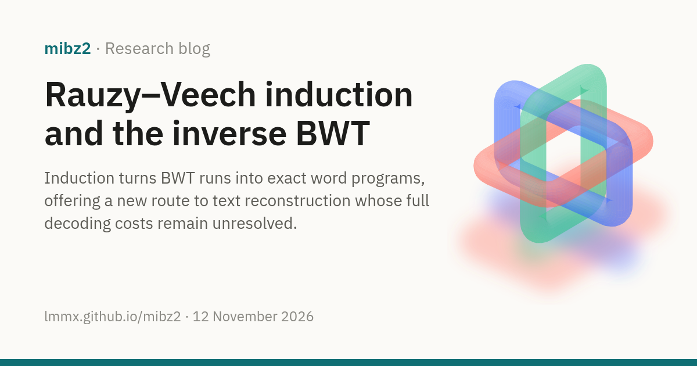12 November 2026 · Research in progressReconstructing text from compact programsThis technical companion traces how compact word programs reconstruct text from the BWT, including the costs and limits of building and expanding them.</a>
<a class="post-card" href="2026-11-10-rauzy-veech-reconstruction.md">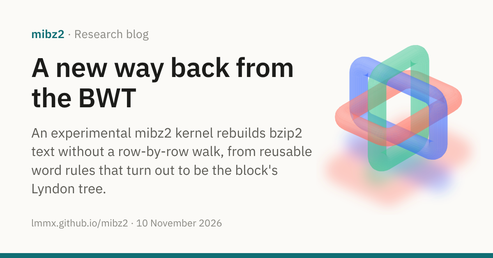10 November 2026 · Research in progressA new way back from the BWTAn experimental mibz2 kernel rebuilds bzip2 text without a row-by-row walk, from reusable word rules that form the block's Lyndon tree.</a>
<a class="post-card" href="2026-11-09-pit-crew-service-threads.md">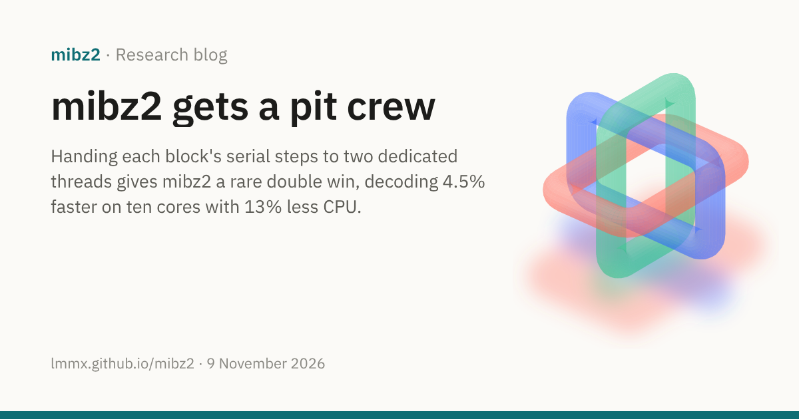9 November 2026 · Research in progressmibz2 gets a pit crewHanding each block's serial steps to two dedicated threads gives mibz2 a rare double win, decoding 4.5% faster on ten cores with 13% less CPU.</a>
<a class="post-card" href="2026-11-08-bwt-runs-from-mtf-codes.md">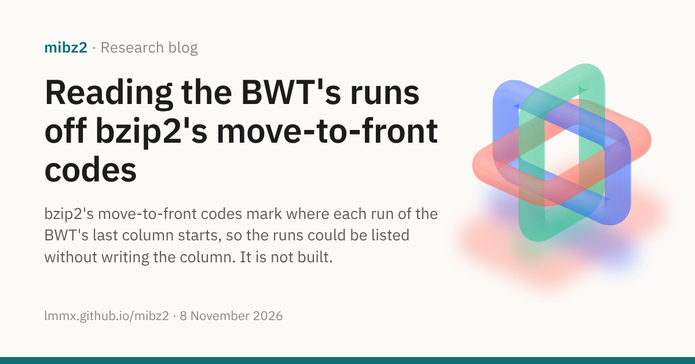8 November 2026 · Open questionReading the BWT's runs off bzip2's move-to-front codesbzip2's move-to-front codes mark where each run of the BWT's last column starts, so the runs could be listed without writing the column. It is not built.</a>
<a class="post-card" href="2026-11-08-inverse-bwt-navigation.md">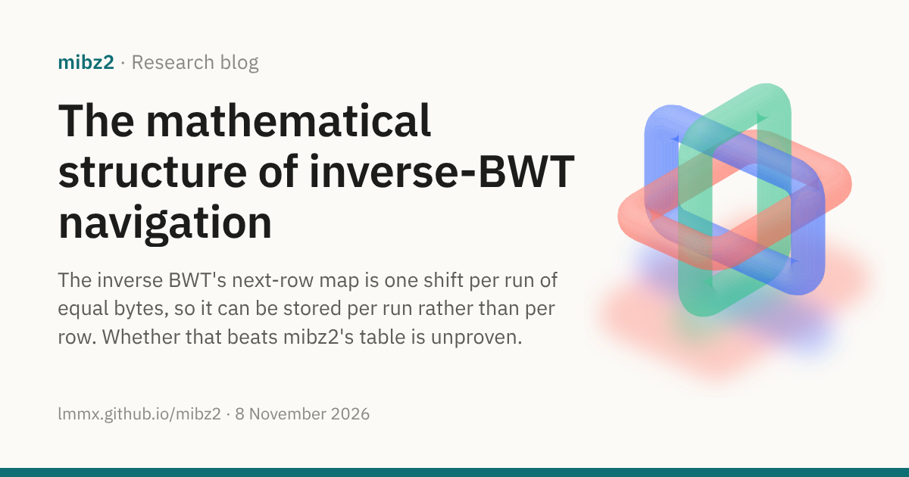8 November 2026 · Open questionThe mathematical structure of inverse-BWT navigationThe inverse BWT's next-row map is one shift per run of equal bytes, so it can be stored per run rather than per row. Whether that beats mibz2's table is unproven.</a>
<a class="post-card" href="2026-11-07-pipelined-teams.md">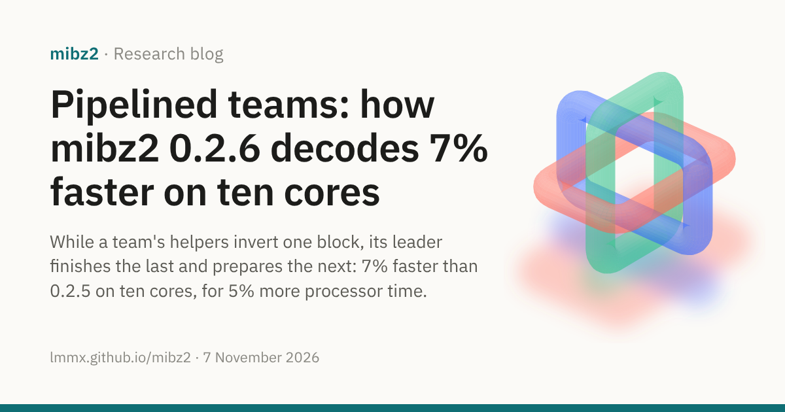7 November 2026 · Research resultPipelined teams: how mibz2 0.2.6 decodes 7% faster on ten coresWhile a team's helpers invert one block, its leader finishes the last and prepares the next: 7% faster than 0.2.5 on ten cores, for 5% more processor time.</a>
<a class="post-card" href="2026-11-07-why-mibz2-stops-scaling.md">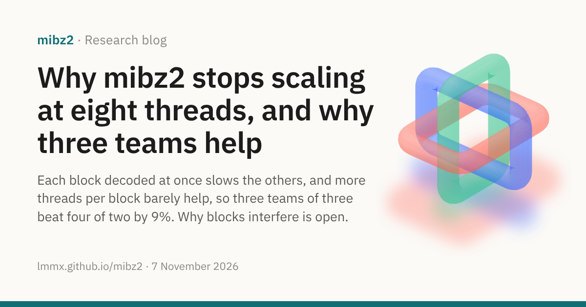7 November 2026 · Research in progressWhy mibz2 stops scaling at eight threads, and why three teams helpEach block decoded at once slows the others, and more threads per block barely help, so three teams of three beat four of two by 9%. Why blocks interfere is open.</a>
<a class="post-card" href="2026-11-05-huffman-bit-buffer.md">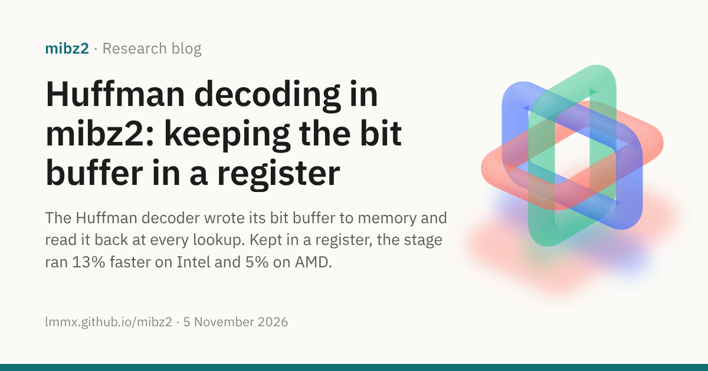5 November 2026 · Research resultHuffman decoding in mibz2: keeping the bit buffer in a registerThe Huffman decoder wrote its bit buffer to memory and read it back at every lookup. Kept in a register, the stage ran 13% faster on Intel and 5% on AMD.</a>
<a class="post-card" href="2026-11-04-autonomous-agent-team.md">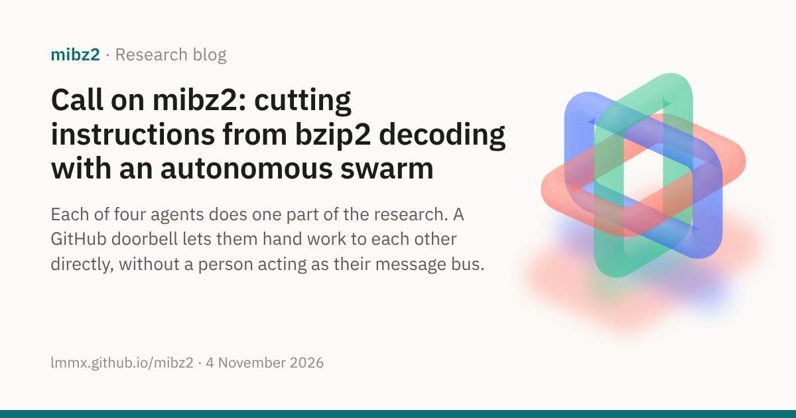4 November 2026 · MetaCall on mibz2: cutting instructions from bzip2 decoding with an autonomous swarmEach of four agents does one part of the research. A GitHub doorbell lets them hand work to each other directly, without me acting as their message bus.</a>
<a class="post-card" href="2026-11-04-compact30-constructor.md">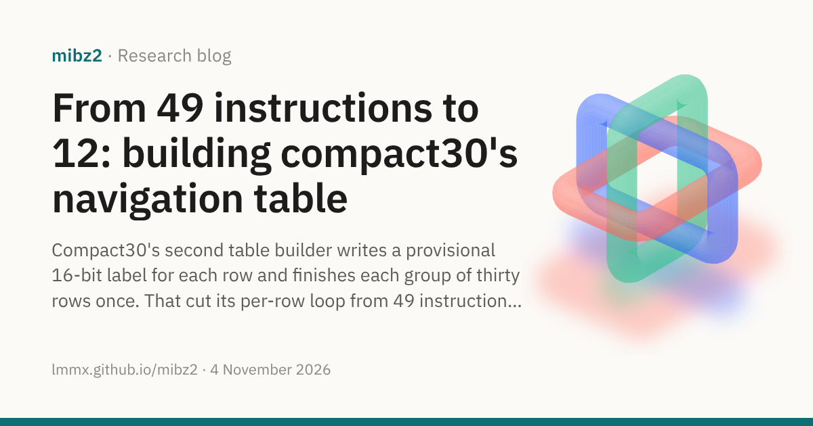4 November 2026 · Research in progressBuilding a smaller bzip2 decoding table: from 49 instructions to 12Writing a cheap placeholder for each row, and finishing each 30-row group once, shrank the inner loop. It still builds too slowly.</a>
<a class="post-card" href="2026-11-02-revisiting-space-time-tradeoff-bwt-inversion.md">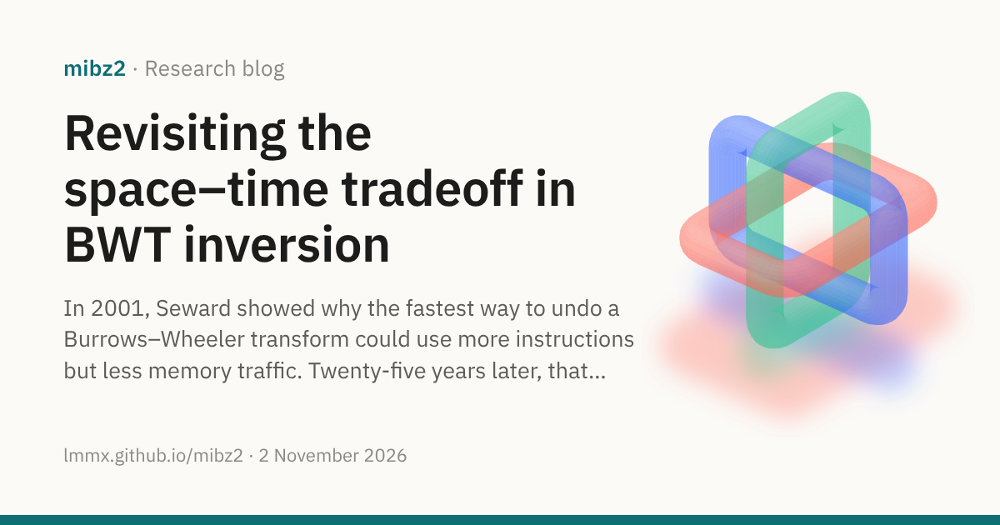2 November 2026 · Research resultRevisiting the space–time tradeoff in BWT inversionA packed table saved memory but cost too much to read. A cheaper compact lookup gives the first positive traversal result.</a>
<a class="post-card" href="2026-11-02-memory-level-parallelism.md">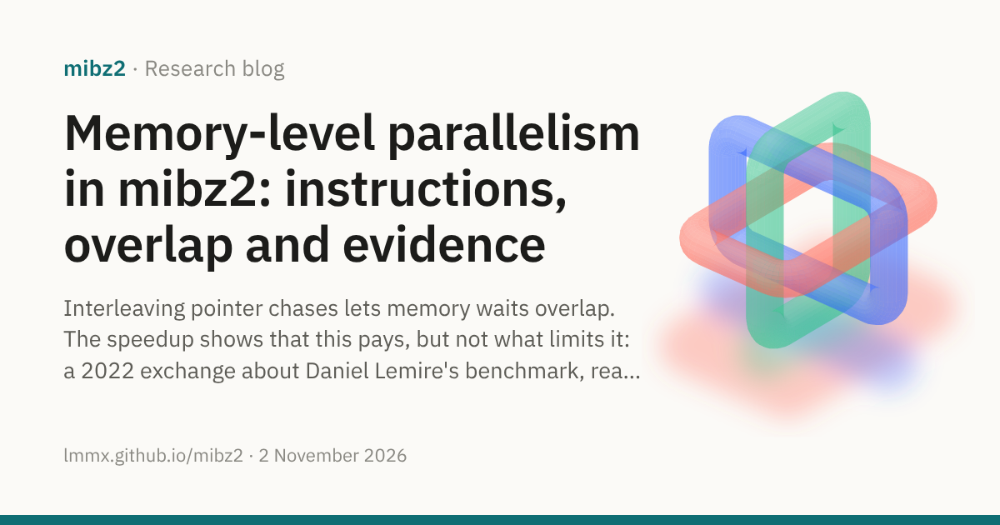2 November 2026 · Research synthesisMemory-level parallelism in mibz2: instructions, overlap and evidenceInterleaving pointer chases lets memory waits overlap. The speedup shows that this pays, but not what limits it: a 2022 exchange about Daniel Lemire's benchmark, read against mibz2's inverse-BWT walk.</a>
<a class="post-card" href="2026-11-01-inverse-bwt-memory-interference.md">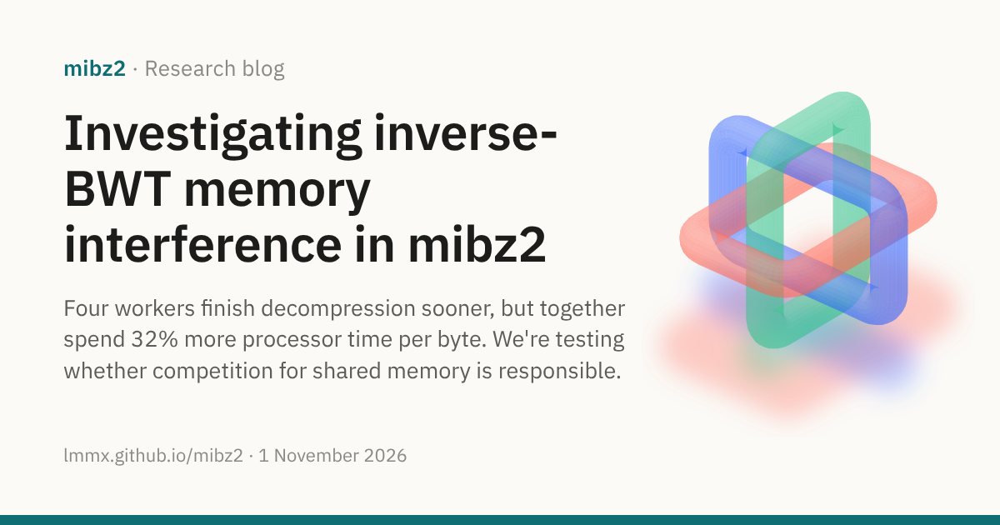1 November 2026 · Research in progressInvestigating inverse-BWT memory interference in mibz2Four workers finish decompression sooner, but together spend 32% more processor time per byte. We're testing whether competition for shared memory is responsible.</a>
<a class="post-card" href="2026-11-01-block-dispatch.md">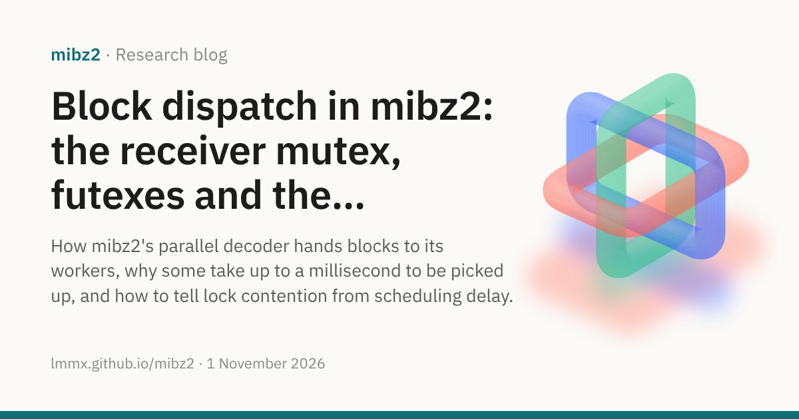1 November 2026 · Investigation in progressBlock dispatch in mibz2: mutexes, futexes and the schedulerHow mibz2's parallel decoder hands blocks to its workers, why some take up to a millisecond to be picked up, and how to tell lock contention from scheduling delay.</a>
<a class="post-card" href="2026-10-31-room-walk-overlap.md">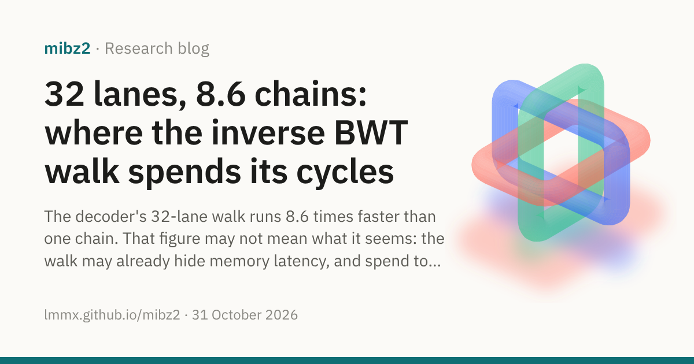31 October 2026 · Open question32 lanes, 8.6 chains: where the inverse BWT walk spends its cyclesThe decoder's 32-lane walk runs 8.6 times faster than one chain. That figure may not mean what it seems: the walk may already hide memory latency, and spend too many instructions on each byte.</a>
<a class="post-card" href="2026-10-29-compact-navigation-tables.md">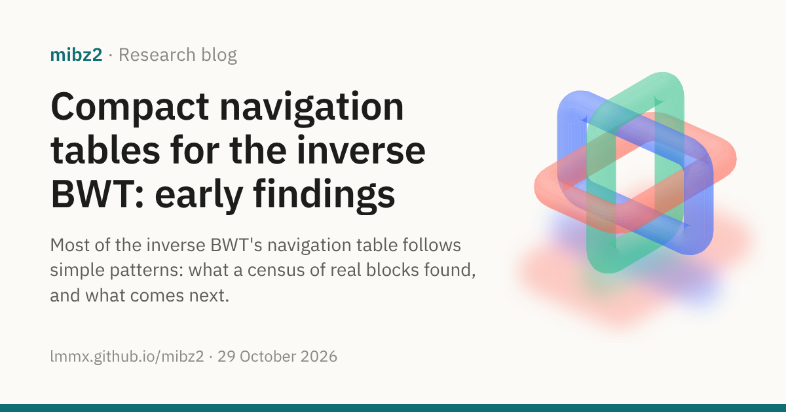29 October 2026 · Work in progressCompact navigation tables for the inverse BWT: early findingsMost of the inverse BWT's navigation table follows simple patterns: what a census of real blocks found, and what comes next.</a>

